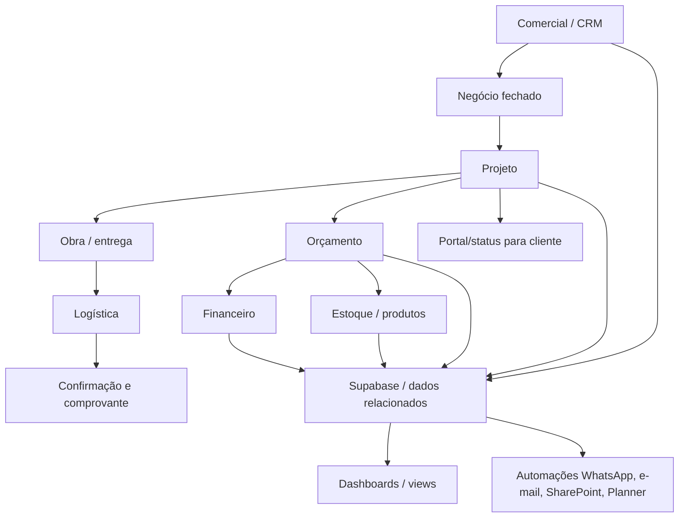
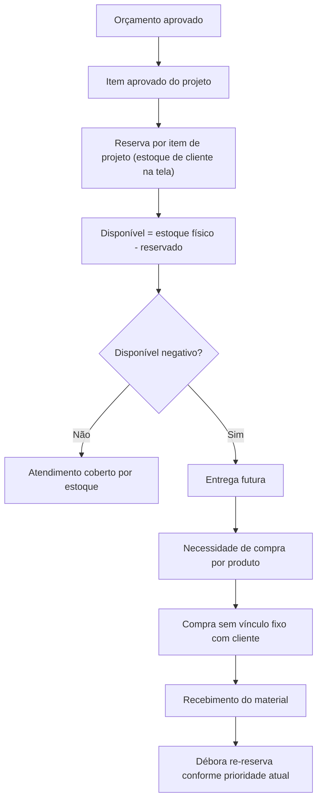
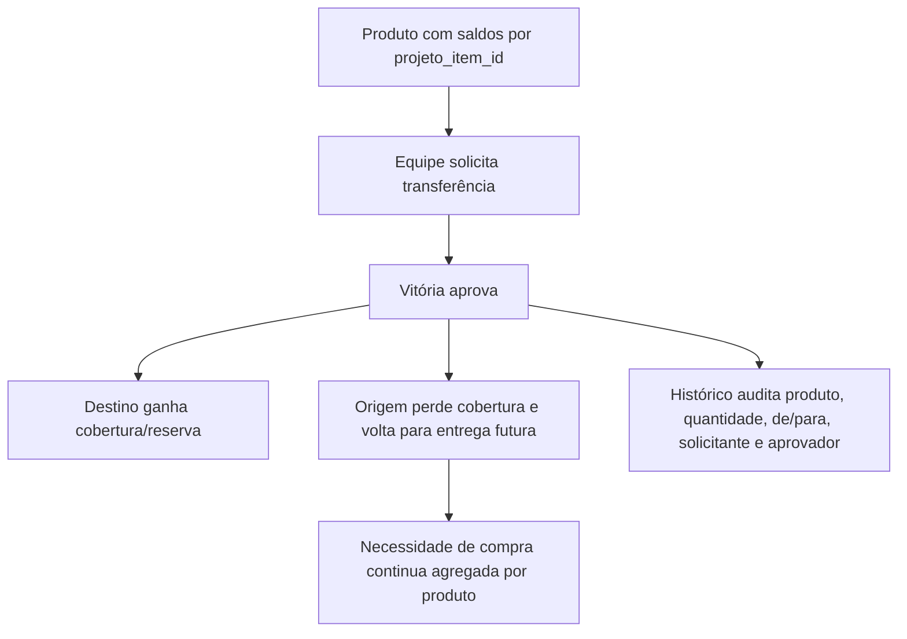

# Fluxos Consolidados das Reuniões Lucenera

Este arquivo consolida os principais fluxos recorrentes identificados nas 8 reuniões. Para detalhes e fonte, consulte o `03_fluxos_encontrados.md` de cada pasta.

## Mapa macro

## Frentes recorrentes

- Dados e Supabase: normalização, IDs, canônicos, views, validações e relacionamento entre tabelas.
- Logística: separação, roteirização, confirmação de entrega, comprovante e comunicação com projetistas/obra.
- Financeiro: histórico do Connect, contas a pagar/receber, parcelas, dashboards e prevenção de duplicidade.
- Projetos: criação de projeto após venda, fichas técnicas, apresentações, CAD/AutoCAD e portal do cliente.
- Automação: WhatsApp, Teams, SharePoint, Planner, Edge Functions, n8n, Skip, VS Code/IA e Python/Vercel.
- Estoque/Compras: saldos por item de projeto, reserva por projeto/cliente como visualização, entrega futura, transferência de reserva, necessidade de compra agregada por produto e re-reserva quando material chega.

## Fluxo consolidado de estoque, reserva e compra

## Fluxo consolidado de transferência de reserva

