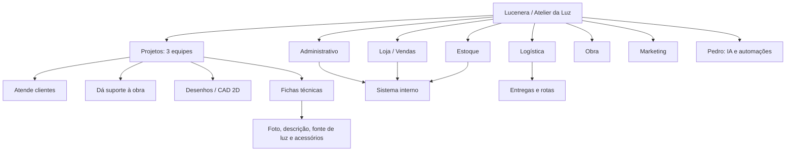
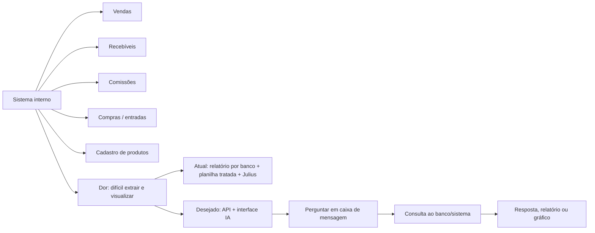
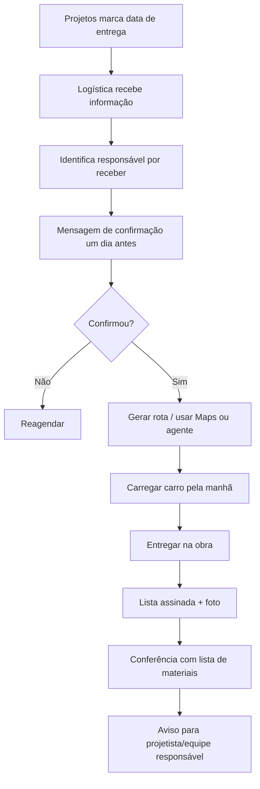

# Fluxos encontrados

- Reunião: 01. Lucenera (Filippo) - 03.12.2025: Mapeamento inicial de áreas e dores de automação
- Data: 2025-12-03
- Horário: 15:30
- Duração aproximada: 01:20:13
- Link tl;dv: https://tldv.io/app/meetings/6930819fceb9ed00139eb6b5
- Fonte: transcrição e metadados retornados pela API do tl;dv.

## Observação

Os fluxos abaixo foram extraídos da transcrição desta reunião. Quando um ponto foi citado como intenção ou desenho futuro, ele está representado como fluxo desejado, não como processo já implementado.

## Fluxo 1 - Estrutura interna mapeada na reunião

## Fluxo 2 - Dados e relatórios desejados

## Fluxo 3 - Entrega desejada

