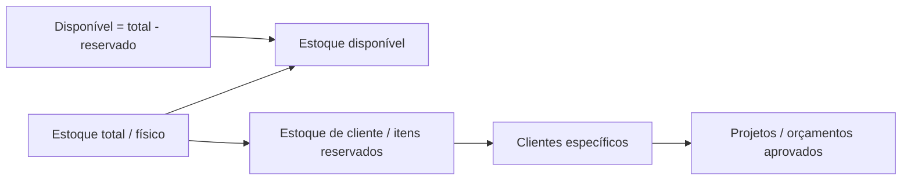
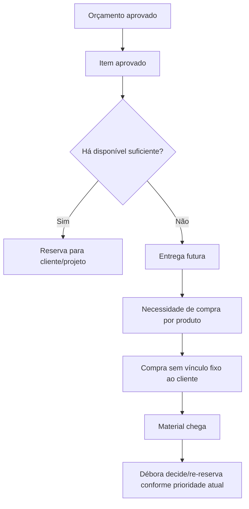
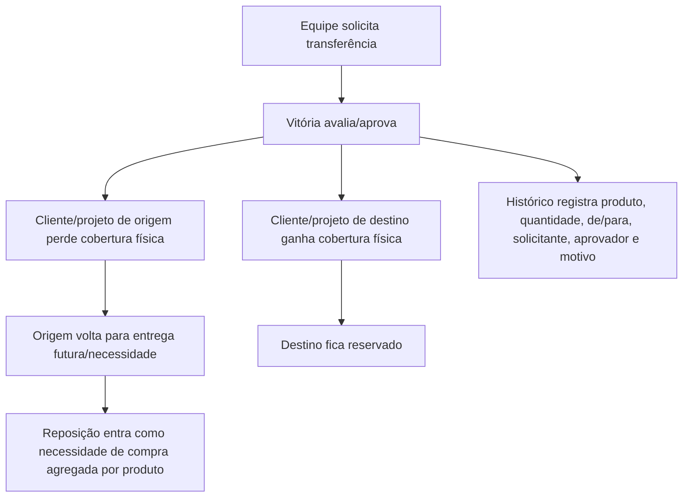
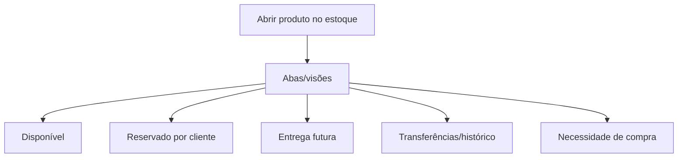

# Fluxos encontrados

- Reunião: 08. Lucenera (Filippo) - 06.07.2026: Gestão de Estoque e Transferência de Materiais
- Data: 2026-07-06
- Duração aproximada: 00:15:19
- Fonte: transcrição local em `00_original/Reunião_Filippo_Vinicius_Pedro.md`

## Observação

Os fluxos abaixo representam o desenho operacional discutido. Pontos ainda não implementados devem ser tratados por SPEC antes de virar código ou migration.

## Fluxo 1 - Estoque total, reservado e disponível

## Fluxo 2 - Venda sem saldo suficiente

## Fluxo 3 - Transferência de reserva entre clientes

## Fluxo 4 - Consulta operacional por produto

