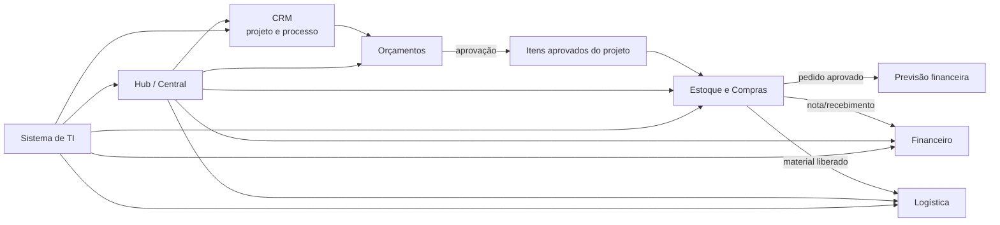

# Relatório Geral Final — Ecossistema Lucenera

Data: 23 de junho de 2026

Atualizacao de portfolio em 24 de junho de 2026: Hub/Central e Sistema de TI passam a ser tratados como sistemas diferentes. Os 9 sistemas prioritarios de mapeamento passam a ser Central/Hub, Sistema de TI, Administracao Bancaria, Gestao Financeira, CRM, RH, Logistica, PowerPoint e Cadastro. Ubiqua continua ativo, mas em baixa prioridade ate definicao melhor de abrangencia.

Atualizacao operacional em 24 de junho de 2026: a pasta `Sistema/` deve conter apenas 9 diretorios locais: os sistemas/projetos em foco local mais Ubiqua ativo em baixa prioridade, com dois diretorios para Logistica durante a migracao. O Sistema de TI ainda nao possui diretorio local dedicado nesta organizacao.

## 1. Resumo executivo

A Lucenera já possui aplicações capazes de atender partes relevantes da operação, mas o ecossistema ainda não executa o processo completo de forma contínua. O principal problema não é a falta de telas: é a ausência de uma ligação confiável entre projeto, orçamento, itens vendidos, estoque, compra, logística e financeiro.

O caminho recomendado é aproveitar os sistemas existentes, corrigir suas responsabilidades e criar somente um novo sistema: **Estoque e Compras**. O objetivo não é reproduzir todo o Connect, mas substituir as capacidades efetivamente necessárias para a operação diária.

O resultado esperado é:

## 2. Fontes analisadas

Foram analisados:

- sete ciclos de reuniões e suas transcrições;
- nove análises e roadmaps anteriores;
- sete relatórios consolidados;
- doze documentos de processos extraídos do Miro;
- os 9 sistemas prioritarios de mapeamento, separando Hub/Central e Sistema de TI, e a organizacao local com 9 diretorios em `Sistema/`;
- os cinco sistemas modificados em 23 de junho de 2026: Hub/Central, Cadastro, CRM, Orçamentos e Financeiro/Retorno;
- Ubiqua como sistema ativo em baixa prioridade de mapeamento;
- os dois sistemas de Logistica: o real em uso e o destino conectado ao banco;
- migrations e tipos locais apenas como evidência histórica;
- planilhas atualizadas de clientes, projetos, contas a pagar, contas a receber, pedidos de compra e itens vendidos;
- a planilha válida de vendas `Vendas 01012025 a 23062026.xlsx`;
- o Supabase atual, acessado com as credenciais do `.env` apenas para leitura e conferência de schema/dados;
- backups do CRM.

O banco de dados atual é considerado a fonte de verdade. Arquivos de migration existentes nos projetos não serão usados para presumir que uma regra ou estrutura ainda está válida.

Na conferência administrativa de 23/06/2026, foram identificadas 107 relações expostas, 20 funções/RPCs e dados já carregados em tabelas centrais. Entre os números relevantes: 1.443 projetos, 3.848 contatos, 4.392 produtos, 1.757 registros de estoque, 7 orçamentos, 17 itens de orçamento, 0 itens em `projeto_itens`, 411 registros em `vendas`, 9 boletos, 14.963 transações, 13.863 linhas em staging de contas a pagar, 4.357 em staging de contas a receber e 7 sistemas cadastrados em `systems`.

Em 24/06/2026, uma nova conferência via REST com anon key retornou contagem 0 para as principais tabelas e lista vazia em `systems`, indicando restrição por RLS/policies para a chave usada. Portanto, essa consulta não substitui a fotografia administrativa de 23/06. A meta atual para o catálogo da Central é manter cards para Administração Bancária, Cadastro, CRM, Gestão Financeira, Sistema de Entregas, RH, Ubiqua e PowerPoint; a Central é o shell do catálogo e não precisa aparecer como card de si mesma.

## 3. Principais achados

### 3.1 Existem sistemas úteis, mas com responsabilidades sobrepostas

Cadastro, CRM e Orçamentos consultam ou alteram entidades próximas. Há também cadastros e permissões específicos em alguns sistemas, criando versões paralelas da mesma informação.

**Motivo:** os aplicativos evoluíram separadamente sobre um banco compartilhado.

**Justificativa da mudança:** cada domínio precisa ter um responsável claro de escrita, mantendo os demais sistemas como consumidores da mesma informação.

**Ação a ser realizada:** documentar e aplicar uma matriz de propriedade dos dados. Cadastro mantém dados cadastrais; Estoque/Compras mantém dados operacionais; CRM mantém projeto e processo; Orçamentos mantém versões e aprovação; Financeiro mantém previsões, títulos e liquidações.

### 3.2 O projeto precisa ser o eixo da operação

Os processos mapeados partem da entrada do projeto e chegam a contrato, orçamento, compras, separação, entrega e financeiro. Entretanto, parte dos registros atuais ainda usa nomes ou códigos livres em vez de relacionamento direto.

**Motivo:** a mesma pessoa pode possuir vários projetos, vendas, entregas e parcelas.

**Justificativa da mudança:** ligar somente pelo cliente não identifica corretamente qual obra ou negociação originou o evento.

**Ação a ser realizada:** usar o identificador interno do projeto nos novos relacionamentos e preservar o código visível do projeto como chave operacional para importações e conferência.

### 3.3 A nova planilha de vendas é a base do histórico aprovado

A planilha válida analisada é `Vendas 01012025 a 23062026.xlsx`, cobrindo vendas de 06/01/2025 a 22/06/2026. Ela contém 22.171 linhas e 3.795 códigos de venda.

Distribuição principal:

- 16.621 linhas classificadas como `VENDAS`;
- 2.068 como `TROCA DEV`;
- 1.491 como `REMESSA TRANSP`;
- 722 como `GARANTIA`;
- 348 como `CASA COR SAIDA`;
- 344 como `BONIFICACAO`;
- além de uso e consumo, entradas Casa Cor, devoluções em garantia, inventário, industrialização, SAC, conserto, devolução de compra, descarte e retorno.

Somente `VENDAS` representa item comercial aprovado. Essas 16.621 linhas somam 2.042 vendas únicas, 1.508 produtos únicos e 330 códigos de projeto extraídos do início de `NomeCliente`.

Na comparação com o Supabase atual:

- 13.227 linhas de `VENDAS` conciliam com projeto entre match exato e match por dígitos;
- 2.688 linhas de `VENDAS` não possuem código de projeto no início do nome;
- 706 linhas possuem código extraído, mas ainda sem correspondência no cadastro atual de projetos;
- 1.287 dos 1.508 códigos de produto aparecem em `produtos.codigo_legado`;
- nenhum código da planilha bate diretamente em `produtos.codigo_produto`;
- 221 códigos de produto ainda não encontraram produto no Supabase;
- `projeto_itens` está vazio, portanto o histórico aprovado ainda precisa ser criado;
- a tabela `vendas` possui 411 registros, mas nenhum dos 2.042 `CodVenda` de `VENDAS` da planilha foi encontrado por `cod_venda`.

**Motivo:** a exportação reúne vendas comerciais, garantias, remessas, devoluções e movimentos físicos diferentes.

**Justificativa da mudança:** transformar todas as linhas em itens aprovados criaria um histórico comercial incorreto.

**Ação a ser realizada:** importar somente `VENDAS` para o histórico aprovado em `vendas`, `venda_itens` e `projeto_itens`, usando hash por linha para idempotência. O projeto deve ser identificado pelo código no início de `NomeCliente`; o produto deve ser identificado primeiro por `produtos.codigo_legado`. As demais categorias devem alimentar movimentos de estoque relacionados ao cliente e, quando disponível, ao projeto e à venda original. A quantidade vendida aprovada deve ser preservada como referência histórica imutável, sem ser reduzida por devoluções, entregas ou transferências.

### 3.4 O CRM atual avançou, mas ainda não representa o processo configurável desejado

O CRM atualizado está na versão `0.0.252` e possui projetos, contatos, parcelas, dashboards, usuários e configurações. Já existem RPCs para criar usuário e alterar status de usuário. Ainda assim, o processo do projeto continua baseado em status fixos e não há uma timeline estruturada com versões de fluxo, checklists, dependências, bloqueios e SLA configuráveis.

**Motivo:** o modelo atual foi criado a partir de uma lista fixa de status.

**Justificativa da mudança:** os processos mapeados possuem atividades paralelas, aprovações, responsáveis diferentes e exceções por projeto.

**Ação a ser realizada:** substituir o status fixo por um modelo de definição de fluxo, versão publicada, etapas, sub-status, tarefas/checklists, dependências, regras de bloqueio, responsáveis e SLA configuráveis na interface.

### 3.5 Estoque e Compras precisam de um sistema próprio

Os processos de Débora demonstram que compras exigem cadastro operacional, necessidade, fornecedor, orçamento, negociação, pedido, aprovação, prazo, recebimento e vínculo com vendas. Os vídeos do Connect reforçam que cada item vendido também precisa acompanhar reserva, entrega futura, separação, entrega, devolução e transferência. Essa responsabilidade não cabe apenas em Cadastro nem deve ficar misturada ao Financeiro.

**Motivo:** uma compra nasce da necessidade operacional, mas produz efeitos financeiros.

**Justificativa da mudança:** Estoque/Compras deve controlar a operação e informar o Financeiro, sem transformar o Financeiro em gestor do material.

**Ação a ser realizada:** criar um novo sistema que use os cadastros canônicos de produtos e fornecedores e gerencie saldos, movimentos, reservas, necessidades, cotações, pedidos e recebimentos. A devolução deve seguir a hierarquia operacional `E. Futura → Reserva → Entregue`, e separação deve nascer apenas de quantidade reservada/liberada.

### 3.6 O atual sistema bancário deve evoluir para Financeiro

O aplicativo atualizado está na versão `0.0.40` e já possui duplicatas, boletos, remessa CNAB, retorno bancário e notas fiscais. Ele é a base mais adequada para receber contas a pagar/receber, previsões de compras e conciliação. Ainda existem partes simuladas ou incompletas, especialmente em notas fiscais e automações de faturamento. Pelos vídeos do Connect, gerar boleto/PDF, enviar remessa ao banco, receber retorno e baixar pagamento são etapas separadas. A oportunidade de melhoria é automatizar o cálculo de vencimentos a partir do orçamento e deixar o Financeiro validar, em vez de redigitar o processo manual.

**Motivo:** manter outro aplicativo financeiro aumentaria a fragmentação.

**Justificativa da mudança:** os recursos bancários fazem parte do mesmo ciclo financeiro e podem ser preservados.

**Ação a ser realizada:** renomear e reorganizar o sistema como Financeiro, preservando CNAB, boletos e retorno, e acrescentando previsões, contas a pagar/receber, alocações e conciliação. Boletos gerados por orçamento aprovado devem entrar em fila de remessa em lote, sem disparo automático individual.

### 3.7 O Hub começou a virar catálogo dinâmico

O Hub atualizado está na versão local `0.0.14` e já lê os cartões a partir da tabela `systems`. A fotografia administrativa de 23/06 indicava 7 registros em `systems`; a atualização de 24/06 criou uma migration para orientar o catálogo-alvo com 8 cards externos: Administração Bancária, Cadastro, CRM, Gestão Financeira, Sistema de Entregas, RH, Ubiqua e PowerPoint. A Central conta como sistema do portfólio, mas não precisa aparecer como card dentro dela mesma.

**Motivo:** foi criado inicialmente como um lançador de aplicações e agora começou a usar catálogo no banco.

**Justificativa da mudança:** o Hub deve continuar como porta de entrada, enquanto o Sistema de TI administra o ecossistema sem alterar código. A evolução deve partir da tabela existente em vez de criar outro cadastro paralelo.

**Ação a ser realizada:** manter o Hub como consumidor do catálogo e separar no Sistema de TI a administração por UI, ambientes, módulos, permissões, exceções por usuário, checks de saúde, integrações e histórico de alterações.

## 4. Arquitetura funcional aprovada

| Sistema | Responsabilidade principal | O que não deve duplicar |
|---|---|---|
| Hub / Central | Porta de entrada, cards autorizados e abertura dos sistemas | Administração de permissões, saúde ou integrações |
| Sistema de TI | Catálogo, acessos, permissões, saúde, integrações e auditoria | Dados comerciais, financeiros ou de estoque |
| Administração Bancária / Financeiro | Títulos, boletos, remessa, retorno, conciliação e integrações bancárias | Controle físico de materiais |
| Gestão Financeira / Orçamentos | Orçamentos, versões, itens, valores, condições e aprovação | Cadastro paralelo de projeto/produto |
| CRM | Projeto, participantes, timeline e execução do fluxo | Editor de orçamento, estoque e liquidação financeira |
| RH | Pessoas, faltas, férias, benefícios, avaliações e folha | Identidade global e permissões dos sistemas |
| Logística | Separação, rota, entrega, evidências e ocorrências | Criação do compromisso comercial |
| PowerPoint Lucenera | Artefatos de apresentação e apoio comercial | Processo operacional, cadastro ou financeiro |
| Cadastro | Dados cadastrais de clientes, contatos, produtos e fornecedores | Saldo, reserva, pedido e movimento |
| Ubiqua | Catálogo e orçamento do contexto Ubiqua | Decisões estruturais desta rodada de mapeamento |

> Ubiqua continua ativo operacionalmente, mas fica em baixa prioridade ate definicao melhor de abrangencia.

## 5. Processo operacional futuro

### Etapa 1 — Entrada e acompanhamento no CRM

1. Criar ou localizar cliente e participantes.
2. Criar o projeto.
3. Aplicar a versão publicada do fluxo escolhida.
4. Executar etapas, sub-status e checklists.
5. Aplicar dependências, bloqueios, responsáveis e SLA configurados.

**Ação a ser realizada:** implementar o runtime do fluxo e a interface de configuração/versionamento.

### Etapa 2 — Orçamento e aprovação

1. Criar orçamento vinculado obrigatoriamente ao projeto.
2. Criar versões sem sobrescrever o histórico.
3. Validar item especial sem preço, frete, forma de pagamento e prazo.
4. Aprovar uma versão e travar edição comercial direta.
5. Calcular parcelas e vencimentos a partir da regra do orçamento.
6. Gerar snapshot dos itens aprovados.
7. Publicar o evento de aprovação para CRM e Estoque/Compras.

**Ação a ser realizada:** criar um comando idempotente de aprovação que registre a versão aprovada, produza `projeto_itens` e calcule parcelas/vencimentos a partir de forma de pagamento e prazo estruturados. Quando a regra estiver ambígua, abrir pendência de estruturação em vez de inventar datas.

### Etapa 3 — Estoque e necessidade de compra

1. Consultar o saldo disponível.
2. Reservar o que já existe.
3. Gerar necessidade para o que falta.
4. Solicitar e comparar cotações.
5. Aprovar o pedido.
6. Enviar previsão ao Financeiro.
7. Receber material e nota.
8. Confirmar ou ajustar a conta a pagar.

**Ação a ser realizada:** criar os módulos operacionais e uma integração idempotente com o Financeiro. Manter a quantidade vendida imutável e controlar reserva, entrega futura, separado, entregue, devolvido e transferido por movimentos/saldos reconciliáveis.

### Etapa 4 — Separação e entrega

1. Liberar itens atendidos para separação.
2. Criar separação estruturada por projeto e item.
3. Agendar e organizar rota.
4. Registrar entrega parcial ou total.
5. Registrar recebedor, ocorrência e evidências.

**Ação a ser realizada:** ligar o aplicativo de Logística a projeto, `projeto_itens` e quantidades liberadas pelo Estoque. Fotos, comprovantes e documentos devem ser enviados ao OneDrive via API; o banco guarda apenas metadados, `driveItemId`, URL controlada e vínculos.

### Etapa 5 — Financeiro

1. Receber previsões de pedidos aprovados.
2. Confirmar títulos após nota/recebimento.
3. Gerar ou acompanhar contas a receber da venda.
4. Emitir NF real ou manter NF pendente enquanto a API não existir.
5. Gerar boleto pendente de registro.
6. Gerar remessa em lote e enviar ao banco.
7. Processar retorno.
8. Conciliar pagamento com título e projeto.

**Ação a ser realizada:** consolidar títulos e eventos bancários no sistema Financeiro, preservando os identificadores do Connect e separando claramente boleto gerado, remessa enviada, boleto registrado, retorno processado e baixa. O Financeiro deve validar os vencimentos calculados pelo orçamento e ajustar somente exceções.

## 6. Plano de substituição do Connect

A substituição deve ocorrer por capacidade, não por desligamento total imediato.

### Fase 1 — Preparar a base

- congelar uma fotografia de comparação;
- organizar dados mestres;
- criar importação por lote;
- preservar códigos externos;
- definir relatórios de divergência.

**Critério de conclusão:** uma importação pode ser repetida sem duplicar registros.

### Fase 2 — Projetos e itens vendidos

- reconciliar projetos;
- importar `VENDAS`;
- gerar cabeçalhos de venda e itens;
- formar o histórico de itens aprovados;
- encaminhar exceções para revisão.

**Critério de conclusão:** um projeto histórico exibe seus itens vendidos e a linha de origem.

### Fase 3 — CRM configurável

- criar definições e versões de fluxo;
- configurar etapas, sub-status e checklists;
- permitir paralelo/sequencial, bloqueio, responsáveis e SLA;
- migrar projetos somente por decisão manual.

**Critério de conclusão:** um novo projeto percorre um fluxo configurado sem regras de etapa gravadas no código.

### Fase 4 — Estoque e Compras

- implementar saldos e movimentos;
- tratar reservas e necessidades;
- controlar cotação, pedido e recebimento;
- integrar previsão e confirmação com Financeiro.

**Critério de conclusão:** a compra nasce da necessidade do projeto e chega ao Financeiro sem digitação duplicada.

### Fase 5 — Financeiro

- importar CP/CR;
- consolidar previsões e títulos;
- manter boleto, remessa e retorno;
- relacionar financeiro a projeto, venda, pedido e parcela.

**Critério de conclusão:** operação financeira diária não exige consulta ao Connect.

### Fase 6 — Logística e corte

- liberar material atendido;
- gerar separação por item;
- registrar entrega;
- comparar saldos, pedidos, títulos e entregas;
- colocar o módulo correspondente do Connect em consulta;
- realizar o corte após aceite.

**Critério de conclusão:** os processos definidos como obrigatórios funcionam integralmente no novo ecossistema.

## 7. Automações prioritárias

### Implementar nesta versão

- importação idempotente de planilhas;
- resolução assistida de projeto e produto;
- aprovação de orçamento;
- criação de itens aprovados;
- reserva e necessidade de compra;
- previsão financeira de pedido;
- confirmação financeira por nota/recebimento;
- liberação para separação;
- processamento de remessa e retorno;
- saúde dos sistemas;
- registro de execução e falha das integrações.

### Não implementar nesta versão

- portal do cliente;
- IA para decisões de aprovação;
- otimização avançada de rotas;
- Hub como rede social ou BI executivo irrestrito (agenda e mural passaram a fazer parte do escopo do Hub em 25/06/2026, ver `Escopos/01_ESCOPO_HUB_TI.md`);
- motor genérico de automação sem processo concreto.

### Baixa prioridade — mapear sem implementar nesta versão

- DocSign e webhooks de assinatura: não entram nesta versão, mas devem continuar mapeados como plano futuro (gate de etapa via webhook na Gestão de Processos/CRM), não como item descartado. Ver `Escopos/03_ESCOPO_CRM.md`, SPEC-CRM-12.

## 8. Indicadores de sucesso

- percentual das linhas `VENDAS` conciliadas com projeto e produto;
- quantidade de exceções pendentes de revisão;
- percentual de projetos usando fluxo versionado;
- pedidos aprovados com previsão financeira criada;
- recebimentos com conta a pagar confirmada;
- separações vinculadas a projeto e item;
- títulos financeiros vinculados à sua origem;
- sistemas cadastrados no Hub com check de saúde;
- redução de processos que ainda exigem o Connect.

## 9. Conclusão

O desenho final mantém o ecossistema compreensível: cada sistema possui uma responsabilidade clara, o banco é compartilhado e canônico, e as integrações são formadas por eventos de negócio rastreáveis.

A prioridade não é criar mais telas. É fechar a trilha:

**projeto → orçamento aprovado → item vendido → estoque/compra → financeiro → separação → entrega**.
