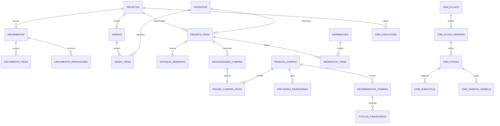

# Relatório Final do Banco de Dados — Lucenera

Data: 23 de junho de 2026

Atualizacao de 24 de junho de 2026: as contagens abaixo continuam sendo a ultima fotografia administrativa confiavel. Uma nova consulta via REST com anon key respondeu, mas retornou contagem 0 para as principais tabelas e lista vazia em `systems`, o que indica restricao por RLS/policies para a chave usada. Essa consulta nao deve ser interpretada como banco vazio.

## 1. Diretriz principal

O banco de dados atual em processo de organização é a única fonte de verdade.

As migrations existentes dentro dos diversos projetos não definem o estado correto do banco. Elas devem ser consultadas apenas para entender decisões antigas, dependências dos aplicativos e possíveis automações que ainda precisam ser substituídas.

As novas correções serão feitas por grupos de migrations controlados. Este documento define os grupos e seus objetivos, mas não contém SQL.

## 2. Situação atual resumida

O Supabase atual foi conferido diretamente via credenciais disponíveis, sem usar migrations antigas como fonte de verdade. A introspecção administrativa retornou `standard public schema 14.4`; a API expõe 107 relações entre tabelas e views, além de 20 funções/RPCs.

Fotografia operacional relevante:

| Entidade | Situação no Supabase atual |
|---|---:|
| `contatos` | 3.848 registros |
| `projetos` | 1.443 registros, sendo 561 arquivados |
| `produtos` | 4.392 registros ativos |
| `estoque_itens` | 1.757 registros |
| `orcamentos` | 7 registros |
| `orcamento_itens` | 17 registros |
| `projeto_itens` | 0 registros |
| `vendas` | 411 registros |
| `boletos` | 9 registros |
| `notas_fiscais` | 0 registros |
| `transacoes` | 14.963 registros |
| `staging_conta_pagar` | 13.863 registros |
| `staging_conta_receber` | 4.357 registros |
| `staging_pedido_compra` | 143 registros |
| `systems` | 7 registros na fotografia administrativa de 23/06; catálogo-alvo da Central com 8 cards externos |
| `usuarios` | 8 registros |

Há estruturas válidas, estruturas concorrentes e estruturas ainda vazias ou sem vínculo operacional completo.

Os principais problemas são:

- projetos com campos redundantes para cliente e textos duplicados;
- status de projeto armazenado em enum fixo;
- `projeto_itens` ainda vazio, apesar de a planilha nova trazer histórico aprovado suficiente para preenchimento;
- venda sem tabela canônica de itens;
- mais de um modelo de orçamento;
- `produtos` misturando cadastro e valores de estoque;
- estoque sem ledger completo de movimentos;
- compras ainda incompletas, com `pedido_compra` e `solicitacoes_compra` vazias no Supabase atual;
- previsão financeira e conta confirmada não separadas;
- transações, parcelas e vendas sem todos os relacionamentos preenchidos;
- cadastros de usuários e papéis paralelos em alguns sistemas;
- staging e histórico de importação sem padrão único;
- migrations distribuídas entre aplicações;
- tipos do Supabase copiados em versões diferentes nos projetos;
- catálogo do Hub já iniciado em `systems`, mas ainda sem módulos, permissões e saúde operacional completos;
- consulta anon/auth sem contexto administrativo pode retornar zero linhas por RLS, inclusive em `systems`;
- produtos vendidos da planilha conciliam com `produtos.codigo_legado`, não com `produtos.codigo_produto`.

## 3. Modelo lógico recomendado

Os nomes acima são conceituais. Antes de gerar migrations, devem ser comparados com as tabelas existentes para decidir entre reaproveitar, alterar ou criar.

## 4. Conciliação dos dados

### 4.1 Projetos

O Supabase atual possui 1.443 projetos. A planilha nova de vendas possui 330 códigos de projeto extraídos de linhas `VENDAS`. A conciliação encontrou:

- 213 códigos com match exato em `projetos.codigo`;
- 66 códigos com match por normalização de dígitos;
- 51 códigos ainda sem correspondência;
- 2.688 linhas `VENDAS` sem código de projeto no início de `NomeCliente`;
- 706 linhas `VENDAS` com código extraído, mas sem match atual no Supabase.

O código deve ser normalizado para comparação, preservando a forma exibida, como `26.173`.

**O que arrumar**

- definir uma única coluna canônica de cliente;
- manter `responsavel_id` como responsável interno principal;
- substituir status fixo pela execução do fluxo;
- preservar status original no histórico de migração;
- remover dependência de textos como `responsavel_nome` e `"Nome Arquiteto"` após os consumidores usarem relacionamentos;
- registrar aliases de código/nome quando necessário.

**Ação a ser realizada:** produzir relatório de códigos, duplicidades, projetos arquivados, clientes, responsáveis e status antes de qualquer alteração. Criar uma tabela de aliases ou identificadores externos quando uma origem possuir formato diferente. Para a planilha de vendas, usar match exato primeiro e match por dígitos apenas como conciliação auditada.

### 4.2 Contatos, clientes e fornecedores

A planilha de clientes possui 2.712 códigos únicos. Há 504 registros sem documento, 1.255 sem e-mail principal e 151 ocorrências adicionais de documentos repetidos.

**O que arrumar**

- manter uma entidade de contato canônica;
- representar os papéis por relacionamento, permitindo que o mesmo contato seja cliente, fornecedor, arquiteto ou outro tipo;
- preservar código e origem do Connect;
- separar empresa do contato, empresa emissora e empresa pagadora;
- colocar duplicidades e matches duvidosos em fila de revisão.

**Ação a ser realizada:** consolidar os papéis em uma estrutura associativa e criar um processo de reconciliação por código de origem, documento normalizado e revisão humana.

### 4.3 Produtos

Produtos devem ter uma única identidade cadastral, usada por Cadastro, Orçamentos e Estoque/Compras.

No Supabase atual existem 4.392 produtos ativos. A planilha `Vendas 01012025 a 23062026.xlsx` possui 1.508 códigos de produto nas linhas `VENDAS`. A conciliação mostrou que:

- 1.287 códigos batem em `produtos.codigo_legado`;
- nenhum código bate diretamente em `produtos.codigo_produto`;
- 221 códigos ainda não encontraram produto;
- 16.161 das 16.621 linhas `VENDAS` batem por `codigo_legado`;
- 460 linhas `VENDAS` ainda ficam sem produto conciliado.

**O que arrumar**

- eleger o código de produto do Connect como identificador externo em `codigo_legado`, mantendo `codigo_produto` como código interno/cadastral quando aplicável;
- manter nome, referência, NCM, unidade, marca, categoria e dados fiscais no cadastro;
- retirar do cadastro mestre a responsabilidade pelo saldo operacional;
- preservar preço e custo da venda como snapshot no item, não como consulta ao valor atual;
- converter e reconciliar o arquivo histórico `.xls` antes de qualquer descarte.

**Ação a ser realizada:** criar uma matriz campo a campo entre `produtos`, arquivos de staging e planilha histórica, classificando cada coluna como cadastral, fiscal, comercial histórica ou operacional. Na importação de vendas, procurar produto por `codigo_legado` antes de qualquer outro campo.

### 4.4 Itens vendidos

Regra aprovada:

- apenas `GrupoCFOP = VENDAS` gera item aprovado;
- as demais classificações geram movimento de estoque.

A planilha válida possui 22.171 linhas. O recorte comercial aprovado é:

- 16.621 linhas `VENDAS`;
- 2.042 vendas únicas;
- 330 códigos de projeto extraídos;
- 1.508 produtos únicos;
- R$ 29.291.376,23 em valor total de linhas `VENDAS`;
- nenhuma linha `VENDAS` com quantidade ou valor negativo.

As demais 5.550 linhas são movimentos operacionais de estoque, como troca, remessa, garantia, Casa Cor, bonificação, uso e consumo, inventário, conserto, devolução e retorno.

O relacionamento recomendado é:

1. empresa + `CodVenda` identificam o cabeçalho da venda;
2. código extraído de `NomeCliente` identifica o projeto;
3. `CodProduto` identifica o produto por `produtos.codigo_legado`;
4. cada linha preserva quantidade, valor unitário, total, descrição, referência, CFOP, arquivo e linha de origem;
5. `VENDAS` cria ou relaciona `venda_itens` e `projeto_itens`, preservando a quantidade vendida original como quantidade imutável;
6. outras categorias criam movimentos vinculados ao cliente e, quando disponível, projeto e venda original.

**Pontos de atenção**

- há 8.751 repetições em linhas `VENDAS` quando se usa apenas `CodVenda + CodProduto + NomeCliente`, portanto essa combinação não pode ser a única chave do item;
- `CodVenda` não aparece hoje em `vendas.cod_venda` para as 2.042 vendas do arquivo, então a carga precisa criar ou reconciliar cabeçalhos sem assumir que já existem;
- `projeto_itens` está vazio e deve ser gerado a partir da promoção validada das linhas `VENDAS`;
- linhas sem projeto, sem produto ou com match apenas por dígitos precisam ficar em fila de revisão ou em staging conciliado, não em produção silenciosa.

**Ação a ser realizada:** criar staging por linha com hash estável, nome do arquivo e número da linha. Promover somente linhas `VENDAS` com projeto e produto conciliados. Gerar `vendas`, uma tabela canônica de itens da venda e `projeto_itens` com snapshots de quantidade, descrição, referência, valor unitário, desconto e total. Linhas negativas ou não `VENDAS` devem gerar movimento compatível, nunca novo item aprovado positivo. A quantidade aprovada/vendida deve ser preservada como referência histórica e não deve ser reduzida por devoluções, entregas ou transferências.

### 4.5 Estoque

O cadastro de produto e o saldo físico não devem permanecer misturados.

**Estruturas necessárias**

- locais de estoque;
- movimentos de estoque;
- reservas por item de projeto;
- saldo operacional por item aprovado: vendido, reservado, entrega futura, aguardando separação, separado, entregue, devolvido e transferido;
- liberações de reserva;
- transferências;
- separações;
- entregas;
- devoluções;
- garantias;
- bonificações;
- remessas;
- uso interno;
- ajustes inventariados.

**Ação a ser realizada:** usar um ledger de movimentos como registro principal. Saldos total, reservado e disponível devem ser calculados ou mantidos por mecanismo controlado e reconciliável. Para os itens aprovados, modelar a regra operacional do Connect: separação só nasce de reserva; chegada de compra/produção move entrega futura para reserva; devolução reduz primeiro entrega futura, depois reserva e por último entregue; transferência entre clientes devolve necessidade futura para o item de origem.

### 4.6 Compras

O Supabase atual possui `pedido_compra` e `solicitacoes_compra`, mas ambas estão vazias. A planilha de pedidos possui 143 linhas no staging atual. A leitura anterior indicava 89 linhas e 59 pedidos no arquivo analisado; essa diferença deve ser tratada como sinal de atualização de origem e precisa ser reconciliada antes da modelagem final.

**Estruturas necessárias**

- necessidade de compra;
- agrupamento por fornecedor;
- cotação e itens cotados;
- negociação;
- pedido e itens;
- aprovação;
- prazo prometido;
- recebimento parcial ou total;
- nota recebida;
- divergência entre pedido, nota e material;
- vínculo entre item comprado e necessidade/projeto.

**Ação a ser realizada:** criar o pedido com itens próprios, evitando registrar somente o total. Toda necessidade atendida deve apontar para o item do pedido que a supriu.

### 4.7 Financeiro

O Financeiro deve diferenciar:

- previsão;
- título confirmado;
- parcela;
- boleto;
- transação realizada;
- alocação da transação.

Pedido aprovado gera previsão. Recebimento da nota ou do material confirma ou ajusta a conta a pagar.

No fluxo de recebíveis vindo de orçamento aprovado, os vídeos do Connect indicam que vencimentos e frete precisam ser conferidos antes da geração de cobrança. No novo sistema, vencimentos devem ser calculados a partir de forma de pagamento e prazo estruturados no orçamento, com validação posterior do Financeiro. Boletos criados devem ficar pendentes de registro até a remessa bancária, e remessa/retorno devem ser tratados como etapas próprias.

**Ação a ser realizada:** criar uma ligação idempotente entre pedido e previsão. Na confirmação, atualizar a previsão ou criar o título definitivo preservando a diferença entre valor previsto e realizado. Para orçamentos aprovados, adicionar `orcamento_id` nos vínculos financeiros necessários, armazenar/derivar forma de pagamento e prazo, calcular vencimentos de forma rastreável e tratar boleto gerado, remessa enviada, boleto registrado, retorno processado e baixa como estados diferentes. Boletos do fluxo aprovado devem ficar por `orcamento_id`; o projeto deve ser derivado de `orcamentos.projeto_id`. A coluna `boletos.projeto_id` foi removida para evitar redundância.

Para contas a pagar e receber, a combinação da empresa, duplicata e item da duplicata apresentou boa capacidade de identificação nas planilhas atuais e deve ser validada como chave externa do Connect. No Supabase atual já existem 14.963 transações, 13.863 linhas em `staging_conta_pagar`, 4.357 em `staging_conta_receber`, 29 linhas em `vw_fluxo_caixa_projetado`, 9 boletos e 2 retornos processados.

### 4.8 CRM configurável e versionado

O fluxo não deve ser representado por um enum fixo.

**Estruturas necessárias**

- definição do fluxo;
- versões rascunho e publicadas;
- etapas por versão;
- sub-status por etapa;
- checklists/tarefas modelo;
- dependências sequenciais e paralelas;
- regras de bloqueio;
- regra de responsável;
- SLA opcional;
- execução por projeto;
- tarefas executadas;
- exceções específicas por projeto;
- histórico de mudanças;
- migração manual entre versões.

**Ação a ser realizada:** tornar configurações publicadas imutáveis. Uma edição deve gerar nova versão. O projeto guarda a versão aplicada e só muda por comando explícito de migração.

### 4.9 Hub, Sistema de TI, permissões e saúde

O Hub/Central precisa consumir dados para:

- sistemas liberados ao usuario;
- URLs e ambientes publicados;
- estado resumido de disponibilidade;
- eventos de acesso permitido ou negado.

O Sistema de TI precisa administrar dados para:

- sistemas e módulos;
- ações permitidas;
- papéis;
- permissões do papel;
- exceções por usuário;
- ambientes e URLs;
- responsáveis técnicos e funcionais;
- checks de saúde;
- resultados dos checks;
- atualizações manuais;
- integrações e execuções.

O Supabase atual já possuía `systems` com 7 registros na fotografia administrativa de 23/06 e o Hub atualizado consulta essa tabela para montar os cartões. Em 24/06, a Central passou a ter migration para orientar o catálogo-alvo com 8 cards externos: Administração Bancária, Cadastro, CRM, Gestão Financeira, Sistema de Entregas, RH, Ubiqua e PowerPoint. A própria Central conta como sistema do portfólio, mas não precisa aparecer como card dentro dela mesma.

Hub/Central e Sistema de TI sao sistemas diferentes. O Hub consome catalogo, permissoes e saude; o Sistema de TI escreve e audita essas configuracoes.

**Ação a ser realizada:** usar `systems` como ponto de partida, acrescentando módulos, ações, papéis, permissões, exceções, ambientes e checks no Sistema de TI. Os aplicativos devem consultar o mesmo contrato de autorização, sem manter listas próprias de papéis.

### 4.10 Logística

Separação e entrega devem usar itens estruturados, não apenas texto ou PDF.

**O que arrumar**

- vincular separação ao projeto;
- vincular itens da separação a `projeto_itens`;
- registrar quantidades solicitadas, separadas e entregues;
- aceitar entregas parciais;
- registrar ocorrências e devoluções;
- manter recebedor e evidências;
- padronizar estados atuais divergentes.

**Ação a ser realizada:** criar uma tabela de equivalência temporária entre status antigos. Migrar gradualmente para estados canônicos sem reescrever o histórico. Fotos, comprovantes e documentos logísticos devem ser armazenados no OneDrive via API; o banco deve guardar metadados, `driveItemId`, URL controlada, hash quando disponível e vínculos com projeto, separação ou entrega.

## 5. Grupos de migrations

Nenhuma migration deve ser gerada antes da validação do banco real, das contagens e das dependências dos sistemas.

### Grupo M00 — Fotografia e contrato de referência

**Objetivo:** registrar o estado real antes das alterações.

**Inclui:**

- inventário de tabelas, colunas, constraints, views, funções e triggers;
- contagens por entidade;
- relações preenchidas e vazias;
- relatório de consumidores por sistema;
- identificação das automações ativas.

**Ação a ser realizada:** gerar artefatos somente de leitura e aprovar a fotografia com a equipe.

### Grupo M01 — Infraestrutura de importação e identificadores externos

**Objetivo:** permitir cargas repetíveis e auditáveis.

**Inclui:**

- lotes de importação;
- linhas brutas;
- hashes;
- identificadores externos;
- resultados de reconciliação;
- fila de revisão;
- métricas do lote.

**Ação a ser realizada:** criar primeiro o framework comum de importação e depois adaptar cada planilha.

### Grupo M02 — Dados mestres

**Objetivo:** consolidar empresas, contatos, papéis, produtos, marcas, categorias e fornecedores.

**Inclui:**

- relacionamentos canônicos;
- aliases e códigos do Connect;
- classificação de campos cadastrais;
- distinção entre `empresas` do grupo econômico Lucenera e empresa/PJ de clientes, fornecedores e arquitetos representada em `contatos`;
- compatibilidade temporária com colunas antigas.

**Ação a ser realizada:** migrar consumidores antes de remover qualquer campo ou tabela antiga. Preservar a regra de que `contatos.empresa_id` aponta para outro `contatos.id` quando representar a empresa/PJ vinculada a uma pessoa ou contato; não tratar isso como erro de FK para `empresas.id`.

### Grupo M03 — Projetos e participantes

**Objetivo:** tornar o projeto o eixo do ecossistema.

**Inclui:**

- cliente canônico;
- responsável interno;
- participantes tipados;
- códigos e aliases;
- limpeza de campos redundantes;
- vínculos de vendas, orçamentos e financeiro.

**Ação a ser realizada:** aplicar backfills apenas para matches únicos; enviar ambiguidades para revisão.

### Grupo M04 — Vendas e itens aprovados

**Objetivo:** criar o histórico comercial por item.

**Inclui:**

- staging da planilha `Vendas 01012025 a 23062026.xlsx`;
- cabeçalho de venda;
- itens da venda;
- vínculo com projeto e produto;
- origem e snapshot;
- geração de `projeto_itens`;
- tratamento específico para `VENDAS`.

**Ação a ser realizada:** validar totais por venda e projeto antes e depois da promoção do staging. Usar `NomeCliente` para extrair o código de projeto e `CodProduto` contra `produtos.codigo_legado`. Criar relatório dos 51 códigos de projeto e 221 códigos de produto ainda não conciliados.

### Grupo M05 — Movimentos de estoque

**Objetivo:** registrar todos os efeitos físicos.

**Inclui:**

- locais;
- ledger de movimentos;
- reservas;
- devoluções;
- garantias;
- bonificações;
- remessas;
- uso interno;
- relação com cliente/projeto/venda.

**Ação a ser realizada:** converter categorias não comerciais da planilha em tipos explícitos de movimento.

### Grupo M06 — Compras e recebimentos

**Objetivo:** modelar a necessidade até a chegada do material.

**Inclui:**

- necessidades;
- cotações;
- pedidos e itens;
- aprovações;
- prazos;
- recebimentos;
- divergências;
- vínculo ao projeto.

**Ação a ser realizada:** permitir recebimento parcial e rastrear qual necessidade foi atendida.

### Grupo M07 — Financeiro consolidado

**Objetivo:** separar previsão, obrigação, cobrança e realização.

**Inclui:**

- previsões;
- títulos a pagar/receber;
- parcelas;
- boletos;
- transações;
- alocações;
- origem em pedido, venda ou projeto;
- reconciliação do backup de parcelas.

**Ação a ser realizada:** preservar códigos externos e impedir que a importação histórica duplique eventos novos. Separar estados de boleto gerado, remessa enviada, registro bancário, retorno processado e baixa, para não confundir PDF de cobrança com título registrado no banco.

### Grupo M08 — Workflow do CRM

**Objetivo:** substituir status fixos pelo fluxo configurável e versionado.

**Inclui:**

- definições;
- versões;
- etapas;
- sub-status;
- checklists;
- dependências;
- bloqueios;
- responsáveis;
- SLA;
- execuções e histórico.

**Ação a ser realizada:** converter status atuais em uma versão inicial, mantendo o valor legado para auditoria.

### Grupo M09 — Logística

**Objetivo:** conectar separação e entrega aos itens do projeto.

**Inclui:**

- separações e itens;
- quantidades;
- agenda e rota;
- entrega parcial;
- evidências;
- metadados de arquivos no OneDrive;
- ocorrências;
- normalização de status.

**Ação a ser realizada:** preservar campos de texto antigos até que todos os registros úteis tenham relação estruturada. Substituir dependências de Supabase Storage por OneDrive API nos fluxos de evidência logística.

### Grupo M10 — Sistema de TI, permissões, saúde e integrações

**Objetivo:** centralizar governança operacional.

**Inclui:**

- consolidação da tabela `systems` existente;
- contratos consumidos pelo Hub/Central;
- módulos e ações;
- papéis e permissões;
- exceções individuais;
- health checks;
- eventos de saúde;
- atualizações manuais;
- integrações e execuções.

**Ação a ser realizada:** migrar os aplicativos para esse contrato comum e descontinuar cadastros locais de papel. Não criar outro cadastro paralelo de sistemas enquanto `systems` puder ser evoluída. Manter o Hub/Central como consumidor desses dados, não como dono administrativo deles.

### Grupo M11 — Compatibilidade e retirada do legado

**Objetivo:** remover estruturas concorrentes somente após migração dos consumidores.

**Inclui:**

- views temporárias de compatibilidade;
- substituição de tabelas paralelas;
- remoção de enums fixos;
- consolidação de tipos gerados;
- retirada de triggers antigas;
- arquivamento de staging e backups validados.

**Ação a ser realizada:** exigir relatório de consumidores igual a zero antes de remover uma estrutura.

### Grupo M12 — Validação e corte do Connect

**Objetivo:** comprovar a substituição por capacidade.

**Inclui:**

- comparação de contagens e totais;
- relatório de divergências;
- aceite do responsável;
- período de observação;
- registro da data de corte;
- bloqueio de novas importações antigas após o corte.

**Ação a ser realizada:** executar separadamente para cadastro, vendas, estoque/compras e financeiro.

## 6. Automações de banco e integração

### Necessárias

- promoção controlada de staging;
- aprovação idempotente de orçamento;
- criação de itens aprovados;
- geração de reserva e necessidade;
- criação de previsão financeira;
- confirmação ou ajuste do título;
- liberação para logística;
- processamento idempotente de remessa e retorno;
- execução de health checks;
- registro de resultado das integrações.

### A revisar ou substituir

- triggers que avançam o processo apenas pela mudança de texto do status;
- triggers que copiam nomes para campos redundantes;
- automações que criam estoque, separação ou entrega sem `projeto_item`;
- funções de usuário repetidas entre sistemas;
- rotinas que assumem uma única FK financeira quando pode haver alocação.

## 7. Ordem recomendada de execução

1. M00 — fotografia.
2. M01 — importação e identificadores.
3. M02 e M03 — dados mestres e projetos.
4. M04 — vendas e itens aprovados.
5. M05 e M06 — estoque e compras.
6. M07 — financeiro.
7. M08 — CRM.
8. M09 — logística.
9. M10 — Sistema de TI e contratos consumidos pelo Hub/Central.
10. M11 — retirada do legado.
11. M12 — corte do Connect.

Essa ordem pode ser dividida em entregas menores, mas não deve inverter dependências. Por exemplo, não se deve importar itens vendidos antes de estabilizar projeto e produto.

## 8. Validações obrigatórias antes de gerar migrations

- confirmar o schema e as contagens diretamente no banco, usando a fotografia atual do Supabase como baseline;
- confirmar quais triggers e funções realmente executam;
- confirmar a chave de `CodVenda` por empresa;
- validar a carga completa da planilha `Vendas 01012025 a 23062026.xlsx`;
- decidir como tratar as 2.688 linhas `VENDAS` sem código de projeto no início de `NomeCliente`;
- revisar os 51 códigos de projeto extraídos que ainda não encontraram projeto no Supabase;
- revisar os 221 códigos de produto que ainda não encontraram produto no Supabase;
- confirmar que `CodProduto` deve continuar conciliando por `produtos.codigo_legado`;
- converter e comparar a planilha histórica de produtos;
- reconciliar as parcelas ativas com o backup;
- validar as regras de entrega parcial, devolução e garantia;
- mapear consumidores de tabelas e colunas antigas;
- definir o repositório e a sequência oficial das novas migrations.

## 9. Adendo de segurança

Após a reorganização do modelo, a reconciliação dos dados e a estabilização das integrações, deverá ser realizada uma análise específica e detalhada de segurança do banco de dados. Essa etapa futura deverá definir as regras de acesso, políticas, papéis técnicos e exposição adequada de cada objeto.
