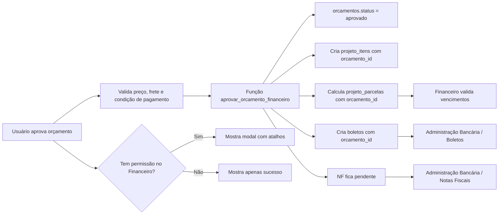

# SPEC-001 — Aprovação de Orçamento para Itens do Projeto e Administração Bancária

## Checklist de Ação

- [x] Adicionar `orcamento_id` nas tabelas necessárias e criar estrutura simples para prazo/frete.
- [x] Criar função transacional `aprovar_orcamento_financeiro(orcamento_id)`.
- [x] Substituir `approveBudgetAndMigrate` para chamar a função.
- [x] Adicionar cálculo estruturado de parcelas/vencimentos a partir de forma de pagamento e prazo do orçamento.
- [x] Criar permissão provisória por `role` para exibir modal financeiro.
- [x] Criar modal condicionado à permissão.
- [x] Ajustar Boletos para filtrar por `orcamento_id`.
- [x] Definir que boletos do fluxo aprovado ficam por `orcamento_id`, sem preencher `boletos.projeto_id`.
- [x] Remover `boletos.projeto_id` do banco real e ajustar a RPC para não depender dessa coluna.
- [x] Ajustar Notas Fiscais para estado "NF pendente" e cadastro manual com `orcamento_id`.
- [x] Ajustar Remessa para processo manual em lote, sem disparo automático individual.
- [x] Remover botão/função de simulação de automação em Notas Fiscais.
- [x] Remover triggers/scheduler/função antiga de billing automation.
- [x] Rodar build dos dois sistemas.

### Passos manuais do usuário

- [ ] Confirmar que as migrations desta SPEC já estão aplicadas em todos os ambientes (gestão financeira e retorno bancário), não só local.
- [ ] Homologar o arquivo CNAB/remessa junto ao banco com dados reais da empresa antes de qualquer envio em produção.
- [ ] Decidir o provedor/API de emissão de nota fiscal.
- [ ] Aprovar a migração do armazenamento de PDFs (NF/boletos) do Supabase Storage para OneDrive/SharePoint.

## Objetivo

Quando um orçamento for aprovado, o sistema deve executar automaticamente o ciclo mínimo necessário para tirar a operação do Connect:

1. marcar o orçamento como aprovado;
2. transformar os itens do orçamento em `projeto_itens`;
3. criar as parcelas financeiras do projeto;
4. criar boletos pendentes na Administração Bancária;
5. deixar a nota fiscal pendente para emissão manual ou futura integração por API;
6. exibir o atalho para Administração Bancária somente se o usuário responsável tiver permissão de acesso ao Financeiro.

O fluxo não deve criar venda, não deve usar `venda_id` e não deve depender de `projeto_id` na navegação entre sistemas. A ligação operacional desta SPEC será feita pelo `orcamento_id`.

## Decisões aprovadas

- Seguir a arquitetura sugerida: aprovação como comando único e idempotente.
- Usar somente `orcamento_id` como entrada do fluxo.
- Preencher `orcamento_id` nos registros gerados.
- Não usar `venda_id`.
- Usar a opção mais simples: criar boletos diretamente na tabela `boletos`.
- Nota fiscal fica pendente para futura integração com API; nesta etapa não simular emissão automática.
- O modal/atalho para Administração Bancária só aparece se o usuário responsável pelo orçamento tiver permissão de acessar o Financeiro.
- Se o usuário não tiver permissão, a aprovação ainda acontece, mas o modal financeiro não aparece.
- No Financeiro, `orcamento_id` passa a ser a fonte operacional principal. `projeto_id` continua existindo nas tabelas próprias de projeto, como `projeto_itens` e `projeto_parcelas`, mas foi removido de `boletos`.
- Boletos e notas fiscais devem exibir orçamento, projeto e cliente a partir do relacionamento `orcamento_id -> orcamentos -> projetos/contatos`.
- A remessa é manual por seleção de boletos. O botão antigo de "fila batch" não deve representar uma automação real.
- A função antiga de automação/simulação fiscal-bancária foi removida do fluxo, pois não representa a operação desejada.

## Definição da SPEC

### Análise das atualizações atuais

#### Sistemas atualizados

Foram conferidos e alterados os sistemas que afetam esta SPEC:

| Sistema | Versão atual | Situação relevante |
|---|---:|---|
| Orçamentos | `0.0.178` | `approveBudgetAndMigrate` passou a chamar a RPC de aprovação |
| Administração Bancária / Financeiro | `0.0.40` | Boletos, Notas Fiscais e Remessa foram ajustados para `orcamento_id` |
| Hub / Central | `0.0.14` | catálogo de sistemas atualizado, mas permissões por módulo ainda não estão completas |

#### Código implementado relevante

No sistema de Orçamentos, a função anterior ficava no frontend:

- `Sistema/gestao-financeira-clone-544cb (1)/src/stores/useBudgetStore.ts`
- função: `approveBudgetAndMigrate`

Esse comportamento foi substituído:

- a regra principal agora roda na RPC `aprovar_orcamento_financeiro`;
- a idempotência é por `orcamento_id`;
- `projeto_itens`, `projeto_parcelas`, `boletos` e `notas_fiscais` usam `orcamento_id`;
- boletos são preparados para validação/remessa;
- Administração Bancária abre por `orcamento_id`.

Na Administração Bancária:

- `Boletos.tsx` lê e grava `boletos`, filtrando por `orcamento_id`;
- `NotasFiscais.tsx` exibe contexto do orçamento e cadastra NF manual com `orcamento_id`;
- `Remessa.tsx` funciona como fluxo manual de geração de arquivo `.REM`;
- a função antiga `process-billing-automation` foi substituída funcionalmente pela RPC, mas em 2026-06-26 ainda aparece publicada no Supabase remoto como legado; não deve ser usada no fluxo novo.

#### Banco após migrations

Estrutura esperada após aplicação das migrations desta SPEC:

| Tabela | Registros | Campos relevantes |
|---|---:|---|
| `orcamentos` | variável | tem `id`, `projeto_id`, `empresa_id`, `cliente_id`, `status`, `valor_total`, `condicoes_pagamento`, `forma_pagamento` e campos auxiliares de prazo/frete |
| `orcamento_itens` | variável | tem `orcamento_id`, `produto_id`, `quantidade`, `preco_unitario`, `desconto`, `descricao` |
| `projeto_itens` | variável | possui `orcamento_id` para rastrear origem |
| `projeto_parcelas` | variável | possui `orcamento_id`; `venda_id` não é usado nesta SPEC |
| `boletos` | variável | possui `orcamento_id`; não possui `projeto_id`, pois o projeto é derivado por `orcamentos.projeto_id` |
| `notas_fiscais` | variável | possui `orcamento_id` |

RPCs atuais relacionadas:

- existe `fn_gerar_numero_orcamento`;
- existe `aprovar_orcamento_financeiro`;
- existe helper de interpretação de prazo da SPEC.

### Alterações aplicadas no banco

O banco foi preparado para rastrear tudo por `orcamento_id`.

#### Campos novos aplicados

Adicionado `orcamento_id` em:

- `projeto_itens`;
- `projeto_parcelas`;
- `boletos`;
- `notas_fiscais`.

Todos devem apontar para `orcamentos.id`.

#### Uso de `orcamento_id`

Regra de uso:

- todo `projeto_item` criado por aprovação deve receber `orcamento_id`;
- toda `projeto_parcela` criada por aprovação deve receber `orcamento_id`;
- todo boleto criado por aprovação deve receber `orcamento_id`;
- toda nota fiscal futura criada por API ou lançamento manual deve receber `orcamento_id`;
- nenhum registro deste fluxo deve preencher `venda_id`.

#### Idempotência mínima

Para esta etapa, a idempotência será por `orcamento_id`.

Regras:

- se já existem `projeto_itens` com o mesmo `orcamento_id`, não criar novamente;
- se já existem `projeto_parcelas` com o mesmo `orcamento_id`, não criar novamente;
- se já existem `boletos` com o mesmo `orcamento_id`, não criar novamente;
- se existir estado parcial inconsistente, a função deve interromper e retornar erro de revisão manual.

Estado parcial inconsistente significa, por exemplo:

- existem itens do projeto, mas não existem parcelas;
- existem parcelas, mas não existem boletos;
- há quantidade diferente de boletos em relação às parcelas esperadas.

### Função criada

Nome:

```text
aprovar_orcamento_financeiro
```

Tipo:

- RPC/Postgres Function para garantir transação.

Entrada:

```json
{
  "orcamento_id": "uuid"
}
```

Saída esperada:

```json
{
  "orcamento_id": "uuid",
  "status": "aprovado",
  "projeto_id": "uuid",
  "projeto_itens_criados": 10,
  "parcelas_criadas": 3,
  "boletos_criados": 3,
  "nota_fiscal_status": "pendente_api",
  "ja_processado": false
}
```

### Fluxo da função

#### Etapa 1 — Buscar orçamento

Buscar em `orcamentos` pelo `orcamento_id`.

Validar:

- orçamento existe;
- orçamento possui `projeto_id`;
- orçamento possui `empresa_id`;
- orçamento possui `cliente_id`;
- orçamento possui `valor_total` maior que zero;
- orçamento possui itens em `orcamento_itens`;
- orçamento não possui item especial, item sem cadastro ou item de produção própria com preço/subtotal zero;
- condição de frete está definida ou pode ser derivada de regra estruturada;
- forma de pagamento está registrada;
- prazo/condição de pagamento está registrado em formato interpretável.

Se qualquer validação falhar, retornar erro claro.

Regra operacional vinda dos vídeos do Connect:

- a função não deve "inventar" vencimentos sem base;
- se forma de pagamento e prazo estiverem registrados no orçamento, a função deve calcular os vencimentos automaticamente;
- o Financeiro valida os vencimentos calculados e pode ajustar exceções antes de faturamento, boleto definitivo ou remessa;
- se o prazo estiver apenas em e-mail, conversa ou observação solta, a aprovação deve abrir pendência de estruturação da condição de pagamento;
- se o usuário que aprovou não tiver acesso ao Financeiro, isso não impede a aprovação nem o cálculo; apenas impede exibir atalhos/modal do Financeiro para esse usuário.

#### Etapa 2 — Atualizar status

Atualizar:

```text
orcamentos.status = 'aprovado'
```

Após esse ponto, a versão aprovada deve ficar travada para edição comercial direta. Correções devem acontecer por reabertura autorizada, nova versão, aditivo ou cancelamento, conforme a regra definida para Orçamentos.

Também registrar em `historico_status_orcamento`, se possível:

- `orcamento_id`;
- status anterior;
- status novo;
- usuário;
- observação.

#### Etapa 3 — Criar `projeto_itens`

Para cada item em `orcamento_itens`, criar um item em `projeto_itens`.

Mapeamento:

| Origem | Destino |
|---|---|
| `orcamentos.projeto_id` | `projeto_itens.projeto_id` |
| `orcamento_itens.produto_id` | `projeto_itens.produto_id` |
| `orcamento_itens.descricao` ou produto nome | `projeto_itens.descricao` |
| `orcamento_itens.quantidade` | `projeto_itens.quantidade` |
| `orcamento_itens.preco_unitario` | `projeto_itens.preco_unitario` |
| `orcamento_itens.desconto` | `projeto_itens.desconto` |
| quantidade × preço × desconto | `projeto_itens.subtotal` |
| `true` | `projeto_itens.validado` |
| `orcamentos.id` | `projeto_itens.orcamento_id` |
| classificação operacional do item, quando existir | campo próprio ou `metadata_operacional` |

Regra:

- se já existem itens com esse `orcamento_id`, não criar de novo.
- se existir informação equivalente à "Classificação (L)" do Connect, preservar essa informação no snapshot do item, pois ela ajuda a manter o vínculo operacional do item com o projeto/arquiteto.

#### Etapa 4 — Criar `projeto_parcelas`

Criar parcelas com base nas condições financeiras estruturadas do orçamento.

Regra simples, mas otimizada:

- se o orçamento já possuir grade de parcelas explícita, usar exatamente essa grade;
- se o orçamento possuir forma de pagamento e prazo estruturado, calcular automaticamente os vencimentos;
- exemplos de prazo interpretável: `30 dias`, `15/30`, `30/60/90`, `3x 30/60/90` ou cadastro equivalente de condição de pagamento;
- a data-base do cálculo deve ser configurável: aprovação, faturamento ou emissão da NF, conforme decisão operacional do Financeiro;
- dividir igualmente somente quando a condição aprovada não informar valores diferentes por parcela;
- se a regra estiver ambígua, incompleta ou apenas em observação livre, retornar pendência clara para o usuário estruturar a condição;
- as parcelas calculadas devem ficar disponíveis para validação do Financeiro antes de remessa/registro bancário.

Mapeamento:

| Origem | Destino |
|---|---|
| `orcamentos.projeto_id` | `projeto_parcelas.projeto_id` |
| número da parcela | `projeto_parcelas.numero_parcela` |
| valor calculado ou validado | `projeto_parcelas.valor` |
| data da aprovação | `projeto_parcelas.data_fechamento` |
| vencimento calculado pela regra | `projeto_parcelas.data_vencimento` |
| `pendente` | `projeto_parcelas.status` |
| `orcamentos.forma_pagamento` | `projeto_parcelas.forma_pagamento` |
| `orcamentos.id` | `projeto_parcelas.orcamento_id` |
| `null` | `projeto_parcelas.venda_id` |

Regra:

- se já existem parcelas com esse `orcamento_id`, não criar de novo.

#### Etapa 5 — Criar boletos

Criar boletos diretamente a partir das parcelas.

Mapeamento:

| Origem | Destino |
|---|---|
| parcela gerada | `boletos.parcela_id` |
| `orcamentos.id` | `boletos.orcamento_id` |
| `orcamentos.empresa_id` | `boletos.empresa_id` |
| valor da parcela | `boletos.valor` |
| vencimento da parcela | `boletos.vencimento` |
| cliente do orçamento | `boletos.nome_pagador` |
| número do orçamento + parcela | `boletos.numero_documento` |
| `pendente_registro` ou `Pendente` | `boletos.status` |
| `Nota Fiscal` | `boletos.tipo` |
| `null` | `boletos.venda` |

Observação importante:

No Financeiro, o relacionamento operacional do boleto deve ser pelo `orcamento_id`. O projeto e o cliente devem ser exibidos a partir do orçamento. `boletos.projeto_id` foi removido para evitar redundância.

Hoje `boletos.nosso_numero` é obrigatório. Como a emissão bancária real pode exigir geração própria do Nosso Número, a implementação deve escolher um dos caminhos:

1. gerar `nosso_numero` provisório e rastreável, por exemplo `ORC-{numero}-P{parcela}`;
2. ou criar antes uma pequena rotina oficial de geração de Nosso Número para boletos pendentes.

Para esta SPEC, a opção simples é gerar um identificador provisório rastreável e manter o status como `pendente_registro`. Antes da remessa final, a Administração Bancária poderá substituir ou validar esse número conforme a regra bancária.

Regra:

- se já existem boletos com esse `orcamento_id`, não criar de novo.
- boleto criado nesta etapa não significa boleto registrado no banco;
- a aprovação do orçamento não deve disparar remessa individual automaticamente;
- boletos devem entrar em uma fila/lote de remessa da Administração Bancária;
- se a operação fiscal exigir NF emitida antes do registro do boleto, o boleto pode ficar preparado como pendente, mas a remessa/registro só deve seguir após a conferência fiscal;
- após envio da remessa ao banco, o status deve avançar para algo como `remessa_enviada` ou `em_registro`;
- o retorno bancário posterior deve ser responsável por baixar ou atualizar boletos pagos.

#### Etapa 6 — Nota fiscal pendente

Nesta SPEC, não emitir nota fiscal automaticamente.

Regra:

- não criar nota fiscal falsa;
- não simular emissão;
- não preencher `numero_nf` sem retorno real;
- a Administração Bancária deve exibir o orçamento como "NF pendente" enquanto não existir `notas_fiscais.orcamento_id = orcamento_id`.

Regra operacional:

- antes da emissão manual da NF, o Financeiro deve conferir valores, frete, vencimentos e dados de pagamento;
- a emissão real segue o fluxo de gerar, assinar e enviar;
- quando a NF for emitida manualmente, o cadastro deve salvar `orcamento_id`, número, série, data, valor e, quando possível, o arquivo/DANFE.

Quando houver integração futura por API:

- a API cria o registro em `notas_fiscais`;
- preenche `numero_nf`, `serie`, `data_emissao`, `valor`, `arquivo_url`;
- preenche `orcamento_id`;
- opcionalmente vincula ao boleto.

### Alterações no sistema de Orçamentos

#### Substituir a função atual

Substituir a lógica atual de `approveBudgetAndMigrate` por chamada à nova função.

Arquivo atual:

```text
Sistema/gestao-financeira-clone-544cb (1)/src/stores/useBudgetStore.ts
```

Ação a ser realizada:

```text
Alterar approveBudgetAndMigrate para chamar a função aprovar_orcamento_financeiro passando apenas orcamento_id. Remover do frontend a responsabilidade de inserir projeto_itens e projeto_parcelas diretamente. Após sucesso, atualizar a lista de orçamentos e retornar o payload da função.
```

#### Ajustar o botão de aprovação

Arquivo atual:

```text
Sistema/gestao-financeira-clone-544cb (1)/src/components/budgets/BudgetTableRow.tsx
```

Ação a ser realizada:

```text
Após aprovação bem-sucedida, verificar se o usuário responsável possui permissão de acesso ao Financeiro. Se possuir, exibir modal com atalhos para Administração Bancária. Se não possuir, mostrar apenas mensagem de sucesso sem modal.
```

#### Modal financeiro condicionado à permissão

O modal deve aparecer somente quando:

- aprovação foi concluída;
- usuário responsável tem acesso ao Financeiro;
- retorno da função possui `orcamento_id`.

Botões do modal:

- "Abrir Boletos";
- "Abrir Nota Fiscal".

Links sugeridos:

```text
/boletos?orcamento_id={orcamento_id}
/notas-fiscais?orcamento_id={orcamento_id}
```

Se o usuário não tiver permissão:

- não exibir modal;
- não exibir botão para Financeiro;
- não tentar abrir nova aba;
- mostrar apenas: "Orçamento aprovado e enviado para Administração Bancária."

#### Cálculo automático e validação financeira

Os vídeos do Connect mostram que vencimentos, frete e forma de pagamento são conferidos manualmente antes de transformar o orçamento em cobrança. No novo sistema, isso deve virar automação com validação: o orçamento guarda forma de pagamento e prazo, a função calcula parcelas e vencimentos, e o Financeiro valida antes de faturar ou enviar remessa.

Ação a ser realizada:

```text
Antes de chamar aprovar_orcamento_financeiro, garantir que a tela tenha dados estruturados de frete, forma de pagamento e prazo. A função deve calcular quantidade de parcelas, valores e vencimentos quando a regra estiver clara. Se a condição estiver ambígua, abrir modal simples para estruturar o prazo. Após aprovar, o Financeiro valida os vencimentos calculados e ajusta exceções antes de faturamento/remessa.
```

### Regra de permissão

#### Regra final desejada

Usar o sistema de permissões do Hub/TI:

```text
sistema = financeiro
modulo = administracao_bancaria
acao = acessar
```

#### Regra temporária se o Hub/TI ainda não estiver pronto

Enquanto a permissão por sistema/módulo/ação não estiver pronta, usar regra provisória por `usuarios.role`.

Sugestão inicial:

| Role | Pode ver modal financeiro? |
|---|---|
| `admin` | Sim |
| `gerente` | Sim |
| `operador` | Sim |
| `funcionario` | Não, salvo exceção |
| `viewer` | Não |

Ação a ser realizada:

```text
Criar helper canAccessFinanceiro(user) no sistema de Orçamentos. Primeiro tentar usar permissão do Hub/TI quando existir. Se ainda não existir, usar temporariamente usuarios.role. O modal de Financeiro só deve renderizar quando canAccessFinanceiro retornar true.
```

### Alterações na Administração Bancária

#### Boletos

Arquivo atual:

```text
Sistema/retorno-bancario-bradesco-5392a/src/pages/Boletos.tsx
```

Ação a ser realizada:

```text
Implementado: ler query param orcamento_id. Se existir, filtrar a lista de boletos por boletos.orcamento_id. Exibir no topo um aviso com o orçamento. Exibir projeto e cliente derivados do orçamento, sem depender de boletos.projeto_id como vínculo operacional.
```

#### Notas fiscais

Arquivo atual:

```text
Sistema/retorno-bancario-bradesco-5392a/src/pages/NotasFiscais.tsx
```

Ação a ser realizada:

```text
Implementado: remover simulação de automação. Ler query param orcamento_id. Se existir nota fiscal vinculada a esse orcamento_id, exibir a nota. Se não existir, exibir estado "NF pendente de emissão". O cadastro manual de NF preenche notas_fiscais.orcamento_id, permite vínculo com boleto e faz upload do PDF no bucket notas_fiscais.

Pendente: substituir o upload no bucket notas_fiscais por OneDrive/SharePoint para reduzir custo de armazenamento no Supabase. Pendente também decidir ferramenta/API de emissão de NF e implementar função real de emissão.
```

#### Remessa

A tela de remessa pode continuar usando `boletos`.

Mudança aplicada:

```text
Boletos criados pela aprovação do orçamento aparecem na rotina de remessa quando estão com status Pendente ou pendente_registro. A remessa é tratada como processo manual/lote da Administração Bancária, não como disparo automático individual a partir da aprovação do orçamento.
```

Regra operacional:

- gerar PDF do boleto não é o mesmo que registrar o boleto no banco;
- o arquivo de remessa precisa ser enviado ao banco;
- enquanto a remessa não for enviada/aceita, o boleto deve continuar com estado de pendência de registro;
- retorno bancário deve atualizar status e baixas sem duplicar transações.
- o arquivo `.REM` atual possui estrutura CNAB 400 com header, detalhes e trailer de 400 posições;
- antes de produção, é obrigatório homologar com dados reais da empresa e do banco: agência, conta, carteira, convênio/código da empresa e sequencial oficial.

### Fluxo visual



### Critérios de aceite

#### Aprovação

- Dado um orçamento válido, ao aprovar, o status vira `aprovado`.
- A função recebe somente `orcamento_id`.
- A função pode ser chamada novamente sem duplicar itens, parcelas ou boletos.
- Orçamento com item especial sem preço ou condição de pagamento/frete impossível de interpretar não deve gerar boletos.

#### Projeto itens

- Cada item do orçamento aprovado aparece em `projeto_itens`.
- Cada item criado possui `orcamento_id`.
- Nenhum item criado usa `venda_id`.
- Quando existir classificação operacional do item, ela é preservada no snapshot.

#### Parcelas

- Parcelas são criadas em `projeto_parcelas`.
- Cada parcela possui `orcamento_id`.
- `venda_id` fica vazio.
- Vencimentos são calculados a partir da forma de pagamento e do prazo estruturado no orçamento.
- Financeiro consegue validar e ajustar vencimentos antes de faturamento/remessa.

#### Boletos

- Boletos são criados na tabela `boletos`.
- Cada boleto possui `orcamento_id`.
- Boletos aparecem na Administração Bancária.
- Ao abrir `/boletos?orcamento_id=...`, a tela mostra apenas os boletos daquele orçamento.
- Boletos criados ficam pendentes de registro até remessa/validação bancária.
- A remessa continua sendo um processo em lote da Administração Bancária.

#### Nota fiscal

- Nenhuma nota fiscal falsa é criada.
- A tela de Notas Fiscais mostra "NF pendente" para orçamento aprovado sem nota.
- Quando uma NF for cadastrada manualmente, ela deve salvar `orcamento_id`.
- O PDF da NF pode ser anexado manualmente.
- Integração com API de emissão fica fora desta etapa e permanece pendente.
- Migração do armazenamento de PDFs de NF/boletos para OneDrive/SharePoint permanece pendente.

#### Permissão

- Usuário com permissão no Financeiro vê modal de atalhos.
- Usuário sem permissão não vê modal.
- A aprovação não depende da permissão de abrir o Financeiro.

### Testes obrigatórios

#### Teste 1 — Orçamento aprovado uma vez

1. Criar ou selecionar orçamento com projeto e itens.
2. Aprovar.
3. Conferir:
   - status do orçamento;
   - registros em `projeto_itens`;
   - registros em `projeto_parcelas`;
   - registros em `boletos`;
   - preenchimento de `orcamento_id`.

#### Teste 2 — Idempotência

1. Executar a aprovação novamente com o mesmo `orcamento_id`.
2. Conferir que nada foi duplicado.

#### Teste 3 — Sem permissão financeira

1. Aprovar com usuário sem acesso ao Financeiro.
2. Conferir que o orçamento aprova.
3. Conferir que o modal não aparece.

#### Teste 4 — Com permissão financeira

1. Aprovar com usuário autorizado.
2. Conferir que o modal aparece.
3. Abrir Boletos.
4. Confirmar filtro por `orcamento_id`.
5. Abrir Notas Fiscais.
6. Confirmar estado de NF pendente.

#### Teste 5 — Orçamento inválido

Testar erro claro quando:

- orçamento não existe;
- orçamento não tem projeto;
- orçamento não tem itens;
- orçamento tem valor total zero;
- orçamento possui item especial ou sem cadastro com valor zero;
- orçamento não possui frete definido ou derivável;
- orçamento não possui condição de pagamento/prazo interpretável;
- orçamento já está parcialmente processado de forma inconsistente.

#### Teste 6 — Remessa não automática

1. Aprovar orçamento válido com boletos.
2. Conferir que os boletos ficam em estado pendente de registro.
3. Conferir que nenhum arquivo de remessa é gerado automaticamente pela aprovação.
4. Conferir que os boletos aparecem na rotina normal de remessa em lote.
5. Selecionar boletos manualmente.
6. Gerar prévia do arquivo `.REM`.
7. Baixar o arquivo e conferir que apenas os boletos selecionados avançam para `Remessa Enviada`.
8. Antes de produção, homologar o arquivo com dados bancários reais.

### Prompt técnico para IA/IDE

Use este prompt para continuar a implementação a partir do estado atual:

```text
Continue o fluxo de aprovação de orçamento para Administração Bancária da Lucenera.

Contexto:
- Entrada única: orcamento_id.
- Não usar venda_id.
- Todo registro gerado pelo fluxo deve preencher orcamento_id.
- A primeira versão já cria projeto_itens, projeto_parcelas e boletos via RPC aprovar_orcamento_financeiro.
- No Financeiro, usar orcamento_id como vínculo operacional principal. `boletos.projeto_id` não existe mais; projeto/cliente vêm do orçamento.
- Nota fiscal deve ficar pendente quando não houver emissão real; não simular emissão.
- O modal para abrir Financeiro só aparece se o usuário tiver permissão de acesso ao Financeiro.
- Calcular vencimentos automaticamente quando frete, forma de pagamento e prazo estiverem estruturados no orçamento.
- Não criar vencimentos sem base: se o prazo estiver ambíguo ou em observação solta, retornar pendência para estruturar a condição.
- Financeiro deve validar e poder ajustar os vencimentos calculados antes de faturamento/remessa.
- Item especial ou item sem cadastro com preço/subtotal zero deve bloquear a aprovação financeira.
- Boleto criado fica pendente de registro; remessa é processo manual/lote da Administração Bancária.
- A função antiga process-billing-automation ainda aparece remotamente como legado e não deve ser reativada nem chamada pelo fluxo novo.

Pendências técnicas: ver seção "Pendências" desta SPEC.
```

## Realizado

### 2026-06-25

Primeira implementação aplicada nos sistemas e no banco.

#### Implementado no sistema de Orçamentos

Arquivos principais:

- `Sistema/gestao-financeira-clone-544cb (1)/src/stores/useBudgetStore.ts`
- `Sistema/gestao-financeira-clone-544cb (1)/src/components/budgets/BudgetTableRow.tsx`
- `Sistema/gestao-financeira-clone-544cb (1)/src/components/budgets/ApprovalsTab.tsx`

Aplicações realizadas:

- `approveBudgetAndMigrate` deixou de criar registros diretamente no frontend.
- A aprovação passou a chamar a RPC `aprovar_orcamento_financeiro`, usando apenas `orcamento_id`.
- O retorno da RPC informa itens criados, parcelas criadas, boletos criados, status da NF e se o orçamento já estava processado.
- O modal financeiro aparece somente para usuários com permissão provisória por `role`.
- O modal abre a Administração Bancária com filtro por `orcamento_id`.
- Foi adicionada a variável opcional `VITE_FINANCEIRO_URL` para apontar para a URL do sistema Financeiro quando ele estiver em outro domínio/app.

#### Implementado no banco

Migrations criadas/aplicadas nesta etapa:

- `Sistema/gestao-financeira-clone-544cb (1)/supabase/migrations/20260625110000_aprovacao_orcamento_financeiro.sql`
- `Sistema/retorno-bancario-bradesco-5392a/supabase/migrations/20260625110100_spec001_orcamento_id_financeiro.sql`
- `Sistema/gestao-financeira-clone-544cb (1)/supabase/migrations/20260625113000_spec001_refinamentos_financeiro.sql`
- `Sistema/retorno-bancario-bradesco-5392a/supabase/migrations/20260625113000_spec001_refinamentos_financeiro.sql`

Aplicações realizadas:

- adicionado `orcamento_id` nas tabelas necessárias para rastrear a origem do fluxo;
- criada RPC `aprovar_orcamento_financeiro`;
- RPC ajustada para criar boletos sem `projeto_id`;
- criada função auxiliar para interpretar prazos de pagamento estruturados;
- aprovação passou a ser idempotente por `orcamento_id`;
- `venda_id` não é usado;
- boletos do fluxo ficam pendentes de registro;
- boletos do fluxo devem ser vinculados por `orcamento_id`; projeto deve ser derivado de `orcamentos.projeto_id`;
- nota fiscal não é emitida automaticamente;
- triggers antigas de aprovação/faturamento foram desativadas/removidas;
- scheduler antigo relacionado à automação de billing é removido caso exista no ambiente;
- `boletos.projeto_id` foi removido do banco real.

#### Implementado na Administração Bancária / Financeiro

Arquivos principais:

- `Sistema/retorno-bancario-bradesco-5392a/src/pages/Boletos.tsx`
- `Sistema/retorno-bancario-bradesco-5392a/src/pages/NotasFiscais.tsx`
- `Sistema/retorno-bancario-bradesco-5392a/src/pages/Remessa.tsx`
- `Sistema/retorno-bancario-bradesco-5392a/src/lib/cnab-generator.ts`

Aplicações realizadas:

- Boletos passam a filtrar por `orcamento_id`.
- Boletos exibem orçamento, projeto e cliente derivados do orçamento.
- O formulário de boleto deixa de depender de seleção direta por `projeto_id`.
- Notas Fiscais passam a filtrar por `orcamento_id`.
- A tela de NF exibe contexto do orçamento: orçamento, projeto, cliente e valor.
- Cadastro manual de NF salva `orcamento_id`.
- Cadastro manual de NF permite vincular boleto do mesmo contexto.
- Upload de PDF da NF passou a ser real no bucket `notas_fiscais` do Supabase.
- A antiga simulação de emissão automática foi removida.
- Remessa foi evoluída para fluxo manual:
  - selecionar boletos;
  - validar pendências mínimas;
  - gerar prévia;
  - baixar `.REM`;
  - marcar boletos selecionados como `Remessa Enviada`.
- O gerador CNAB passou a criar header, detalhes e trailer com linhas de 400 posições.

#### Validações executadas

- Build do sistema de Orçamentos concluído com sucesso.
- Build do sistema de Administração Bancária concluído com sucesso.
- Warnings restantes são de bundle grande/dynamic import e não bloqueiam a SPEC.

## Pendências

- [ ] Validar em operação real a idempotência da RPC `aprovar_orcamento_financeiro` com orçamento completo — confirmar que reexecutar a aprovação não duplica itens/parcelas/boletos em produção, não só em teste.
- [x] Simplificar a RPC de aprovação — a migration central `20260625_003_remover_projeto_id_boletos` removeu `boletos.projeto_id` e recriou a RPC para inserir boletos apenas com `orcamento_id`.
- [ ] Homologar remessa bancária real (CNAB) — configurar dados bancários reais por empresa (agência, conta, carteira, convênio/código, sequencial oficial) e homologar o arquivo `.REM` com o Bradesco antes de uso em produção.
- [ ] Migrar armazenamento de PDFs de NF/boletos para OneDrive/SharePoint — hoje o upload manual da NF salva o PDF no bucket `notas_fiscais` do Supabase; mover para OneDrive/SharePoint, mantendo no banco apenas metadados e `arquivo_url`/link externo, e criar rotina de migração dos arquivos já enviados.
- [ ] Decidir e implementar emissão real de nota fiscal — escolher provedor/API de NF, mapear campos obrigatórios e criar função de emissão a partir de `orcamento_id`, salvando `numero_nf`, `serie`, `chave`, `protocolo`, `data_emissao`, `valor`, XML/DANFE e status.
- [ ] Substituir permissão provisória por `role` pela permissão oficial do Hub/TI — trocar a regra temporária de acesso ao modal financeiro por `sistema=financeiro / modulo=administracao_bancaria / acao=acessar` quando o Hub/TI tiver isso pronto.
- [ ] Adicionar testes/checklist de regressão cobrindo aprovação, idempotência, NF pendente, upload de NF, remessa manual e retorno bancário.
