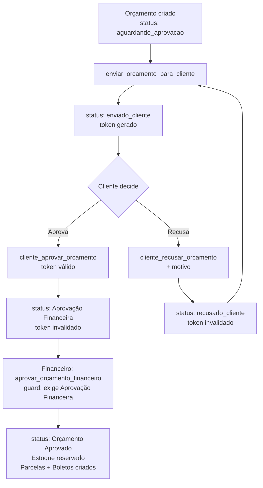

# SPEC-009 — Aprovação do Cliente no Orçamento

> Atualização 06/07/2026: esta SPEC continua válida para a existência do aceite do cliente, token, recusa e aprovação manual. O desenho de status `aprovado_cliente -> aprovado` foi superado pela [SPEC-016](SPEC-016_Normalizacao_Aprovacao_Financeira_Orcamento.md), que consolidou o contrato oficial como `enviado_cliente -> Aprovação Financeira -> Orçamento Aprovado`.

## Checklist de Ação

- [x] Adicionar 6 colunas em `orcamentos` para rastrear o ciclo de aprovação do cliente
- [x] Criar índice em `token_aprovacao_cliente`
- [x] Criar RPC `enviar_orcamento_para_cliente(p_orcamento_id)`
- [x] Criar RPC `cliente_aprovar_orcamento(p_orcamento_id, p_token)`
- [x] Criar RPC `cliente_recusar_orcamento(p_orcamento_id, p_token, p_motivo)`
- [x] Adicionar guard em `aprovar_orcamento_financeiro_base_spec001` — bloqueio aplicado para status fora de `aprovado_cliente`/`aprovado`
- [x] Executar migration `20260704_018_aprovacao_cliente_orcamento` no Supabase
- [x] Implementar normalização da SPEC-016 para transformar `aprovado_cliente`, `aprovado` e `aprovado_financeiro` em legados/compatibilidade
- [x] Ajustar sistema de Orçamentos: botão "Enviar para cliente" que chama a RPC e exibe link/token — **confirmado implementado em `ClientApprovalTab.tsx`** (`handleEnviar` → `enviarOrcamentoCliente` → RPC `enviar_orcamento_para_cliente`, com `buildClientApprovalLink`/cópia de link, `handleCopyLink`, `handleAprovarManual` e recusa). Achado em 07/07/2026: o item estava marcado como pendente neste documento, mas o código já existe.

### Passos manuais do usuário

- [x] Confirmar decisão sobre compatibilidade retroativa: migration `005_backfill_compatibilidade.sql` aplicada
- [ ] Confirmar se token de aprovação expira ou não (ver Ponto em aberto P-01)
- [x] Confirmar se ADM pode aprovar pelo cliente sem token (ver Ponto P-02): permitido por `adm_aprovar_pelo_cliente`
- [x] Executar migration de normalização do contrato de status/RPC após revisão
- [ ] Testar fluxo completo em ambiente de homologação antes de liberar novos botões no frontend

## Objetivo

Hoje o orçamento vai direto da elaboração para aprovação administrativa, sem que o cliente tenha formalmente aceitado. Isso reserva estoque e gera pendências financeiras para projetos ainda não confirmados.

Esta SPEC introduz a fase de **aprovação do cliente** como etapa obrigatória antes que a ADM possa processar financeiramente um orçamento. O cliente recebe um link com token único e registra a aceitação ou recusa. No desenho original, a ADM só conseguiria aprovar o orçamento financeiramente após `status = 'aprovado_cliente'`; pela SPEC-016, o status operacional correto após aceite passa a ser `Aprovação Financeira`.

## Decisões aprovadas

- A aprovação do cliente deve existir antes da aprovação financeira/administrativa.
- O link/token de aprovação é de uso único.
- A aprovação manual pela ADM é permitida para casos presenciais/verbais, desde que fique registrada em histórico.
- A partir da reavaliação de 06/07/2026, o próximo passo não é criar novas RPCs, e sim normalizar o fluxo real já existente no banco.
- A SPEC-016 define que a aprovação do cliente não gera itens, parcelas, boletos ou reserva; ela apenas move o orçamento para `Aprovação Financeira`.

## Definição da SPEC

### Estado original identificado em 04/07/2026

| Item | Situação |
|---|---|
| `orcamentos.status` | `text`, default `'aguardando_aprovacao'` — aceita valores livres, sem enum |
| Status conhecidos hoje | `'aguardando_aprovacao'`, `'aprovado'`, `'cancelado'` |
| `historico_status_orcamentos` | Existe — registra cada mudança de status |
| Colunas de rastreio do cliente | **Não existem** em `orcamentos` |
| Guard na RPC de aprovação ADM | **Não existe** — qualquer status permite aprovação hoje |
| Modelo de referência | `orcamentos_revenda_ubiqua` já tem `enviado_em`, `aprovado_em`, `aprovado_por`, `rejeitado_em`, `motivo_rejeicao` |

### Estado real confirmado em 06/07/2026 antes da SPEC-016

O snapshot reextraído do Supabase real em 06/07/2026 mostra que parte desta SPEC já foi aplicada:

- `orcamentos` já possui `enviado_cliente_em`, `enviado_cliente_por`, `aprovado_cliente_em`, `recusado_cliente_em`, `motivo_recusa_cliente` e `token_aprovacao_cliente`.
- Já existem as RPCs `enviar_orcamento_para_cliente`, `cliente_aprovar_orcamento`, `cliente_recusar_orcamento` e `adm_aprovar_pelo_cliente`.
- `aprovar_orcamento_financeiro_base_spec001` já continha guard exigindo `aprovado_cliente` ou `aprovado`.
- Também existem funções/trigger de outro desenho: `aprovar_orcamento_cliente`, `aprovar_orcamento_cliente_manual`, `aprovar_orcamento_cliente_publico`, `handle_orcamento_workflow` e `normalize_orcamento_status`.
- O banco real continha status de orçamento em uso: `Orçamento Aprovado`, `enviado_cliente` e `Aprovação Financeira`.

**Inconsistência reavaliada:** esta SPEC desenhava a transição `aprovado_cliente -> aprovado`, enquanto parte do banco real usa `enviado_cliente -> Aprovação Financeira -> Orçamento Aprovado`. A SPEC-016 escolheu o segundo contrato como oficial e a migration de normalização foi aplicada antes da atualização dos botões/fluxos financeiros no sistema de Orçamentos.

### Máquina de estados original, mantida como histórico

```
aguardando_aprovacao
        │
        │  enviar_orcamento_para_cliente()
        ▼
enviado_cliente           ← enviado_cliente_em = now()
        │
        ├──── cliente_aprovar_orcamento()
        │         ▼
        │    aprovado_cliente  ← aprovado_cliente_em = now()
        │         │
        │         │  aprovar_orcamento_financeiro()  [já existente — com guard novo]
        │         ▼
        │       aprovado  → estoque reservado, parcelas, boletos
        │
        └──── cliente_recusar_orcamento()
                  ▼
             recusado_cliente  ← recusado_cliente_em + motivo_recusa_cliente
                  │
                  │  enviar_orcamento_para_cliente()  [reenvio após revisão]
                  ▼
             enviado_cliente  (novo token gerado)
```

### Máquina de estados consolidada pela SPEC-016

```text
aguardando_aprovacao / rascunho
        |
        | enviar_orcamento_para_cliente()
        v
enviado_cliente
        |
        | cliente_aprovar_orcamento() ou aprovação manual interna
        v
Aprovação Financeira
        |
        | aprovar_orcamento_financeiro(p_orcamento_id)
        v
Orçamento Aprovado -> projeto_itens, projeto_parcelas, boletos, reserva
```

Transições bloqueadas após esta SPEC:
- `aguardando_aprovacao` -> `Orçamento Aprovado` direto: **PROIBIDO**
- `enviado_cliente` -> `Orçamento Aprovado` direto: **PROIBIDO**
- `cancelado` continua sendo permitido de qualquer status

### Novas colunas em `orcamentos`

```sql
ALTER TABLE public.orcamentos
    ADD COLUMN IF NOT EXISTS enviado_cliente_em      timestamp with time zone,
    ADD COLUMN IF NOT EXISTS enviado_cliente_por     uuid REFERENCES auth.users(id),
    ADD COLUMN IF NOT EXISTS aprovado_cliente_em     timestamp with time zone,
    ADD COLUMN IF NOT EXISTS recusado_cliente_em     timestamp with time zone,
    ADD COLUMN IF NOT EXISTS motivo_recusa_cliente   text,
    ADD COLUMN IF NOT EXISTS token_aprovacao_cliente text UNIQUE;

CREATE INDEX IF NOT EXISTS idx_orcamentos_token_aprovacao
    ON public.orcamentos (token_aprovacao_cliente)
    WHERE token_aprovacao_cliente IS NOT NULL;
```

| Coluna | Tipo | Descrição |
|---|---|---|
| `enviado_cliente_em` | `timestamptz` | Quando foi enviado ao cliente (última vez) |
| `enviado_cliente_por` | `uuid → auth.users` | Usuário interno que enviou |
| `aprovado_cliente_em` | `timestamptz` | Quando o cliente aprovou |
| `recusado_cliente_em` | `timestamptz` | Quando o cliente recusou (mais recente) |
| `motivo_recusa_cliente` | `text` | Razão da última recusa |
| `token_aprovacao_cliente` | `text UNIQUE` | Token de uso único para o link de aprovação |

### RPC: `enviar_orcamento_para_cliente`

**Assinatura:**
```sql
CREATE OR REPLACE FUNCTION public.enviar_orcamento_para_cliente(
    p_orcamento_id uuid
) RETURNS jsonb
```

**O que faz:**
1. Valida que o orçamento existe e o status é `'aguardando_aprovacao'` ou `'recusado_cliente'`
2. Gera um `token_aprovacao_cliente` único (`gen_random_uuid()::text`)
3. Atualiza `status = 'enviado_cliente'`, `enviado_cliente_em = now()`, `enviado_cliente_por = auth.uid()`
4. Registra em `historico_status_orcamentos`
5. Retorna o token para o frontend montar o link de aprovação

**Retorno:**
```json
{
  "orcamento_id": "...",
  "numero": "ORC-0012",
  "status": "enviado_cliente",
  "token": "3f8a2b1c-...",
  "enviado_em": "2026-07-04T14:00:00Z"
}
```

**Erros:**
- `P0001` — Orçamento não encontrado
- `P0002` — Status não permite envio (ex: já `aprovado_cliente` ou `aprovado`)

---

### RPC: `cliente_aprovar_orcamento`

**Assinatura:**
```sql
CREATE OR REPLACE FUNCTION public.cliente_aprovar_orcamento(
    p_orcamento_id uuid,
    p_token        text
) RETURNS jsonb
```

**O que faz:**
1. Valida que `token_aprovacao_cliente = p_token` e status é `'enviado_cliente'`
2. No desenho original, atualiza `status = 'aprovado_cliente'`; após SPEC-016, deve atualizar `status = 'Aprovação Financeira'`, mantendo `aprovado_cliente_em = now()`
3. Limpa o token (`token_aprovacao_cliente = NULL`) — uso único
4. Registra em `historico_status_orcamentos`

**Retorno:**
```json
{
  "orcamento_id": "...",
  "numero": "ORC-0012",
  "status": "Aprovação Financeira",
  "aprovado_em": "2026-07-04T15:00:00Z"
}
```

**Erros:**
- `P0001` — Token inválido ou orçamento não encontrado
- `P0002` — Status inválido (já aprovado, cancelado, etc.)

---

### RPC: `cliente_recusar_orcamento`

**Assinatura:**
```sql
CREATE OR REPLACE FUNCTION public.cliente_recusar_orcamento(
    p_orcamento_id uuid,
    p_token        text,
    p_motivo       text DEFAULT NULL
) RETURNS jsonb
```

**O que faz:**
1. Valida token e status `'enviado_cliente'`
2. Atualiza `status = 'recusado_cliente'`, `recusado_cliente_em = now()`, `motivo_recusa_cliente = p_motivo`
3. Limpa o token
4. Registra em `historico_status_orcamentos`

**Retorno:**
```json
{
  "orcamento_id": "...",
  "numero": "ORC-0012",
  "status": "recusado_cliente",
  "motivo": "Valor acima do orçado pelo cliente"
}
```

---

### Alteração original em `aprovar_orcamento_financeiro_base_spec001`

Bloco histórico da SPEC-009 aplicada. Para novas migrations, usar a SPEC-016: o guard deve exigir `Aprovação Financeira`, não `aprovado_cliente`.

```sql
IF v_orcamento.status <> 'aprovado_cliente' THEN
    RAISE EXCEPTION
        'Orçamento % não pode ser aprovado administrativamente: '
        'cliente ainda não aprovou. Status atual: %',
        v_numero_orcamento, v_orcamento.status
        USING ERRCODE = 'P0003';
END IF;
```

> Impacto: orçamentos existentes com `status = 'aguardando_aprovacao'` ficarão bloqueados. Ver compatibilidade retroativa abaixo.

---

### Regras de negócio

| # | Regra |
|---|---|
| RN-01 | Aprovação administrativa/financeira (estoque + parcelas + boletos) só é possível após `status = 'Aprovação Financeira'`, conforme SPEC-016 |
| RN-02 | Token de aprovação é de uso único — invalidado após qualquer uso (aprovar ou recusar) |
| RN-03 | Vendedor pode reenviar após recusa (`recusado_cliente → enviado_cliente`), gerando novo token |
| RN-04 | `cancelar_orcamento()` continua funcionando de qualquer status |
| RN-05 | Cada mudança de status deve ser registrada em `historico_status_orcamentos` |

---

### Compatibilidade retroativa

Os orçamentos já em `status = 'aprovado'` **não são afetados** — o guard só bloqueia a transição para `aprovado`, não registros já nesse estado.

Orçamentos em `status = 'aguardando_aprovacao'` ficarão bloqueados pelo guard. Opções:

| Opção | Descrição |
|---|---|
| **A (recomendada)** | Backfill: setar `status = 'aprovado_cliente'` nos orçamentos `aguardando_aprovacao` que já têm aprovação verbal confirmada |
| **B** | Ativar guard apenas para orçamentos criados após a data da migration (coluna `created_at`) |
| **C** | Ativar guard como `WARNING` primeiro, transformar em `EXCEPTION` após período de transição |

**Estado em 06/07/2026:** compatibilidade aplicada pela migration `005_backfill_compatibilidade.sql`. A pendência remanescente não é mais backfill nem normalização de status/RPC; a SPEC-016 já foi aplicada. Resta homologar o fluxo operacional completo e decidir detalhes de envio/expiração do token.

---

### Pontos em aberto e resolvidos

| # | Situação | Questão | Impacto |
|---|---|---|---|
| P-01 | Aberto | Token de aprovação expira? Se sim, em quanto tempo? | Segurança do link enviado por e-mail/WhatsApp |
| P-02 | Resolvido | ADM pode marcar `aprovado_cliente` manualmente (sem token) para casos presenciais/verbais? | Sim, via `adm_aprovar_pelo_cliente`, com histórico |
| P-03 | Resolvido | O que fazer com orçamentos `aguardando_aprovacao` existentes quando o guard for ativado? | Backfill aplicado e normalização da SPEC-016 executada |
| P-04 | Aberto | Frontend gera e envia o e-mail/WhatsApp com o link, ou Supabase Edge Function envia automaticamente? | Escopo da implementação no sistema de Orçamentos |
| P-05 | Aberto | Ao reenviar após recusa, cria nova versão numerada do orçamento ou reenvia o mesmo? | Rastreabilidade de versões |

---

### Tabelas afetadas

| Tabela | Operação | Detalhe |
|---|---|---|
| `orcamentos` | `ALTER TABLE` + `UPDATE` via RPCs | +6 colunas + índice |
| `historico_status_orcamentos` | `INSERT` | Uma linha por transição |
| `aprovar_orcamento_financeiro_base_spec001` | `CREATE OR REPLACE` | Guard de status |

Não afetadas: `estoque_itens`, `projeto_itens`, `projeto_parcelas`, `boletos`.

---

### Migration planejada

```
supabase/db/migrations/20260704_018_aprovacao_cliente_orcamento/
  001_add_colunas_aprovacao_cliente.sql    — ALTER TABLE orcamentos + índice
  002_rpc_enviar_orcamento_cliente.sql     — CREATE FUNCTION enviar_orcamento_para_cliente
  003_rpc_cliente_aprovar_recusar.sql      — CREATE FUNCTION cliente_aprovar/recusar_orcamento
  004_guard_aprovacao_financeira.sql       — CREATE OR REPLACE aprovar_orcamento_financeiro (guard)
  005_backfill_compatibilidade.sql         — (conforme decisão P-03)
  README.md
```

---

### Critérios de aceite

- [x] Orçamento em `aguardando_aprovacao` não pode ser aprovado financeiramente sem passar por `Aprovação Financeira`
- [x] `enviar_orcamento_para_cliente()` gera token único, muda status e registra histórico
- [x] `cliente_aprovar_orcamento()` com token válido invalida o token e, após SPEC-016, muda status para `Aprovação Financeira`
- [x] `cliente_aprovar_orcamento()` com token inválido ou status errado lança exceção
- [x] `cliente_recusar_orcamento()` registra motivo, invalida token e permite reenvio posterior
- [x] Reenvio após recusa gera novo token
- [x] Orçamento legado já em `aprovado` não é afetado pelas RPCs de cliente; a normalização final fica na SPEC-016
- [x] `cancelar_orcamento()` continua funcionando de qualquer status
- [x] Cada transição aparece em `historico_status_orcamentos`

---

### Fluxo visual consolidado pela SPEC-016



## Realizado

- Migration `20260703_017_razao_social_clientes` aplicada no banco real (`contatos.razao_social` existe).
- Migration `20260704_018_aprovacao_cliente_orcamento` aplicada no banco real: colunas de aprovação do cliente, RPCs de envio/aprovação/recusa/manual e guard em `aprovar_orcamento_financeiro_base_spec001`.
- Snapshot `supabase/db/current/` reextraído em 06/07/2026 refletindo o estado real.
- Migration `20260706_020_normalizacao_aprovacao_financeira_orcamento` aplicada no Supabase real: aprovação do cliente termina em `Aprovação Financeira` e a aprovação financeira final exige essa fila antes de gerar efeitos por `orcamento_id`.
- Sistema de Orçamentos atualizado pela SPEC-017 para listar/editar/aprovar financeiramente por orçamento, não por projeto.

## Pendências

- [ ] Ajustar sistema de Orçamentos: botão "Enviar para cliente", exibição de status e geração do link, depois da normalização.
- [ ] Testar caminho completo: enviar → cliente aprova → revisão/aprovação financeira → orçamento aprovado.
- [ ] Validar que orçamento sem aprovação do cliente não reserva estoque nem gera parcelas/boletos.
