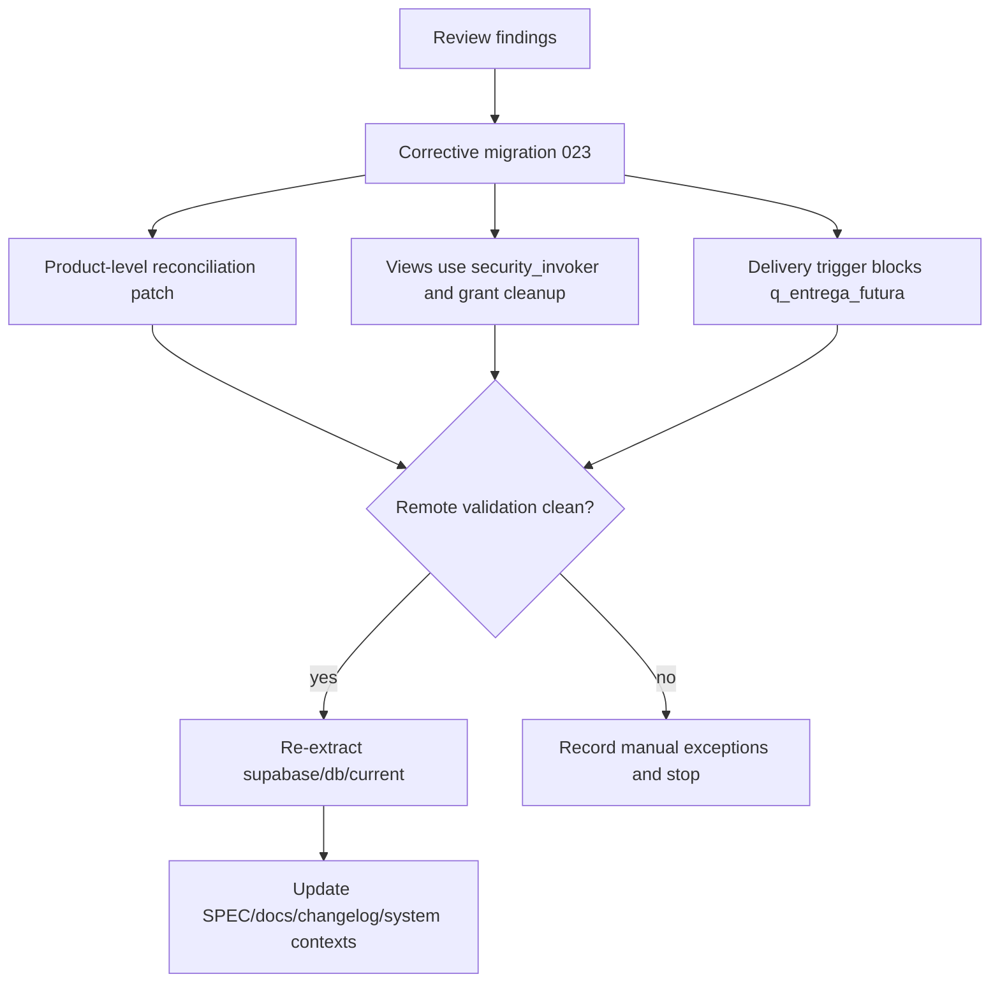

# fix: Harden SPEC-010 Stock Balances

## Goal Capsule

| Field | Value |
|---|---|
| Objective | Bring the applied SPEC-010 migration to a safe production state by closing the view/RLS leak, reconciling current stock balance drift, hardening delivery semantics, and aligning docs with the real Supabase state. |
| Authority | SPEC-010 owns the stock-balance model; Supabase real state owns applied-schema truth; repo docs must match applied reality after verification. |
| Execution profile | Database-first hardening with explicit Supabase execution approval before any write to the remote database. |
| Stop conditions | Stop before remote writes if the reconciliation set changes, if a product requires business judgement, or if a proposed RLS policy broadens access beyond the current decision. |
| Tail ownership | After SQL is applied remotely, re-extract `supabase/db/current/`, update docs, and leave a verification trail in `CHANGELOG.md` and the SPEC-010 checklist. |

---

## Product Contract

### Summary

SPEC-010 has been applied in the Supabase real database, but the implementation is not yet safe to call complete.
The follow-up must preserve the chosen model - live operational stock balance by `projeto_item_id` - while fixing security, data reconciliation, and documentation drift found in review.

### Problem Frame

The migration created `estoque_saldos_projeto_item`, `estoque_movimentos_projeto_item`, and the three stock views, and the real database confirms those objects exist.
However, the views currently expose rows to `anon` and `authenticated` despite the migration text saying only `service_role` should access these tables until RLS is decided.
The real database also has four products where open SPEC-010 balances do not reconcile with `estoque_itens.quantidade_reservada`.
Finally, `trigger_fechar_projeto` still delivers any open balance, including `q_entrega_futura`, even though SPEC-010 says future delivery cannot be delivered directly.

### Requirements

- R1. The three SPEC-010 read views must not bypass RLS on `estoque_saldos_projeto_item` and `estoque_movimentos_projeto_item`.
- R2. Access for `anon` and `authenticated` must stay closed until a business RLS policy is explicitly approved.
- R3. The four known reconciliation differences between open saldos and `estoque_itens.quantidade_reservada` must be resolved or recorded as manual exceptions.
- R4. `trigger_fechar_projeto` must block direct delivery when any active project item still has `q_entrega_futura > 0`.
- R5. Delivery must move only the real open covered balance to `q_entregue` and decrement aggregate stock reservation by that same real open amount.
- R6. The backfill SQL must be safe to re-read and re-run in future environments without creating misleading audit movements for rows it did not create.
- R7. Documentation must reflect that SPEC-010 is applied in the real database, with hardening/reconciliation pending until this plan lands.
- R8. `supabase/db/current/` must be re-extracted only after the corrective SQL has been applied to the real Supabase database.

### Acceptance Examples

- AE1. Given role `anon`, when querying `vw_estoque_saldos_projeto_item`, then it must not reveal SPEC-010 saldo rows while the base tables have RLS enabled without policy.
- AE2. Given an active saldo with `q_entrega_futura > 0`, when a project transitions to `Entrega materiais`, then the trigger must raise a controlled exception instead of moving that future balance to `q_entregue`.
- AE3. Given an active saldo where only `q_reserva + q_ag_separar + q_separado` remains open, when delivery succeeds, then `q_entregue` increases by that open amount and `estoque_itens.quantidade_reservada` decreases by the same product-level sum.
- AE4. Given the current real database, when the reconciliation query runs after correction, then the count of products where open saldo differs from `quantidade_reservada` is zero or each remaining row is listed as an explicit manual exception.

### Scope Boundaries

This plan fixes the SPEC-010 migration and its immediate applied-state drift.
It does not implement SPEC-011 transfer, SPEC-012 purchase-need views, SPEC-014 CRM badges, or SPEC-015 return flows.

#### Deferred to Follow-Up Work

- Define the final business RLS policy for sellers, stock users, admins, and service workflows.
- Add UI consumption of `vw_estoque_saldos_projeto_item` in CRM/Estoque/Logistica after the hardened database contract is stable.
- Build transfer, purchase-need, and return RPCs in their own SPECs.

---

## Planning Contract

### Key Technical Decisions

- KTD1. Fix view exposure with invoker security and explicit grant cleanup. `WITH (security_invoker = true)` makes the views honor base-table RLS; revoking broad access from `anon`/`authenticated` keeps the current "service_role only" decision true until a policy exists.
- KTD2. Use an additive corrective migration instead of replaying `20260706_022`. The real database already has SPEC-010 objects, and the original migration is not registered in `supabase_migrations.schema_migrations` under the repo's `20260706_022` name, so the fix must be idempotent and object-aware.
- KTD3. Reconcile by product-level open saldo, not by original item quantity. SPEC-010 defines the aggregate compatibility value as the sum of open balances, so the correction must compare that sum against `estoque_itens.quantidade_reservada`.
- KTD4. Delivery must refuse future-only stock. `q_entrega_futura` means the item is approved without physical coverage; moving it to `q_entregue` hides an unresolved purchase/receipt need.
- KTD5. Update snapshots only after remote write verification. `db/current/` represents the real Supabase state, so local edits before the corrective migration lands would recreate the drift found in this review.

### High-Level Technical Design

### Assumptions

- The counts observed on 2026-07-07 are the expected baseline: 9 saldos, 9 movimentos, 0 missing saldos, 0 saldos exceeding `projeto_itens.quantidade`, and 4 product reconciliation differences.
- Remote write access requires explicit user approval before running any SQL against Supabase real.
- The final RLS business policy remains undecided; this plan preserves the closed-access posture rather than inventing a broad policy.

### Sequencing

1. Prepare and review SQL locally.
2. Apply the corrective SQL to Supabase real only after explicit approval.
3. Validate RLS/view access and reconciliation against the real database.
4. Re-extract `supabase/db/current/`.
5. Update docs and system context so future agents stop treating SPEC-010 as pending.

---

## Implementation Units

### U1. Close SPEC-010 View Access

- **Goal:** Prevent `vw_estoque_saldos_projeto_item`, `vw_estoque_por_produto_projeto`, and `vw_estoque_resumo` from exposing saldo rows while base-table RLS has no business policy.
- **Requirements:** R1, R2, AE1
- **Dependencies:** None
- **Files:** `supabase/db/migrations/20260707_023_spec010_hardening/001_fix_views_rls.sql`, `supabase/db/migrations/20260706_022_saldos_estoque_projeto_item/003_views_saldos_estoque.sql`, `supabase/db/migrations/20260707_023_spec010_hardening/README.md`
- **Approach:** Add a corrective migration that alters or recreates all three views with `security_invoker = true`, then revokes broad privileges from `anon` and `authenticated` unless a later RLS decision explicitly grants them. Also update the original untracked `003_views_saldos_estoque.sql` so future environments do not recreate the leak.
- **Execution note:** Validate with role-switched SQL before and after the remote change; this is a security-sensitive database fix.
- **Patterns to follow:** Existing snapshot views that already use `WITH (security_invoker='on')`, such as `vw_estoque_por_marca` in `supabase/db/current/01_schema_full.sql`.
- **Test scenarios:**
  - Query as `anon` against each SPEC-010 view and expect zero leaked saldo rows or permission denial while no policy exists.
  - Query as `authenticated` against each SPEC-010 view and expect the same closed behavior.
  - Query via service role or privileged database session and expect the 9 applied saldo rows remain visible for verification.
- **Verification:** The real database no longer returns the 9 SPEC-010 saldo rows to `anon` through the views, and the view definitions show `security_invoker`.

### U2. Reconcile Open Saldos With Aggregate Reservation

- **Goal:** Resolve the four current product differences between open SPEC-010 saldo and `estoque_itens.quantidade_reservada`.
- **Requirements:** R3, AE4
- **Dependencies:** U1 can run independently, but remote apply should batch after review.
- **Files:** `supabase/db/migrations/20260707_023_spec010_hardening/002_reconcile_quantidade_reservada.sql`, `supabase/db/migrations/20260707_023_spec010_hardening/README.md`, `CHANGELOG.md`
- **Approach:** Build a report CTE that computes open saldo by product and compares it with `estoque_itens.quantidade_reservada`. For the current four-product set, update the aggregate to the open saldo only after confirming no hidden legacy reservation should remain. Record any manual exception instead of forcing a value when business meaning is unclear.
- **Execution note:** Stop before remote write if the reconciliation query returns products other than the four observed on 2026-07-07.
- **Patterns to follow:** SPEC-010's reconciliation rule in `03-Projeto/Planos de Ação/SPECs/SPEC-010_Saldos_Estoque_por_Item_de_Projeto.md`.
- **Test scenarios:**
  - Run the reconciliation query before correction and expect the known four rows to appear.
  - Apply the correction in a transaction and rerun the query before commit; expect zero differences or explicitly documented exceptions.
  - Roll back a dry run and confirm no permanent changes happen during review.
  - After approved apply, run the same query against real Supabase and record the final count.
- **Verification:** Reconciliation count is zero, or every remaining difference has a named business exception in the migration README and CHANGELOG.

### U3. Harden Delivery and Backfill Semantics

- **Goal:** Make SPEC-010 delivery rules match the Product Contract and make backfill SQL idempotent for future environments.
- **Requirements:** R4, R5, R6, AE2, AE3
- **Dependencies:** None for local SQL; remote apply should happen with U1/U2.
- **Files:** `supabase/db/migrations/20260707_023_spec010_hardening/003_harden_entrega_backfill.sql`, `supabase/db/migrations/20260706_022_saldos_estoque_projeto_item/002_atualizar_aprovacao_cancelamento_entrega.sql`, `supabase/db/migrations/20260706_022_saldos_estoque_projeto_item/004_backfill_saldos_projeto_item.sql`, `supabase/db/migrations/20260707_023_spec010_hardening/README.md`
- **Approach:** Update `trigger_fechar_projeto` so it checks active project saldos for `q_entrega_futura > 0` and raises a controlled exception before physical delivery. When delivery is allowed, aggregate real open covered quantity by product and decrement `estoque_itens.quantidade_reservada` by that amount, not by `projeto_itens.quantidade`. Rewrite backfill audit insertion to use the inserted rows from a CTE so it cannot create audit movements for pre-existing saldos.
- **Execution note:** Treat trigger changes as high risk because they alter project status transitions and stock movement.
- **Patterns to follow:** Existing `cancelar_orcamento` logic in the same migration already calculates open saldo before mutating rows.
- **Test scenarios:**
  - Create or identify a project with an active saldo containing `q_entrega_futura > 0`; transitioning to `Entrega materiais` must fail with a clear message.
  - Create or identify a project with active covered saldo only; transitioning to `Entrega materiais` must move the open covered amount to `q_entregue`.
  - For a partially delivered or manually adjusted saldo, delivery must decrement aggregate reservation by the remaining open covered amount, not the original item quantity.
  - Re-run the backfill script in a transaction and confirm it creates no duplicate movement rows for existing saldos.
- **Verification:** Trigger behavior satisfies AE2 and AE3 in transactional tests, and the backfill script is safe under repeated execution.

### U4. Align Documentation and Current Snapshot

- **Goal:** Remove stale statements that SPEC-010 is not applied and re-extract the snapshot after the corrective migration is applied.
- **Requirements:** R7, R8
- **Dependencies:** U1, U2, U3 remote apply and validation
- **Files:** `supabase/README.md`, `supabase/docs/ai_context_global.md`, `supabase/docs/relationships.md`, `supabase/docs/table_index.md`, `supabase/docs/pending_decisions.md`, `supabase/db/domains/estoque_compras.md`, `supabase/db/domains/crm.md`, `03-Projeto/00_INDICE.md`, `03-Projeto/Planos de Ação/SPECs/SPEC-010_Saldos_Estoque_por_Item_de_Projeto.md`, `03-Projeto/Planos de Ação/00_TASKS_GERAIS_ECOSSISTEMA.md`, `CHANGELOG.md`, `supabase/db/current/00_manifest.md`, `supabase/db/current/01_schema_full.sql`, `supabase/db/current/03_functions.sql`, `supabase/db/current/04_triggers.sql`, `supabase/db/current/05_views.sql`, `supabase/db/current/07_rls_policies.sql`, `supabase/db/current/09_schema_inventory.md`
- **Approach:** Update docs to say SPEC-010 is applied but hardening/reconciliation was required. Re-extract `db/current/` from the real database only after the corrective migration lands, and make the manifest describe the applied sequence accurately.
- **Execution note:** Preserve unrelated user edits in the currently dirty repo; do not clean or revert broad snapshot churn unless it contradicts the verified database state.
- **Patterns to follow:** Existing Supabase docs use "Estado confirmado em YYYY-MM-DD" and domain-specific pending sections.
- **Test scenarios:**
  - Grep central docs for stale phrases like "ainda nao existem", "aguardando execucao manual", and "nao implementada" around SPEC-010; expect only historical or clearly qualified references to remain.
  - Compare re-extracted snapshot objects against the corrected real database; expect the SPEC-010 objects, views, functions, triggers, and RLS state to match.
  - Confirm SPEC-011/012/014/015 remain marked dependent on hardened SPEC-010 behavior, not blocked on the table creation itself.
- **Verification:** Documentation consistently distinguishes "SPEC-010 applied" from "business RLS and dependent SPECs pending".

### U5. Version, Registration, and Handoff Checks

- **Goal:** Leave the repo in a traceable state that future Supabase workflows can understand.
- **Requirements:** R7, R8
- **Dependencies:** U1, U2, U3, U4
- **Files:** `supabase/db/migrations/20260707_023_spec010_hardening/README.md`, `CHANGELOG.md`, `03-Projeto/Planos de Ação/SPECs/SPEC-010_Saldos_Estoque_por_Item_de_Projeto.md`
- **Approach:** Document whether SPEC-010 was applied through SQL Editor outside CLI migration tracking, and make the new `023` migration explicitly additive. If the team wants CLI history parity, include a controlled registration note rather than silently inserting rows into `supabase_migrations.schema_migrations`.
- **Execution note:** Do not update `supabase_migrations.schema_migrations` without explicit approval; that is remote metadata mutation.
- **Patterns to follow:** Migration READMEs that state whether a migration is pending, applied, or mirrored from a system migration.
- **Test scenarios:**
  - Query `supabase_migrations.schema_migrations` and confirm how the applied SPEC-010 and corrective migration are represented.
  - Confirm all new corrective migration files are tracked by Git along with the previously untracked SPEC-010 files.
  - Confirm `CHANGELOG.md` names the applied hardening and the verification results.
- **Verification:** Future agents can tell which SQL was applied, which SQL is additive, and what still requires business decision.

---

## Verification Contract

| Gate | Applies to | Done signal |
|---|---|---|
| Static SQL review | U1, U2, U3 | Corrective migration is additive, idempotent, and does not replay object creation that already exists in Supabase real. |
| Role-based access check | U1 | `anon` and `authenticated` cannot read SPEC-010 saldo rows through the views while no business policy exists. |
| Reconciliation query | U2 | Product-level open saldo equals `estoque_itens.quantidade_reservada`, or remaining exceptions are documented. |
| Transactional trigger tests | U3 | Delivery blocks `q_entrega_futura` and delivers only covered open saldo. |
| Backfill idempotency check | U3 | Re-running backfill in a transaction creates no duplicate or misleading movement rows. |
| Snapshot refresh | U4 | `supabase/db/current/` matches the corrected real database and the manifest names the corrected state. |
| Documentation grep | U4, U5 | Stale "SPEC-010 not applied" statements are removed or clearly marked historical. |

---

## Definition of Done

- The corrective SQL is reviewed locally and applied to Supabase real only after explicit approval.
- SPEC-010 views no longer leak saldo data to `anon` or `authenticated`.
- The four known reconciliation differences are fixed or documented as manual exceptions.
- `trigger_fechar_projeto` blocks `q_entrega_futura` delivery and uses real open covered saldo for delivery movement.
- Backfill SQL is idempotent for future environments.
- `supabase/db/current/` is refreshed from the corrected real database.
- SPEC-010, Supabase docs, domain docs, index docs, and CHANGELOG all describe the same state.
- Previously untracked SPEC-010 and migration files are staged or otherwise accounted for before commit.
- Abandoned scratch SQL or temporary validation outputs are not left in the repo.

---

## Appendix

### Review Evidence Captured Before Planning

- Supabase real contains both SPEC-010 tables and all three views.
- Supabase real contains 9 saldo rows and 9 movement rows.
- `anon` direct table access returned zero rows, but `anon` view access returned 9 saldo rows and 1749 summary rows.
- Four products showed reconciliation drift between open saldo and `estoque_itens.quantidade_reservada`: product codes `13578`, `9543`, `5322`, and `9022`.
- Several repo docs still said `estoque_saldos_projeto_item` and `estoque_movimentos_projeto_item` did not exist in the real database.
