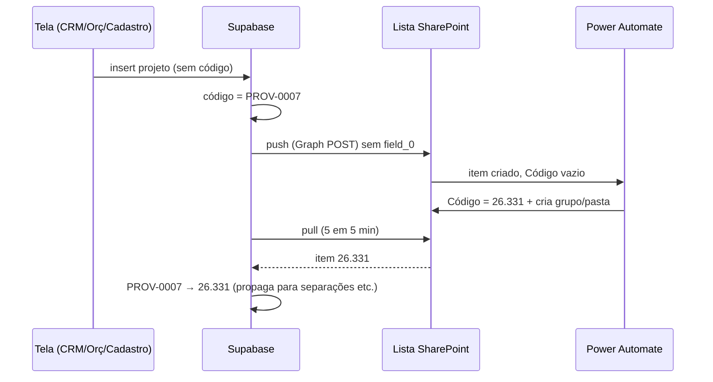

# SPEC-228 — Código do projeto gerado só pelo SharePoint (para o Power Automate criar o grupo)

## Checklist de Ação

- [x] A1 — Banco: código provisório automático (`PROV-NNNN`) quando o projeto é criado sem código (trigger BEFORE INSERT + sequence própria).
- [x] A2 — Banco: trigger `trg_projetos_sharepoint_push_fn` passa a disparar também para código provisório (`^PROV-\d+$`), mantendo a guarda que barra `COM-N`, `PRJ-TESTE` etc.
- [x] A3 — Banco: RPC `aplicar_pull_sharepoint` usa o código provisório (não mais `gerar_codigo_projeto()`) quando o item da lista ainda não tem Código; e troca o provisório pelo oficial quando o Código chega.
- [x] A4 — Banco: aposentar `gerar_codigo_projeto()` (sem uso depois de A3/B1) e a tabela `projeto_codigo_sequencia` (hoje parada em 1621, causa do 26.1620 do teste).
- [x] A5 — Banco: conferir onde o código do projeto é copiado como texto (`separacoes.codigo_obra` já é atualizado por `propagate_projeto_codigo`; levantar as colunas `projeto_codigo` de outras tabelas/views) e garantir que a troca provisório → oficial chega em todas.
- [x] B1 — Edge Function `sharepoint-projetos-push`: **nunca enviar `field_0` (Código)**, nem na criação nem na edição; remover a geração de código; anti-duplicação por código só quando o código for oficial.
- [x] B2 — Edge Function `salvar-projeto`: código deixa de ser obrigatório na criação.
- [x] C1 — CRM `ProjectNew.tsx`: tirar o campo Código e a sugestão "último + 1"; mostrar "O código será gerado pelo SharePoint em alguns minutos".
- [x] C2 — Orçamentos `ProjectCreateModal.tsx`: tirar o campo Código e a checagem de duplicidade.
- [x] C3 — Cadastro `ProjetoFormDialog.tsx`: na criação, sem campo Código; na edição, Código só leitura.
- [x] C4 — Listas/telas que mostram o código: projeto com `PROV-*` aparece com aviso "aguardando código do SharePoint".
- [x] D1 — Teste ponta a ponta pelo CRM: criar projeto → item na lista sem Código → fluxo numera → grupo criado no Teams → sistema troca `PROV-*` pelo código oficial em até ~6 min.
- [ ] D2 — Limpeza dos testes de 26/10 (ver Pendências).

### Passos manuais do usuário

- [x] Aprovar as decisões em aberto (as 4 recomendações aprovadas em 26/10).
- [x] Aplicar a migration no Supabase de São Paulo (244 aplicada em 26/10).
- [x] Publicar as Edge Functions `sharepoint-projetos-push` e `salvar-projeto` (v4) e os 3 sistemas (push → Cloudflare).
- [ ] Combinar com o Igor: o fluxo continua sendo o **único** gerador de código e deve continuar rodando em item criado por aplicativo ("SharePoint App").
- [ ] Conferir no Teams o grupo do teste D1.

## Objetivo

Projeto criado pelo sistema precisa gerar o **grupo no Teams**, como acontece com projeto criado direto na lista. Hoje não gera: o sistema manda o item já com o Código preenchido e o fluxo do Power Automate (Igor) só roda quando o Código chega **vazio** — é ele quem numera e cria o grupo. Resultado esperado: o sistema cria o item sem Código, o fluxo numera e cria o grupo, e o sistema puxa o código oficial de volta. **Um único gerador de código: o SharePoint.**

## Decisões aprovadas

- O código oficial do projeto é gerado **só pelo fluxo do SharePoint** (usuário, 26/10/2026). O sistema nunca gera nem envia código oficial — evita número repetido entre os dois lados.
- Projeto criado no sistema vai para a lista **sem o Código**; o sistema recebe o código pela sincronização de 5 em 5 minutos (`sharepoint-projetos-pull`).
- Continua valendo a SPEC-130: criação na lista por Graph (app "Lucenera CRM"), Estado obrigatório (sem Estado o fluxo não cria grupo).

## Decisões aprovadas em 26/10 (as 4 recomendações)

| # | Pergunta | Recomendação |
|---|---|---|
| 1 | Formato do código enquanto o oficial não chega | `PROV-0001`, `PROV-0002`… (sequence própria). Não bate com `AA.NNN`, então nunca é confundido com código real |
| 2 | Pode editar o código no sistema? | **Não.** Código só leitura em todas as telas; se precisar corrigir, corrige na lista e a sincronização traz |
| 3 | Deixar o código chegar mais rápido que 5 min? | Não nesta SPEC. Medido em 26/10: fluxo leva ~40 s e a sincronização até 5 min. Só fazer se a equipe reclamar |
| 4 | O que fazer se o fluxo falhar e o projeto ficar com `PROV-*`? | Aviso na lista do CRM + consulta de conferência (projeto `PROV-*` com mais de 15 min = fluxo falhou; avisar o Igor) |

## Definição da SPEC

### Estado atual (medido em 26/10/2026)

- **Quem gera o código hoje:** o fluxo do Power Automate (conta `automacao@lucenera.com.br`). Histórico de versões da lista: itens 7208 e 7218 criados à mão ganharam o Código ~40 s depois, gravado por essa conta.
- **Teste com código** (projeto TESTE, item 7219, Código 26.1620 enviado pelo sistema): o fluxo **não rodou**, não teve grupo.
- **Teste sem código** (TESTE 2, item 7220, criado pelo app sem `field_0`): o fluxo rodou em 41 s, deu **26.330**, **grupo criado** (confirmado pelo usuário). A sincronização das 15:00 trocou o código no sistema para 26.330.
- **Corrida observada:** a sincronização das 14:55:00 puxou o TESTE 2 **antes** do fluxo numerar (14:55:21) e o sistema gerou 26.1621 com `gerar_codigo_projeto()`; a seguinte corrigiu. Por isso A3 troca esse gerador pelo provisório.
- **Contador do sistema quebrado:** `projeto_codigo_sequencia` estava em 1619 (gerador quase nunca usado). Por isso o teste saiu 26.1620.
- **Telas de criação hoje exigem código digitado:** CRM (`ProjectNew.tsx`, sugere último+1, regex `XX.XXX`, grava por `salvar-projeto`), Orçamentos (`ProjectCreateModal.tsx`), Cadastro (`ProjetoFormDialog.tsx`). Qualquer código digitado no formato `AA.NNN` faz o fluxo **não** criar grupo.
- Desde 06/10 todos os projetos novos foram criados **direto na lista** (o 26.319 aparece como "sistema" só por edição posterior). Por isso o problema não tinha aparecido.

### Fluxo novo

### Banco

- `projetos.codigo` continua `NOT NULL UNIQUE`; o provisório preenche na criação.
- Trigger de push: `codigo ~ '^\d{2}\.\d+$' OR codigo ~ '^PROV-\d+$'`. Demais formatos continuam bloqueados (lição de 14/09, push em massa).
- Pull: item casado por `sharepoint_item_id`; se o item tem Código e o projeto está com `PROV-*`, grava o oficial (`last_sync_source='sharepoint'` → não gera eco). Item sem Código: projeto novo nasce com `PROV-*`.
- Edição do projeto enquanto está `PROV-*`: o push faz PATCH sem `field_0`, então não apaga o Código que o fluxo já gravou.
- Anti-duplicação do push: a busca por código só vale para código oficial. Para `PROV-*` vale o `sharepoint_item_id` gravado na confirmação; risco residual (POST no Graph ok + falha antes de confirmar) fica registrado nas pendências.

### Ecossistema

- Depende de `projetos`; afeta CRM, Orçamentos, Cadastro, Separação (`codigo_obra`) e quem mais copia o código como texto (A5).
- Não mexe em permissão (RLS) nem em dados financeiros.
- Projetos antigos e códigos internos (`COM-N` etc.) não mudam.

### Critérios de aceite

- Projeto criado em qualquer uma das 3 telas aparece na lista **sem Código**, ganha o Código do fluxo e **tem grupo no Teams**.
- Em até ~6 min o sistema mostra o código oficial e a Separação/Orçamento usam o código novo.
- Nenhum código é gerado pelo sistema no formato `AA.NNN`.
- Editar o projeto antes do código chegar não apaga o código na lista.

## Realizado

### 2026-10-26

- Diagnóstico com 2 testes reais (itens 7219 e 7220) e histórico de versões da lista — ver "Estado atual".
- Confirmado com o usuário: grupo criado no teste sem código (26.330).
- Implementado e publicado, nesta ordem: Edge Functions `sharepoint-projetos-push` v4 (não envia `field_0`; gerador de
  código removido; anti-duplicação por código só para código oficial) e `salvar-projeto` v4 (refeita sobre a versão
  do ar, que tinha Responsável obrigatório e a mensagem de código repetido que não estavam no Git; ignora `codigo`)
  → migration `20261026_244_spec228_codigo_projeto_sharepoint` (com `rollback.sql` gerado do banco real; ensaio em
  ROLLBACK antes) → telas: CRM `efb1e73` (Novo Projeto sem código, edição só leitura e sem gravar código, lista mostra
  "Aguardando código"), Orçamentos `de0b6a5` (modal sem código; salvar acha o projeto criado ali pelo id, caso o
  provisório já tenha virado oficial), Cadastro `3265a6e` (código só leitura, fora do payload).
- `separacoes_arquivos.codigo_obra` não tem vínculo com projeto (tabela vazia) — fica fora da propagação.
- Teste final pelo caminho do CRM (`salvar-projeto`, com "26.999" enviado de propósito e ignorado): TESTE 3 nasceu
  `PROV-0001` 17:28:19 → item 7221 criado sem Código 17:28:22 → fluxo deu **26.331** 17:29:06 → pull 17:30 trocou no
  sistema para 26.331.

## Pendências

- [x] TESTE 2 (26.330, item 7220) apagado no sistema e na lista em 26/10 a pedido do usuário. O número 26.330 fica gasto (próximo real = 26.331).
- [ ] Projeto **TESTE** (26.1620, item 7219, sem grupo) ainda está no sistema e na lista — apagar quando o usuário liberar.
- [x] TESTE 3 (26.331, item 7221): grupo confirmado pelo usuário no Teams; apagado no sistema e na lista em 26/10. Próximo real = 26.332.
- [ ] Grupos do Teams dos testes "TESTE 2" (26.330) e "TESTE 3" (26.331), equipe Marina — só o Igor apaga.
- [ ] `salvar-projeto` usa service role e não confere quem chama (`verify_jwt` desligado): qualquer pessoa com a chave anon pode criar projeto. Já era assim antes desta SPEC — avaliar numa SPEC de segurança.
- [ ] Risco residual de item duplicado na lista se o push gravar no Graph e falhar antes de confirmar `sharepoint_item_id` com código `PROV-*` (antes a busca por código protegia). Avaliar gravar o código provisório numa coluna oculta da lista se acontecer.
- [ ] Confirmar com o Igor que o fluxo não filtra por criador e que nenhuma mudança prevista impede rodar em item criado pelo app "Lucenera CRM".
