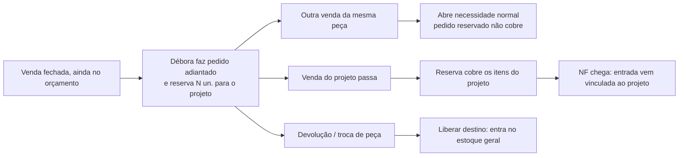

# SPEC-299 — Pedido adiantado para uma venda que ainda não passou

> Origem: `02-Reunioes/56. Lucenera (Vinicius e Debora) 13.11.2026_ rastreio de necessidade de compra atraves do codigo de projeto/Reunião.01` (Vinícius e Débora, 13/11/2026).
> Relacionada: SPEC-221 (regra da necessidade por peça — **em standby, não implementada**), SPEC-022 / SPEC-038 / SPEC-040 (destino e vínculo de origem do pedido), SPEC-243 (entrega futura e reserva por ambiente), SPEC-284 (Pedido Avulso lê estoque real).

## Checklist de Ação

**A. Banco**
- [x] A1. Tabela nova `pedido_compra_item_destino_projeto` (`pedido_compra_item_id`, `projeto_id`, `quantidade`, `criado_por`, `criado_em`, `liberado_em`/`liberado_por`/`motivo_liberacao`); RLS ligado, `REVOKE ALL ... FROM anon`, SELECT por `pode_acessar_sistema('compras')`, escrita só por RPC `SECURITY DEFINER`
- [x] A2. RPC `reservar_pedido_item_para_projeto(item, projeto, quantidade)` — grava o destino; recusa quantidade maior que a do item do pedido ou que a soma já reservada
- [x] A3. RPC `liberar_destino_projeto_pedido_item(...)` — tira o vínculo (cancelou/devolveu/trocou a peça); a quantidade volta a ser pedido "livre"
- [x] A4. Necessidade de compra por peça: o que está **reservado para um projeto** não entra na cobertura de outras vendas (cobertura livre = pedido em andamento − reservado para projeto)
- [x] A5. Quando o projeto vira venda (itens entram no `projeto_itens`), a reserva do pedido passa a cobrir **os itens daquele projeto** (some a necessidade deles enquanto o pedido está a caminho) — sem duplicar contagem
- [x] A6. RPC `destinos_projeto_do_pedido` devolve as reservas do pedido; a entrada usa para pré-preencher "Para quem" (`entregas_futuras_para_entrada` ficou intacta)

**B. Compras (telas)**
- [x] B1. Pedido Avulso e itens do Pedido de Compra: campo "Reservado para o projeto" (busca por código do projeto) + quantidade exata, com o rótulo/tag "Compra adiantada — projeto XXXX" na lista de pedidos
- [x] B2. Aviso no Pedido Avulso quando a peça já tem venda aberta ("Existe venda a ser vinculada?") para a Débora lembrar de marcar o projeto
- [ ] B3. Necessidade de Compra: mostrar na linha da peça "X un. do pedido NNNN estão reservadas para o projeto YYYY (não cobrem outras vendas)"
- [x] B4. Entrada de NF: item do pedido que veio com projeto já entra **vinculado** a esse projeto (igual ao fluxo normal de "Para quem"), com opção de **retirar o vínculo** → a peça entra no estoque geral
- [x] B5. Ação "Liberar destino" no pedido (para devolução de orçamento / cancelamento antes de a peça chegar), com motivo

**C. Fora do código (Controle de Produção)**
- [ ] C1. Liberar a tela do Controle de Produção para toda a empresa (leitura); **alterar status só Vinícius, Débora, Matheus e Vitória** por enquanto; João entra na semana seguinte (o Vinícius libera e ensina)

**Entrega**
- [ ] Migration com dry-run em ROLLBACK (sem COMMIT embutido), teste como usuário sem o sistema Compras, publicar Compras por wrangler, CHANGELOG, `AI_DB_CONTEXT.md` do Compras

### Passos manuais do usuário
- [ ] Validar com o Vinícius/Débora as "Decisões aprovadas" abaixo
- [ ] Liberar o acesso do Controle de Produção (item C1) no Hub/Acesso a Sistemas
- [ ] Teste com a Débora: pedido avulso de 10 reservado para o projeto X; vender 5 da mesma peça no meio → **tem que abrir necessidade de 5**; passar a venda do projeto X → necessidade dela fica coberta; dar entrada → vem vinculada ao cliente do projeto X

## Objetivo

Hoje o pedido de compra "cobre" a necessidade da peça sem saber para quem é. Quando a Débora adianta uma compra de uma venda **fechada mas que ainda não passou** (aprovação de contrato, ficha técnica, 10–15 dias; o motivo típico é o fornecedor que vai reajustar preço na sexta ou que já encerrou o ano), qualquer venda feita no meio do caminho enxerga esse pedido como cobertura e **não abre necessidade** — a peça fica sem compra e só reaparece quando a venda adiantada entrar, com lapso de até 20 dias.

Resultado esperado: o pedido adiantado fica **marcado com o código do projeto** e com a quantidade exata; essa quantidade é "do projeto" e não cobre outras vendas.

## O que foi dito na reunião (decisões)

1. O vínculo é **pelo código do projeto**, não pelo número da venda (a venda ainda não existe: o orçamento só tem número de orçamento e de projeto) e **não pelo orçamento** (as pessoas duplicam orçamento para guardar histórico; o projeto continua o mesmo).
2. A marcação diz "este material tem destino futuro" com a **quantidade exata** (ex.: 10 reservadas para o projeto).
3. A venda do meio **não** reconhece esse pedido como atendimento → abre necessidade normal.
4. O vínculo vale até a peça chegar: na **entrada da nota** o item vem automaticamente para aquele cliente/projeto (igual ao vínculo manual de hoje).
5. Se o orçamento do projeto for devolvido/trocado a peça antes de chegar: **opção de retirar o vínculo** do projeto; a peça entra no estoque geral, supre outra venda ou abre necessidade.
6. Se trocar a peça no orçamento, o vínculo não funciona → precisa **alterar o vínculo** (tela de liberar/trocar).
7. Quando a Débora quiser, na entrada, ainda pode **desvincular manualmente** ("não quero que vincule para isso") — o caminho normal continua existindo.
8. Controle de Produção: liberar para a empresa toda; só Vinícius, Débora, Matheus e Vitória alteram status (João depois).

## Estado atual (verificado nos arquivos do repo, 13/11)

- `pedido_compra_item_origem` (SPEC-038, migration 054) liga item do pedido a `projeto_item_id` — só funciona **depois** que a venda tem itens; é informativo e `UNIQUE (pedido_compra_item_id, projeto_item_id)`. Não serve para um projeto ainda sem venda.
- `vw_necessidade_compra_item_orcamento` (SPEC-040) desconta só o que está ligado ao `projeto_item_id`; `vw_necessidade_compra` (por peça) usa `necessidade − pedidos abertos` sem destino.
- SPEC-221 quer que o pedido cubra a peça **inteira** (inclusive o comprado a mais) pela data da venda. **Conflito a resolver:** pedido reservado para projeto sai dessa cobertura livre (A4). A SPEC-221 está em standby; esta SPEC não depende dela, mas a implementação de uma precisa respeitar a outra.
- Entrada de NF (SPEC-220): "Para quem" sugere os L de origem do pedido.

## Definição

### Regra de cobertura (por peça)

```
cobertura_livre = (a receber nos pedidos em andamento) − (reservado para projeto, ainda não liberado)
necessidade     = entrega futura das vendas − cobertura_livre
```

Pedido reservado para o projeto P cobre apenas as linhas de P (A5). Enquanto P não virou venda, a reserva só existe no pedido; quando virar, passa a cobrir os itens de P e some da "reserva solta".

### Fluxo



### Permissões
- Reservar/liberar: quem hoje monta pedido (Compras: Débora e quem já tem o papel). Ver reserva: quem acessa Compras. Nada de custo exposto (SPEC-193).

### Critérios de aceite
- Pedido de 10 reservado ao projeto X + venda nova de 5 da mesma peça → necessidade de 5 aparece.
- Reserva > quantidade do item é recusada; soma das reservas do item ≤ quantidade do item.
- Entrada de NF de item reservado: "Para quem" já vem com o projeto; dá para retirar o vínculo e a peça entra no estoque geral.
- Liberar destino devolve a quantidade à cobertura livre e registra motivo/quem/quando.
- Peça sem reserva se comporta exatamente como hoje (sem regressão no Pedido Avulso estratégico, de estoque).
- Usuário sem Compras não vê nem grava; `anon` sem acesso.

### Ecossistema (análise obrigatória)
- Depende de `projetos`, `orcamentos`, `projeto_itens`, `pedidos_compra`, `pedido_compra_itens`, `estoque_saldos_projeto_item`, `systems`/`user_system_access`. Afeta Compras e Estoque (entrada); CRM/Orçamentos só leem o código do projeto. Não duplica dado: cliente/orçamento vêm por JOIN do `projeto_id`.
- Migration antiga em sistema: não consultada; fonte é o snapshot central + migrations de `supabase/db/migrations`. Confirmar nomes reais no snapshot antes de redigir (a view atual `vw_necessidade_compra` está em `current/05_views.sql`; `pedidos_compra`/`pedido_compra_itens` estão só em migrations — conferir no banco real).
- Atualizar `04-Sistemas/compras-lucenera-3o23t98ee/supabase/AI_DB_CONTEXT.md`.

### Rollback
Tabela nova + RPCs novas + views recriadas: guardar a definição atual das views em `backup`, `rollback.sql` recria as views antigas e apaga a tabela; sem mexer em dado existente.

## Decisões aprovadas (16/11/2026 — usuário: "faça o que for melhor", adotadas as recomendações)

1. **Código do projeto:** o orçamento já tem `projeto_id` antes de virar venda (`orcamentos.projeto_id`) e o projeto tem `codigo` (snapshot central). A busca do Pedido Avulso é por `projetos.codigo`. Falta só conferir no banco real que orçamentos em andamento têm `projeto_id` preenchido.
2. **Venda passou:** a reserva cobre automaticamente os itens da mesma peça do projeto, até o limite reservado (A5).
3. **Troca de peça no orçamento:** o sistema avisa a Débora e exige liberar/trocar o destino; não libera sozinho.
4. **Devolução de orçamento:** só avisa a Débora (a peça pode já estar comprada); a liberação é ação dela (B5).
5. **Mais de um projeto no mesmo item:** permitido, com soma das reservas ≤ quantidade do item.
6. **Ordem:** SPEC-299 antes da SPEC-221; a SPEC-221 deve respeitar a cobertura livre (pedido − reservado para projeto) ao ser retomada.

## Realizado

### 2026-11-16

- Migration `20261116_373_spec299_pedido_adiantado_destino_projeto` REDIGIDA e ensaiada em ROLLBACK (`dry_run.sql`, com teste: reserva de 2 un. baixou a cobertura do produto de 17 para 15; liberar devolveu; as views mantiveram 174 e 946 linhas). **APLICADA em 16/11/2026** (tabela vazia, 4 funções criadas, RLS ligado e sem acesso `anon`). (Número 373 porque 357 já era da SPEC-300.) Tem `up.sql`, `dry_run.sql` e `rollback.sql`.
  - Tabela `pedido_compra_item_destino_projeto` (RLS por `pode_acessar_sistema('necessidade-de-compra')`, sem `anon`, escrita só por RPC); RPCs `reservar_pedido_item_para_projeto`, `liberar_destino_projeto_pedido_item`, `destinos_projeto_do_pedido`, `buscar_projetos_para_reserva`.
  - Views recriadas com as mesmas colunas: `vw_necessidade_compra_pedidos_abertos` (reservado sai da cobertura livre; cobre só o que o próprio projeto já tem em entrega futura) e `vw_necessidade_compra_item_orcamento` (reserva cobre os L do próprio projeto, na ordem do L).
- Compras (só no working tree, sem commit/deploy): Pedido Avulso com botão ⌖ "Reservar para projeto" por linha (`ReservaProjetoDialog`: busca por código/nome/cliente, quem tem a peça no orçamento vem primeiro, soma limitada à quantidade); `ModalGerarCompraItemOrcamento` grava as reservas após criar o pedido; Pedidos mostra "Compra adiantada: N un. → projeto X" com "liberar" (motivo obrigatório); Entrada de NF sugere primeiro os L dos projetos reservados.
- Achado no banco real: `orcamentos.projeto_id` está preenchido em enviado_cliente (6/6) e Aprovação Financeira (17/17), mas só 5 de 36 rascunhos — rascunho sem projeto não aparece na busca.

## Pendências

- [ ] Commitar e publicar o Compras (wrangler); a migration 373 já está aplicada.
- [ ] Item B3 (aviso na tela Necessidade de Compra: "X un. do pedido NNNN reservadas para o projeto YYYY") ainda não feito.
- [ ] Testar com a Débora o roteiro dos passos manuais (pedido de 10 reservado ao projeto; venda de 5 abre necessidade; entrada vem vinculada).
- [ ] Mostrar as decisões aprovadas (seção acima) ao Vinícius e à Débora para validação; se divergirem, reabrir só o ponto divergente.
- [ ] Ao retomar a SPEC-221, ajustar a cobertura por peça para descontar o que está reservado para projeto.
- [ ] Liberar o Controle de Produção para a empresa toda e a edição de status para Vinícius, Débora, Matheus e Vitória (João na semana seguinte, o Vinícius libera e ensina) — passo no Hub/Acesso a Sistemas.
