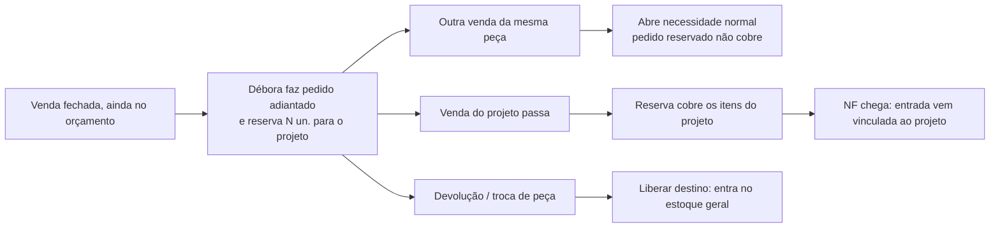

# SPEC-299 — Pedido adiantado para uma venda que ainda não passou

> Origem: `02-Reunioes/56. Lucenera (Vinicius e Debora) 13.11.2026_ rastreio de necessidade de compra atraves do codigo de projeto/Reunião.01` (Vinícius e Débora, 13/11/2026).
> Relacionada: SPEC-221 (regra da necessidade por peça — **em standby, não implementada**), SPEC-022 / SPEC-038 / SPEC-040 (destino e vínculo de origem do pedido), SPEC-243 (entrega futura e reserva por ambiente), SPEC-284 (Pedido Avulso lê estoque real).

## Checklist de Ação

**A. Banco**
- [ ] A1. Tabela nova `pedido_compra_item_destino_projeto` (`pedido_compra_item_id`, `projeto_id`, `quantidade`, `criado_por`, `criado_em`, `liberado_em`/`liberado_por`/`motivo_liberacao`); RLS ligado, `REVOKE ALL ... FROM anon`, SELECT por `pode_acessar_sistema('compras')`, escrita só por RPC `SECURITY DEFINER`
- [ ] A2. RPC `reservar_pedido_item_para_projeto(item, projeto, quantidade)` — grava o destino; recusa quantidade maior que a do item do pedido ou que a soma já reservada
- [ ] A3. RPC `liberar_destino_projeto_pedido_item(...)` — tira o vínculo (cancelou/devolveu/trocou a peça); a quantidade volta a ser pedido "livre"
- [ ] A4. Necessidade de compra por peça: o que está **reservado para um projeto** não entra na cobertura de outras vendas (cobertura livre = pedido em andamento − reservado para projeto)
- [ ] A5. Quando o projeto vira venda (itens entram no `projeto_itens`), a reserva do pedido passa a cobrir **os itens daquele projeto** (some a necessidade deles enquanto o pedido está a caminho) — sem duplicar contagem
- [ ] A6. RPC de entrada (`entregas_futuras_para_entrada` e a gravação da entrada) devolve o destino por projeto para pré-preencher "Para quem"

**B. Compras (telas)**
- [ ] B1. Pedido Avulso e itens do Pedido de Compra: campo "Reservado para o projeto" (busca por código do projeto) + quantidade exata, com o rótulo/tag "Compra adiantada — projeto XXXX" na lista de pedidos
- [ ] B2. Aviso no Pedido Avulso quando a peça já tem venda aberta ("Existe venda a ser vinculada?") para a Débora lembrar de marcar o projeto
- [ ] B3. Necessidade de Compra: mostrar na linha da peça "X un. do pedido NNNN estão reservadas para o projeto YYYY (não cobrem outras vendas)"
- [ ] B4. Entrada de NF: item do pedido que veio com projeto já entra **vinculado** a esse projeto (igual ao fluxo normal de "Para quem"), com opção de **retirar o vínculo** → a peça entra no estoque geral
- [ ] B5. Ação "Liberar destino" no pedido (para devolução de orçamento / cancelamento antes de a peça chegar), com motivo

**C. Fora do código (Controle de Produção)**
- [ ] C1. Liberar a tela do Controle de Produção para toda a empresa (leitura); **alterar status só Vinícius, Débora, Matheus e Vitória** por enquanto; João entra na semana seguinte (o Vinícius libera e ensina)

**Entrega**
- [ ] Migration com dry-run em ROLLBACK (sem COMMIT embutido), teste como usuário sem o sistema Compras, publicar Compras por wrangler, CHANGELOG, `AI_DB_CONTEXT.md` do Compras

### Passos manuais do usuário
- [ ] Confirmar com o Vinícius/Débora os "Pontos para confirmar" abaixo
- [ ] Liberar o acesso do Controle de Produção (item C1) no Hub/Acesso a Sistemas
- [ ] Teste com a Débora: pedido avulso de 10 reservado para o projeto X; vender 5 da mesma peça no meio → **tem que abrir necessidade de 5**; passar a venda do projeto X → necessidade dela fica coberta; dar entrada → vem vinculada ao cliente do projeto X

## Objetivo

Hoje o pedido de compra "cobre" a necessidade da peça sem saber para quem é. Quando a Débora adianta uma compra de uma venda **fechada mas que ainda não passou** (aprovação de contrato, ficha técnica, 10–15 dias; o motivo típico é o fornecedor que vai reajustar preço na sexta ou que já encerrou o ano), qualquer venda feita no meio do caminho enxerga esse pedido como cobertura e **não abre necessidade** — a peça fica sem compra e só reaparece quando a venda adiantada entrar, com lapso de até 20 dias.

Resultado esperado: o pedido adiantado fica **marcado com o código do projeto** e com a quantidade exata; essa quantidade é "do projeto" e não cobre outras vendas.

## O que foi dito na reunião (decisões)

1. O vínculo é **pelo código do projeto**, não pelo número da venda (a venda ainda não existe: o orçamento só tem número de orçamento e de projeto) e **não pelo orçamento** (as pessoas duplicam orçamento para guardar histórico; o projeto continua o mesmo).
2. A marcação diz "este material tem destino futuro" com a **quantidade exata** (ex.: 10 reservadas para o projeto).
3. A venda do meio **não** reconhece esse pedido como atendimento → abre necessidade normal.
4. O vínculo vale até a peça chegar: na **entrada da nota** o item vem automaticamente para aquele cliente/projeto (igual ao vínculo manual de hoje).
5. Se o orçamento do projeto for devolvido/trocado a peça antes de chegar: **opção de retirar o vínculo** do projeto; a peça entra no estoque geral, supre outra venda ou abre necessidade.
6. Se trocar a peça no orçamento, o vínculo não funciona → precisa **alterar o vínculo** (tela de liberar/trocar).
7. Quando a Débora quiser, na entrada, ainda pode **desvincular manualmente** ("não quero que vincule para isso") — o caminho normal continua existindo.
8. Controle de Produção: liberar para a empresa toda; só Vinícius, Débora, Matheus e Vitória alteram status (João depois).

## Estado atual (verificado nos arquivos do repo, 13/11)

- `pedido_compra_item_origem` (SPEC-038, migration 054) liga item do pedido a `projeto_item_id` — só funciona **depois** que a venda tem itens; é informativo e `UNIQUE (pedido_compra_item_id, projeto_item_id)`. Não serve para um projeto ainda sem venda.
- `vw_necessidade_compra_item_orcamento` (SPEC-040) desconta só o que está ligado ao `projeto_item_id`; `vw_necessidade_compra` (por peça) usa `necessidade − pedidos abertos` sem destino.
- SPEC-221 quer que o pedido cubra a peça **inteira** (inclusive o comprado a mais) pela data da venda. **Conflito a resolver:** pedido reservado para projeto sai dessa cobertura livre (A4). A SPEC-221 está em standby; esta SPEC não depende dela, mas a implementação de uma precisa respeitar a outra.
- Entrada de NF (SPEC-220): "Para quem" sugere os L de origem do pedido.

## Definição

### Regra de cobertura (por peça)

```
cobertura_livre = (a receber nos pedidos em andamento) − (reservado para projeto, ainda não liberado)
necessidade     = entrega futura das vendas − cobertura_livre
```

Pedido reservado para o projeto P cobre apenas as linhas de P (A5). Enquanto P não virou venda, a reserva só existe no pedido; quando virar, passa a cobrir os itens de P e some da "reserva solta".

### Fluxo



### Permissões
- Reservar/liberar: quem hoje monta pedido (Compras: Débora e quem já tem o papel). Ver reserva: quem acessa Compras. Nada de custo exposto (SPEC-193).

### Critérios de aceite
- Pedido de 10 reservado ao projeto X + venda nova de 5 da mesma peça → necessidade de 5 aparece.
- Reserva > quantidade do item é recusada; soma das reservas do item ≤ quantidade do item.
- Entrada de NF de item reservado: "Para quem" já vem com o projeto; dá para retirar o vínculo e a peça entra no estoque geral.
- Liberar destino devolve a quantidade à cobertura livre e registra motivo/quem/quando.
- Peça sem reserva se comporta exatamente como hoje (sem regressão no Pedido Avulso estratégico, de estoque).
- Usuário sem Compras não vê nem grava; `anon` sem acesso.

### Ecossistema (análise obrigatória)
- Depende de `projetos`, `orcamentos`, `projeto_itens`, `pedidos_compra`, `pedido_compra_itens`, `estoque_saldos_projeto_item`, `systems`/`user_system_access`. Afeta Compras e Estoque (entrada); CRM/Orçamentos só leem o código do projeto. Não duplica dado: cliente/orçamento vêm por JOIN do `projeto_id`.
- Migration antiga em sistema: não consultada; fonte é o snapshot central + migrations de `supabase/db/migrations`. Confirmar nomes reais no snapshot antes de redigir (a view atual `vw_necessidade_compra` está em `current/05_views.sql`; `pedidos_compra`/`pedido_compra_itens` estão só em migrations — conferir no banco real).
- Atualizar `04-Sistemas/compras-lucenera-3o23t98ee/supabase/AI_DB_CONTEXT.md`.

### Rollback
Tabela nova + RPCs novas + views recriadas: guardar a definição atual das views em `backup`, `rollback.sql` recria as views antigas e apaga a tabela; sem mexer em dado existente.

## Pontos para confirmar

1. **Código do projeto existe no orçamento ainda em andamento?** A reunião assume que sim (o orçamento tem projeto antes de virar venda). Conferir no banco real.
2. **Quando o projeto vira venda**, a reserva cobre automaticamente os itens da mesma peça (A5)? Recomendação: **sim**, até o limite da quantidade reservada.
3. **Peça trocada no orçamento** depois da reserva: aviso e obrigar "liberar/trocar destino" (recomendado) ou liberar sozinho?
4. **Devolução de orçamento** libera a reserva automaticamente ou só avisa a Débora? Recomendação: avisar (a peça pode já estar comprada e a decisão é dela).
5. **Pedido reservado a mais de um projeto** (ex.: 10 = 6 do projeto A + 4 do B)? Recomendação: permitir, a soma ≤ quantidade.
6. **Precedência com a SPEC-221**: implementar esta junto ou antes dela (recomendação: antes, é menor e evita o buraco já).

## Realizado

(vazio)

## Pendências

- [ ] Confirmar com Vinícius e Débora os 6 pontos acima antes de redigir a migration.
- [ ] Verificar no banco real se o orçamento sem venda já tem `projeto_id` e como o código do projeto é exibido na busca do Pedido Avulso.
- [ ] Definir como esta SPEC convive com a SPEC-221 (cobertura por peça pela data da venda), que está em standby.
- [ ] Liberar o Controle de Produção para a empresa toda e a edição de status para Vinícius, Débora, Matheus e Vitória (João na semana seguinte, o Vinícius libera e ensina) — passo no Hub/Acesso a Sistemas.
