# Fluxogramas Lucenera

Fonte: board Miro **"fluxograma Lucenera"** (`https://miro.com/app/board/uXjVHEZy9vM=/`) — board consolidado atual. O board anterior ("Copia Kimberly") foi descontinuado e não é mais usado como referência.

Cada seção abaixo foi reconstruída lendo o board em resolução nativa (zoom e crops dedicados, sem downscale) diretamente nos widgets indicados pelo usuário, e não a partir de prints de baixa resolução. Observações de ambiguidade/texto cortado estão anotadas onde relevante.

---

## 1. ENTRADA DE PROJETO

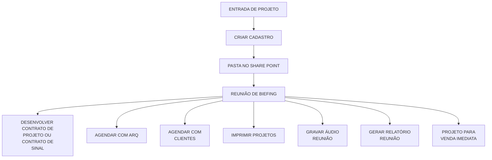

> Observação: "REUNIÃO DE BIEFING" é o texto literal escrito no board (erro de digitação de "BRIEFING"). "CRIAR CADASTRO" é destacado em vermelho no board (etapa de atenção). `E` (DESENVOLVER CONTRATO...) é o ponto de entrada para o ciclo de Contrato e Aprovação de Projeto, seção 2 abaixo.

---

## 2. CICLO DE CONTRATO E APROVAÇÃO DE PROJETO

Continuação direta da seção 1 (a partir de "DESENVOLVER CONTRATO DE PROJETO OU CONTRATO DE SINAL"). É o maior e mais ramificado fluxo do board: cobre assinatura de contrato, 1ª/2ª/3ª apresentações de projeto (preliminar, pré-executivo e executivo) e cobranças de parcela, terminando em "ENVIO FINAL".

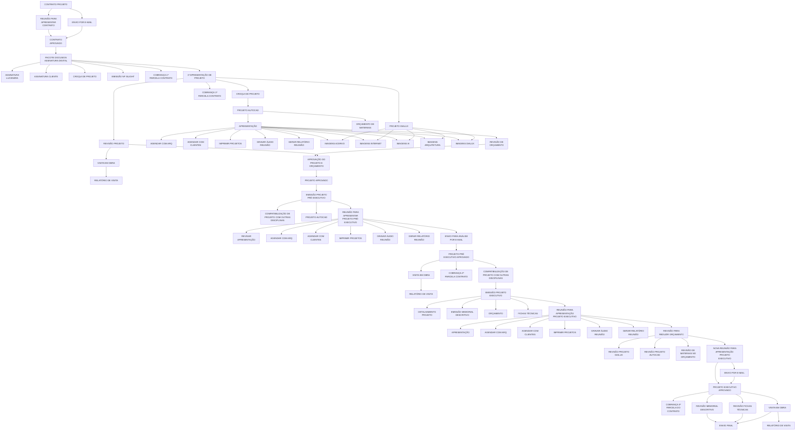

> Observação: o nó "CONTRATO PROJETO" recebe a entrada de "DESENVOLVER CONTRATO DE PROJETO OU CONTRATO DE SINAL" da seção 1. Não foi possível confirmar com 100% de certeza a direção de algumas conexões na junção entre "APRESENTAÇÃO"/"PROJETO DIALUX" e o cluster de imagens (ACERVO/INTERNET/IA/ARQUITETURA/DIALUX) — ambos parecem alimentar o mesmo cluster.

---

## 3. ACOMPANHAMENTO DA OBRA

```mermaid
flowchart TD
    A[ACOMPANHAMENTO DA OBRA] --> VEO[VISITAS EM OBRA]
    VEO --> DLE[DESENHOS LUMINÁRIAS ESPECIAIS]
    VEO --> CME[CONFERÊNCIA DE MEDIDAS PARA PROJETO\nDE LUMINÁRIAS ESPECIAIS]
    VEO --> RDV[RELATÓRIOS DE VISITAS]
    A --> EDL[ENVIO DOS DESENHOS DE LUMINÁRIAS\nESPECIAIS PARA O COMPRAS LUCENERA]

    A --> RPA[REVISÃO PROJETO AUTOCAD]
    A --> APO[ALTERAÇÃO DE PROJETO EM OBRA]
    RPA --> RFT[REVISÃO FICHA TÉCNICA]
    APO --> ORD[ORÇAMENTO DEVOLUÇÃO]
    APO --> ORA[ORÇAMENTO AQUISIÇÃO]

    A --> RPP[RECEBIMENTO PROJETO PAISAGISMO]
    A --> RPM[RECEBIMENTO PROJETO DE MARCENARIA]

    RPP --> AEC[ANÁLISE E CROQUI]
    AEC --> PCAD[PROJETO CAD]
    PCAD --> ORP[ORÇAMENTO]
    ORP --> EPE[ENVIO POR E-MAIL]
    EPE --> RPAp[REUNIÃO PARA APRESENTAÇÃO]
    RPAp --> OAPP[ORÇAMENTO APROVADO]

    RPM --> GRR[GERAR RELATÓRIO REUNIÃO]
    RPM --> GAR[GRAVAR ÁUDIO REUNIÃO]
    RPM --> APR[APRESENTAÇÃO]
    RPM --> AGA[AGENDAR COM ARQ]
    RPM --> AGC[AGENDAR COM CLIENTES]
    RPM --> IPR[IMPRIMIR PROJETOS]
    GRR -.-> RPAp
    GAR -.-> RPAp
    APR -.-> RPAp
    AGA -.-> RPAp
    AGC -.-> RPAp
    IPR -.-> RPAp

    A --> EFV[ENVIO PARA FINANCEIRO PARA\nFORMALIZAR VENDA]

    EnvC[ENVIO PARA CLIENTE] --> MEE[MATERIAL EM ESTOQUE]
    EnvC --> MJE[MATERIAL JÁ ENTREGUE]
    MEE --> NES[NOTIFICAÇÃO PARA EQUIPE OBRA\nSEPARAR MATERIAL]
    MJE --> NES
    NES --> SEEB1[SOLICITAÇÃO PARA EQUIPE ESTOQUE BUSCAR]
    NES --> CTD[COMBINAR PARA TRAZEREM A DEVOLUÇÃO]
    SEEB1 --> EEst[ENTREGUE NO ESTOQUE]
    CTD --> EEst
    SEEB1 --> ESsr[ESTREGUE NO SHOWROOM]
    CTD --> ESsr
    EEst --> SEEB2[SOLICITAR PARA EQUIPE ESTOQUE BUSCAR]
    ESsr --> SEEB2
    EEst --> NFE[NOTIFICAR FINANCEIRO QUE O MATERIAL\nJÁ ESTÁ NO ESTOQUE PARA FINALIZAR DEVOLUÇÃO]

    ODA[ORÇAMENTO DEVOLUÇÃO APROVADO] --> EFF[ENVIO PARA FINANCEIRO PARA FORMALIZAR]
    OAA[ORÇAMENTO AQUISIÇÃO APROVADO] --> EFF
    PA[PROJETO APROVADO] --> EFF
    PA --> EPO[ENVIO PROJETO PARA OBRA]

    PA --> DPM[DETALHAMENTO PROJETO MARCENARIA]
    DPM --> EEM[ENVIO PARA EMPRESA MARCENARIA,\nOBRA E DEMAIS DISCIPLINAS]

    PA --> PEP[PRÉ EXECUTIVO PAISAGISMO]
    PEP --> PE1[PREPARAR ESTACAS]
    PE1 --> VMP1[VISITA PARA MARCAR POSIÇÃO\nDAS LUMINÁRIAS]
    VMP1 --> RO1[RELATÓRIO DE OBRA]
    VMP1 --> VRM1[VÍDEO DO RESULTADO DA MARCAÇÃO]
    VRM1 --> EVE1[ENVIO DO VÍDEO PARA EQUIPE DE OBRA]

    NMO[NECESSIDADE DE MATERIAL EM OBRA] --> CDE[CONFERIR DISPONIBILIDADE EM ESTOQUE]
    CDE --> GLS[GERAR LISTA DE SEPARAÇÃO]
    GLS --> ACE[AGENDAR COM EQUIPE ESTOQUE]
    NMO -.-> VMP1

    EOF2[ENVIO ORÇAMENTO PARA FINANCEIRO] --> OAP2[ORÇAMENTO APROVADO]
    OAP2 --> PE2[PREPARAR ESTACAS]
    PE2 --> VMP2[VISITA PARA MARCAR POSIÇÃO\nDAS LUMINÁRIAS]
    VMP2 --> RO2[RELATÓRIO DE OBRA]
    VMP2 --> VRM2[VÍDEO DO RESULTADO DA MARCAÇÃO]
    VRM2 --> EVE2[ENVIO DO VÍDEO PARA EQUIPE DE OBRA]

    RO1 -.-> REVOBRA[VISITA PARA REVITALIZAÇÃO\nDO PROJETO]
```

> Observação: o board tem dois nós "ACOMPANHAMENTO DA OBRA" ligados visualmente (provavelmente recurso de desvio de linha do Miro, sem significado de processo). O ramo "PREPARAR ESTACAS → VISITA PARA MARCAR POSIÇÃO DAS LUMINÁRIAS → RELATÓRIO DE OBRA/VÍDEO" aparece duplicado (uma vez a partir de "PRÉ EXECUTIVO PAISAGISMO", outra a partir de "ENVIO ORÇAMENTO PARA FINANCEIRO") — mantido como dois ramos paralelos por fidelidade. `RO1` conecta à seção 4 (Obra Finalizada) via "VISITA PARA REVITALIZAÇÃO DO PROJETO", mas a seta exata de conexão não está visível em nenhuma captura — inferida pela proximidade espacial no board.

---

## 4. OBRA FINALIZADA

Conecta-se ao final da seção 3 (Acompanhamento da Obra) via "VISITA PARA REVITALIZAÇÃO DO PROJETO".

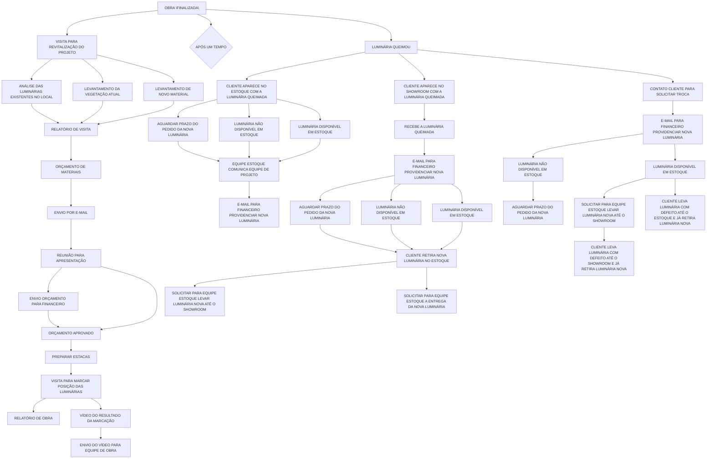

> Observação: o texto real no board é "LUMINÁRIA QUEIMOU" (não "LUMINÁRIA QUEBROU" como em rascunhos anteriores). "APÓS UM TEMPO" e "LUMINÁRIA QUEIMOU" são ambos filhos diretos de "OBRA FINALIZADA" no mesmo nível (não um sub-nó do outro). A tríplice repetição do padrão "AGUARDAR PRAZO/LUMINÁRIA (NÃO) DISPONÍVEL" tem cobertura visual desigual entre as 3 colunas; a coluna 3 (H) tem menos certeza nas conexões finais.

---

## 5. VENDA PADRÃO - LUCENERA

```mermaid
flowchart TD
    A["VENDA PADRÃO - LUCENERA"] --> B["EQUIPE DE PROJETOS ENVIA"]
    B --> C["ENVELOPE COM DOCS DE ORÇAMENTO APROVADO PARA ASSINATURA"]
    C --> D["ASSINTURA FEITA"]
    D --> E["RECEBIMENTO DO ORÇAMENTO APROVADO E CONTRATO"]
    E --> F{"TODAS INF. PRECISAM ESTAR CORRETAS"}
    F -.-> CH["CHECAGEM DE INFORMAÇÕES:"]

    F --> G1["PRODUTO S/ CADASTRO"]
    G1 --> G2["CONSULTA DE DADOS COM FORNECEDOR"]
    G2 --> G3["SEM INFORMAÇÃO?"]
    G2 --> G4["COM INFORMAÇÃO?"]
    G3 --> G5["SOLICITA INFORMAÇÃO PROJETOS"]
    G4 --> G6["SOLICITA CADASTRO COMPRAS"]
    G6 --> G7["APÓS CADASTRO, SEGUE"]

    F --> H1["COND. PAGAMENTO"]
    H1 --> H2["CERTO?"]
    H1 --> H3["ERRADO/FALTANDO"]
    H2 --> H4["SEGUE"]
    H3 --> H5["SOLICITA INFORMAÇÃO"]

    F --> I1["ARQUIT. EXT."]
    I1 --> I2["CERTO?"]
    I1 --> I3["ERRADO OU SEM"]
    I2 --> I4["SEGUE"]
    I3 --> I5["SOLICITA CORREÇÃO OU INCLUSÃO"]

    F --> J1["EMPRESA FAT."]
    J1 --> J2["CERTO?"]
    J1 --> J3["ERRADO"]
    J2 --> J4["SEGUE"]
    J3 --> J5["SOLICITA CORREÇÃO OU CORRIGE"]

    G7 --> K["TUDO REVISADO, INFORMAÇÕES CORRETAS E PRODUTOS CADASTRADOS - INICIA-SE O PROCESSO DE FATURAMENTO:"]
    H4 --> K
    I4 --> K
    J4 --> K
    G5 -.-> K
    H5 -.-> K
    I5 -.-> K
    J5 -.-> K

    K --> L["ALIMENTAR VENCIMENTOS"]
    L --> M["FECHAR ORÇAMENTO"]
    M --> N["APROVAR ORÇAMENTO"]
    N --> N2["ENVIAR SEPARAÇÃO P/ ESTOQUE (TEAMS)"]
    N --> O["EMITIR NOTA"]
    O --> O2["IMPRIMIR C/ MEMÓRIA DE CÁLCULO"]
    O --> O3["ENVIAR POR EMAIL CLIENTE E ENVOLVIDOS"]
    O --> P["EMITIR BOLETO"]
    P --> P2["PONTUAR CLUBE MAIS (PLANILHA E SITE)"]
    P --> Q["GERAR REMESSA BANCÁRIA"]
    Q --> R["ENVIAR AO BANCO"]

    R --> S["VENDA FINALIZADA? INICIA-SE PROCESSO DE COMPRA, QUE PODE SER DE IMEDIATO OU AGUARDAR ALGUNS DIAS"]

    S --> T1["SE PEÇA ESPECIAL?"]
    T1 --> T2["AGUARDAR DESENHO"]
    S --> T3["PEÇA PADRÃO LUCENERA"]
    S --> T4["PEÇA PADRÃO FORNCEDOR"]

    T3 --> U1["IMPRIMIR"]
    T4 --> U1
    U1 --> U2["MONTAR PEDIDO"]
    U2 --> U3{"É COMUM QUE MONTA PEDIDOS MESMO FORNECEDOR VAI DE ACORDO COM O CNPJ VENDEDOR"}
    U3 --> U4["SALVAR NA PASTA DO FORNECEDOR"]
    U4 --> U5["ENVIAR PARA O FORNECEDOR"]
    U5 --> U6["AGUARDAR CÓPIA DO PEDIDO"]
    U6 --> U7["SOLICITAR CORREÇÃO"]
    U7 -.-> U6
    U6 --> U8["CONFERIR"]
    U8 --> U9["APROVAR"]
    U9 --> U10{"AGUARDAR CHEGAR MATERIAL NO ESTOQUE"}

    T2 --> V1["RECEBEU DESENHO?"]
    V1 --> V2["CONFERIR COM A VENDA"]
    V2 --> V3["MONTAR PEDIDO"]
    V3 --> V4["INDUSTRIALIZAÇÃO LUCENERA:"]
    V4 --> V5["ENVIA PARA CLAUDIO - PEDIDO E DESENHO"]
    V4 --> V6["IMPRIMIR"]
    V4 --> V7["ALIMENTA PLANILHA CONTROLE DE PRODUÇÃO"]
    V5 --> V8{"AGUARDAR PRODUÇÃO LUCENERA"}
    V8 --> V9["CLAUDIO ENVIA PEDIDO FINALIZADO PARA ENTRADA"]
    V9 --> V10["ENTRADA DO MATERIAL"]

    U10 --> W1["FORNECEDOR PADRÃO:"]
    W1 --> W2["SALVAR PEDIDO NA PASTA"]
    W2 --> W3["ENVIAR PARA FORNECEDOR PEDIDO E DESENHO"]
    W3 --> W4["IMPRIMIR"]
    W3 --> W5["AGUARDAR CÓPIA DO FORNECEDOR"]
    W5 --> W6["SOLICITAR CORREÇÃO"]
    W6 -.-> W5
    W5 --> W7["CONFERIR"]
    W7 --> W8["APROVAR"]
    W8 --> X1{"AGUARDAR CHEGAR MATERIAL NO ESTOQUE"}

    X1 --> Y1["MATERIAL CHEGA NO ESTOQUE"]
    V10 --> Y1
    Y1 --> Y2["CONFERÊNCIA DE NOTA E VOLUME"]
    Y2 --> Y3["SE, PEÇA DECORATIVA TEM A CONFEÊNCIA MINUCIOSA ITEM A ITEM"]

    V10 --> Z1["PASSAR DOCUMENTO DE ENTRADA PARA DEP. C. A PAGAR"]
    Z1 --> Z2["LANÇAMENTO FINANCEIRO"]
    Z2 --> Z3["ENTRADA DO MATERIAL"]
    Z3 --> Z4["CONFERIR VALORES"]
    Z4 --> Z5["CONFERIR NOTA COM PEDIDO"]
    Z5 --> Z6{"NOTA FISICA VAI PARA ESCRITÓRIO"}

    Z3 --> AA1["VINCULAR MATERIAL COM VENDAS DE CLIENTES"]
    Z3 --> AA2["PASSAR RELAÇÃO DE VINCULO AO ESTOQUE"]
    AA1 --> AA3["START SEPARAÇÃO FISICA DO PRODUTO NO ESTOQUE"]
    AA2 --> AA3
```

> Observação: erros de digitação reais do board preservados ("ASSINTURA", "FORNCEDOR", "CONFEÊNCIA", "SOLICITA CADASTRO" etc.). O diamante cinza próximo a "CONFERIR/APROVAR" (ramo fornecedor padrão) ficou parcialmente cortado nas capturas — texto reconstruído por analogia ao diamante equivalente do outro ramo ("AGUARDAR CHEGAR MATERIAL NO ESTOQUE"); confirmar no board se precisão exata for necessária. Este fluxo de compras (a partir de "VENDA FINALIZADA?") é compartilhado/análogo nos processos das seções 6–9.

---

## 6. VENDA PARA FICAR EM ABERTO - LUCENERA

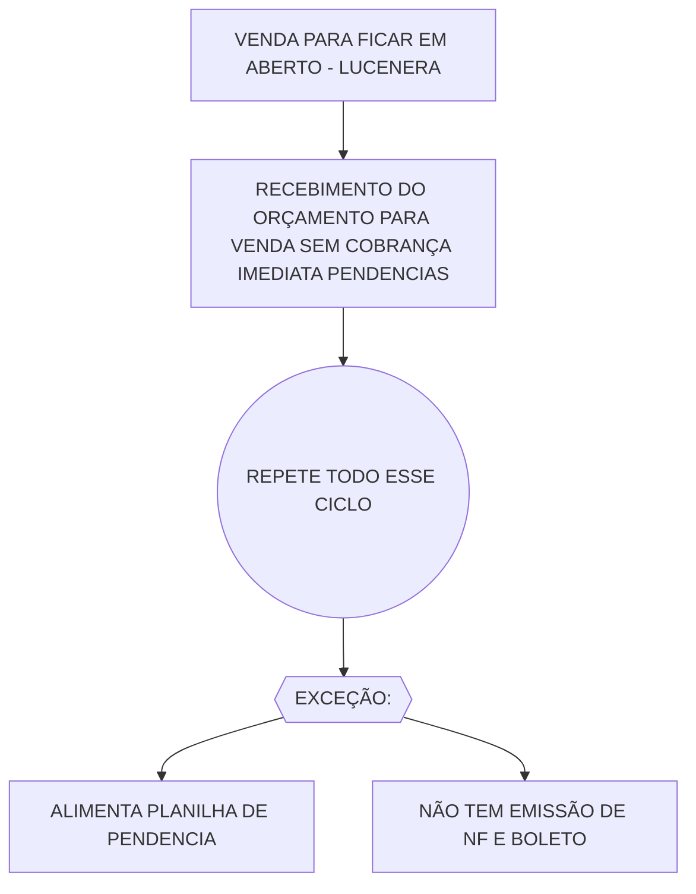

---

## 7. DEVOLUÇÃO PARA FICAR EM ABERTO - LUCENERA

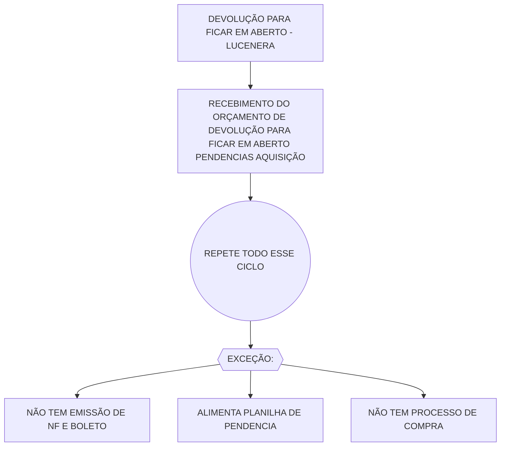

---

## 8. AQUISIÇÃO + DEVOLUÇÃO - LUCENERA

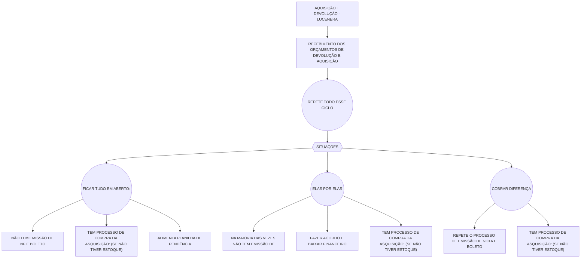

> Observação: "ASQUISIÇÃO" é o texto literal e consistente no board (erro de digitação de "AQUISIÇÃO"), repetido em 3 caixas.

---

## 9. ORÇAMENTO DE BRINDE - LUCENERA

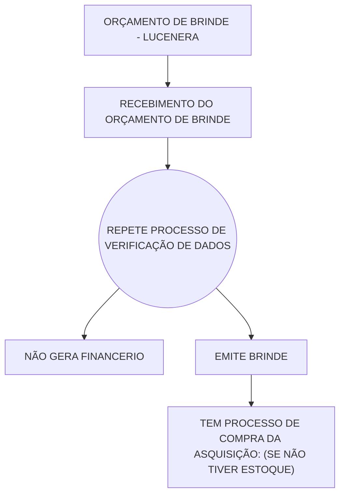

> Observação: "FINANCERIO" é o texto literal no board (erro de digitação de "FINANCEIRO").

---

## 10. PROJETO LUMINOTÉCNICO (faturamento)

Versão de faturamento/contrato do projeto luminotécnico (distinta do ciclo de elaboração de projeto da seção 2, embora compartilhe parte do vocabulário). Aparece duplicada em duas áreas do board com conteúdo idêntico; documentada uma única vez aqui.

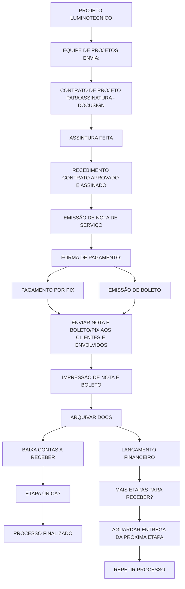

---

## 11. SINAL DE F. VENDA

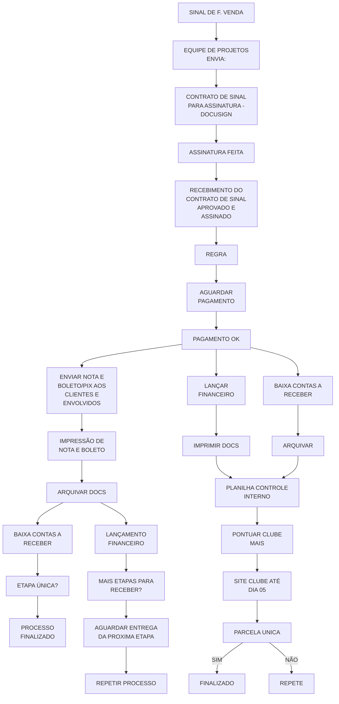

> Observação: há um nó parcialmente cortado nas capturas, ao lado de "AGUARDAR PAGAMENTO" (algo terminando em "...PIX/DADOS"), possivelmente um terceiro ramo de pagamento — não incluído por falta de confirmação visual completa. A ramificação exata entre "PAGAMENTO OK" e as duas colunas seguintes (envio direto de nota/boleto vs. lançamento financeiro/clube mais) pode ter um nó condicional intermediário não capturado.

---

## 12. VENDA DIRETA

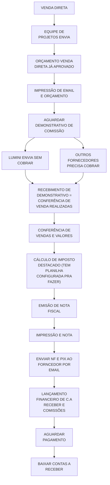

---

## 13. CAROLINE - Funções e Responsabilidades

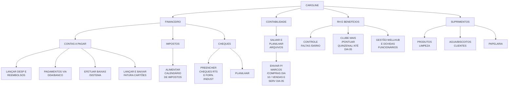

---

## 14. LANA - Processos Financeiros

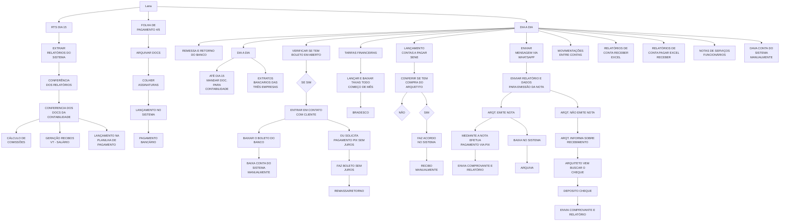

---

## 15. DÉBORA - Compras e Logística

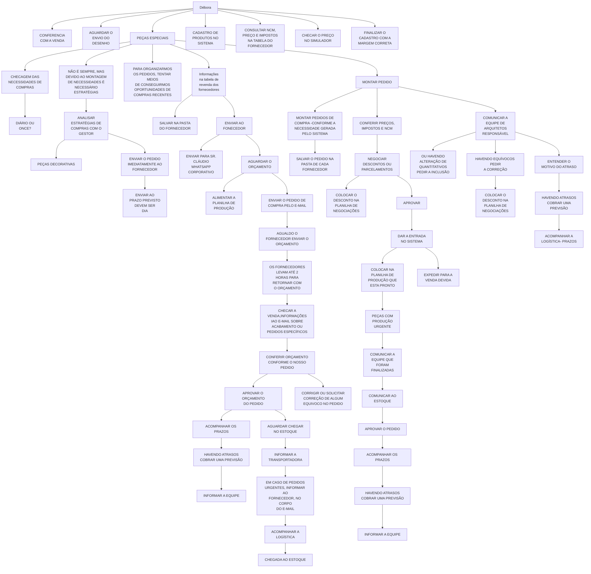
