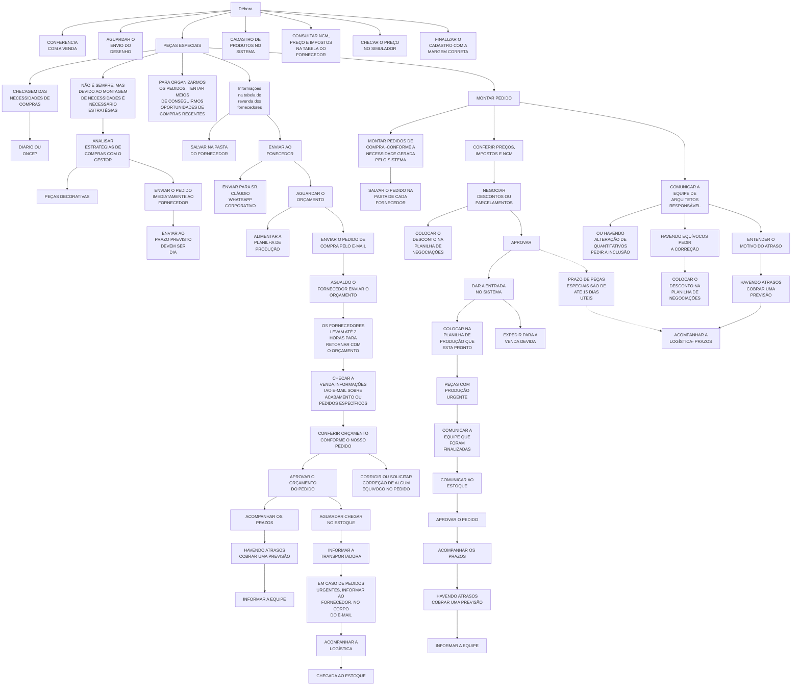

# Débora - Compras e Logística

Fonte: board Miro "fluxograma Lucenera" (consolidado), widget "Débora". Texto fiel ao board.

> **`D54` (PRAZO DE PEÇAS ESPECIAIS SÃO DE ATÉ 15 DIAS UTEIS)** é uma caixa de fluxo normal do board (não post-it), na mesma coluna vertical de `D21` (APROVAR) e do bloco `D53` (ACOMPANHAR A LOGÍSTICA- PRAZOS). Não constava na leitura original. A seta exata de entrada/saída não foi confirmada via conector (a leitura via API não expõe os conectores desse widget) — a ligação `D21 -.-> D54 -.-> D53` é inferida por proximidade espacial.

## Post-its do board (não são etapas do fluxo)

O board usa post-its cinza ao lado de algumas caixas, como observação/lembrete — não são etapas com seta de entrada/saída própria. Os seguintes não constavam na leitura original:

- Ao lado de `D1` (CHECAGEM DAS NECESSIDADES DE COMPRAS): **"DIARIAMENTE- É CRUCIAL"**.
- Ao lado de `D6` (ENVIAR O PEDIDO IMEDIATAMENTE AO FORNECEDOR): **"DEVIDO AO PRAZO PRECISAMOS DEIXAR EM DIA"**.
- Ao lado de `D34` (CONFERIR ORÇAMENTO CONFORME O NOSSO PEDIDO): **"CONFERIR A REF, DESCRIÇÃO, PREÇO E ACABAMENTO. NCM (SE TIVER DESCRIMINADO NO ORÇ)."**

Além disso, dois nós tratados acima como caixas sequenciais do fluxo são, na verdade, post-its (confirmado por tipo de widget e posição no board), não etapas:

- `D9` ("Informações na tabela de revenda dos fornecedores") é um post-it ao lado de `D10`/`D11`, não uma etapa própria — o texto é fiel, mas a leitura como nó com setas de saída não reflete o board.
- `D32` ("OS FORNECEDORES LEVAM ATÉ 2 HORAS PARA RETORNAR COM O ORÇAMENTO") é um post-it ao lado de `D31` (AGUALDO O FORNECEDOR ENVIAR O ORÇAMENTO), não uma etapa seguinte no fluxo.
