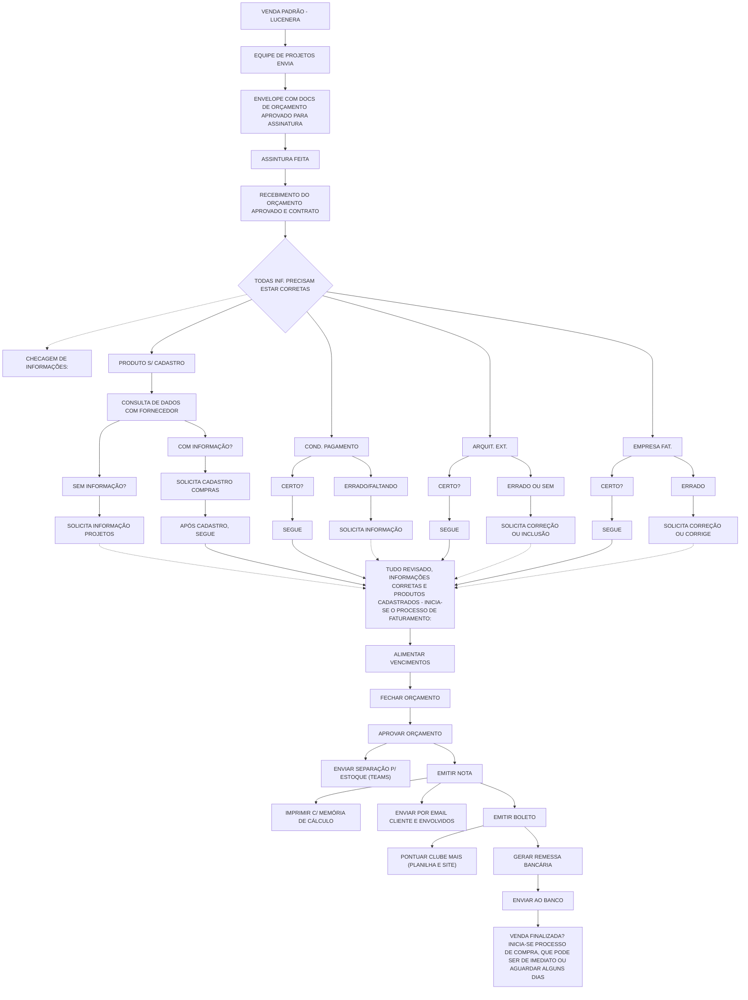
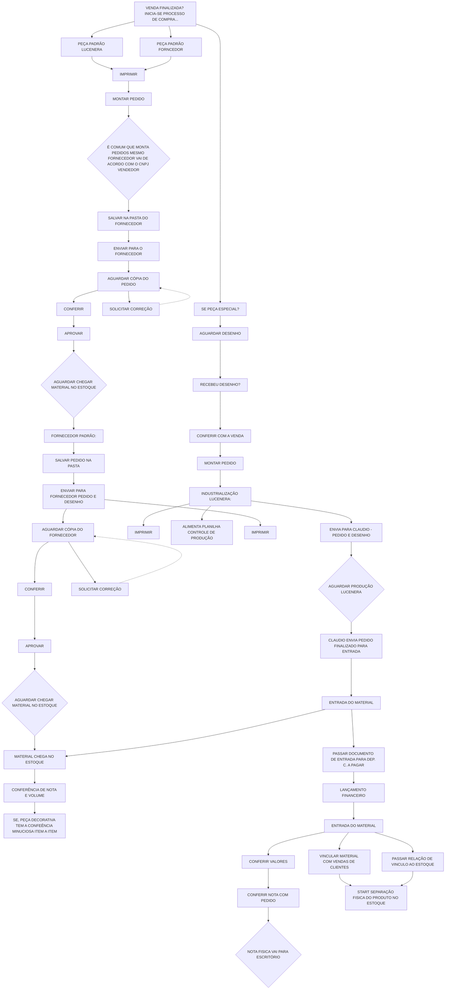
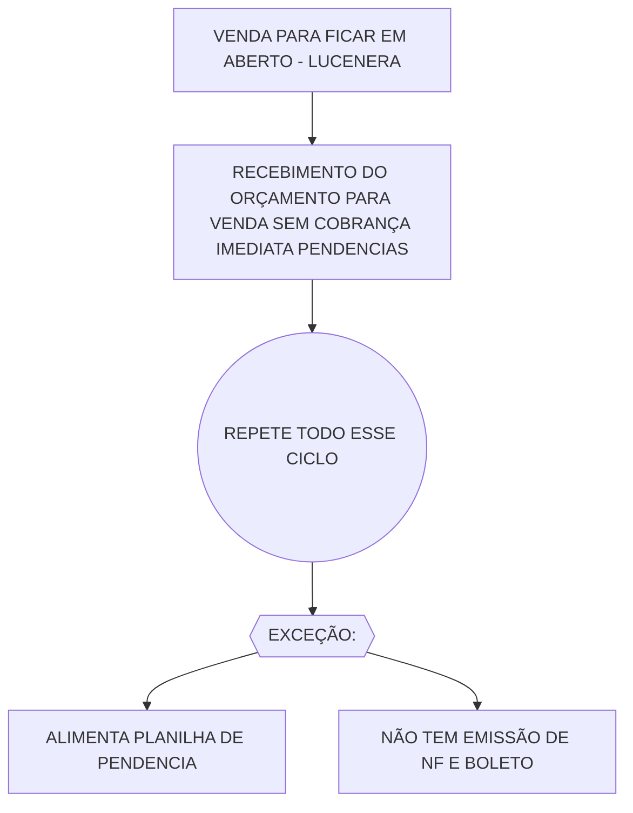
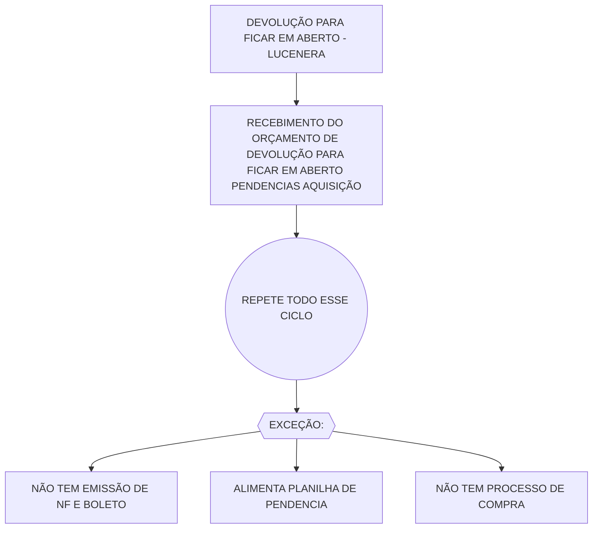
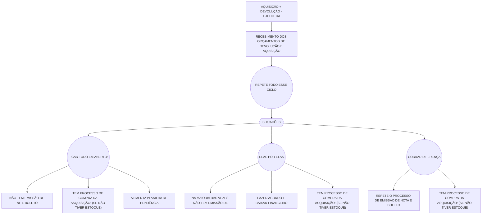
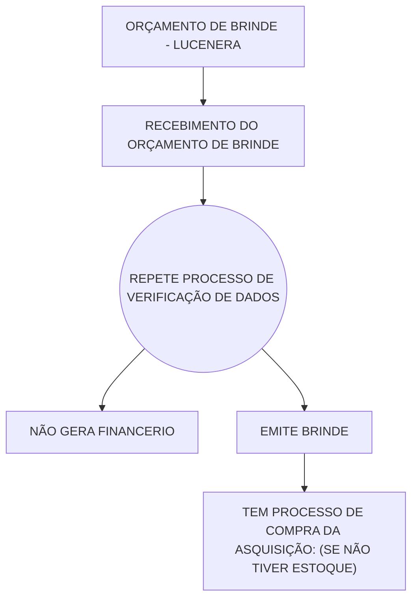

# Fluxo Comercial - Venda, Faturamento, Devolução e Aquisição

Fonte: board Miro "fluxograma Lucenera" (consolidado), widget "Faturamento Lucenera" (5 sub-processos lado a lado). Texto fiel ao board, incluindo erros de digitação originais (ex.: "ASSINTURA", "FORNCEDOR", "ASQUISIÇÃO", "FINANCERIO").

## 1. Venda Padrão - Lucenera

Fluxo principal: conferência de informações, faturamento e o sub-fluxo de compras (compartilhado/análogo nos demais processos desta página).

### Sub-fluxo de compras (a partir de "VENDA FINALIZADA?")

> O diamante cinza próximo a "CONFERIR/APROVAR" do ramo fornecedor padrão ficou parcialmente cortado na captura original — texto reconstruído por analogia ao diamante equivalente do outro ramo; vale confirmar no board se precisão exata for necessária.

## 2. Venda para Ficar em Aberto - Lucenera

## 3. Devolução para Ficar em Aberto - Lucenera

## 4. Aquisição + Devolução - Lucenera

## 5. Orçamento de Brinde - Lucenera

