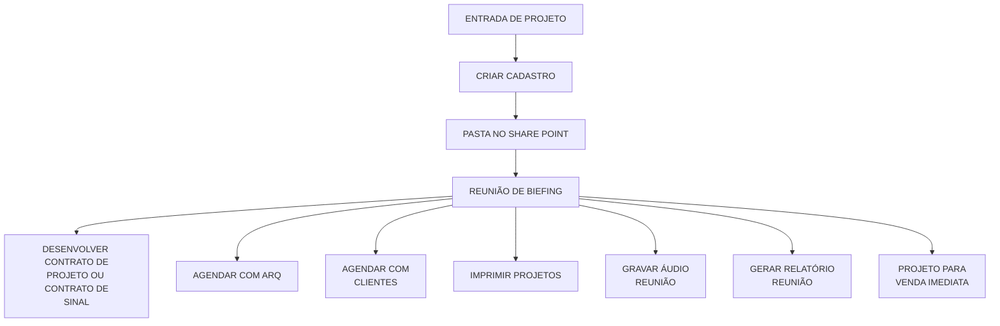
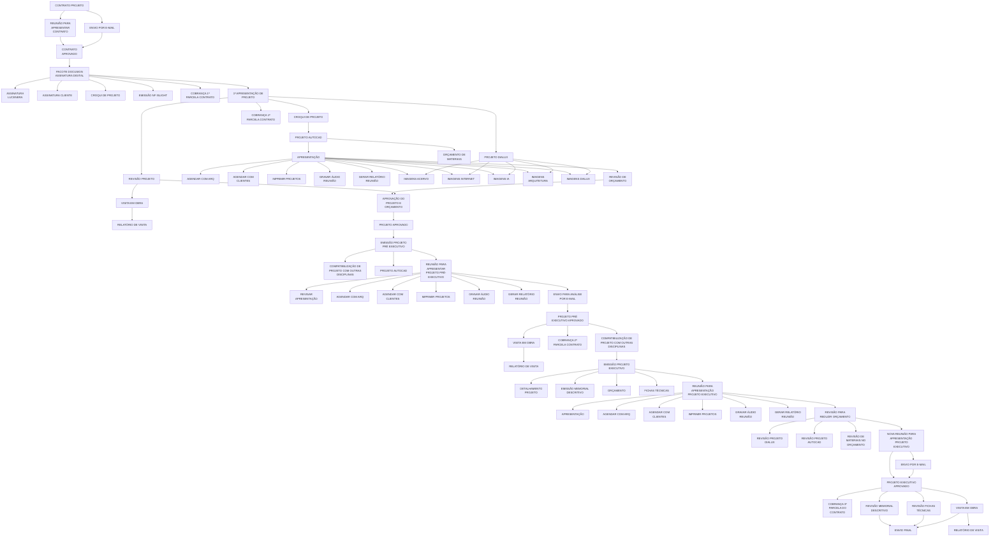
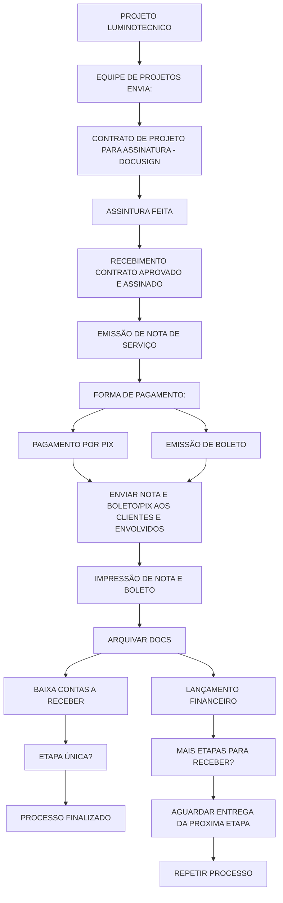

# Projeto Luminotécnico - Entrada, Contrato, Aprovação e Faturamento

Fonte: board Miro "fluxograma Lucenera" (consolidado), widgets do "Quadro 1" (Entrada de Projeto + ciclo de Contrato/Apresentação/Aprovação) e widget "Projeto Luminotécnico" (versão de faturamento). Texto fiel ao board.

## 1. Entrada de Projeto

> "REUNIÃO DE BIEFING" é o texto literal do board (erro de digitação de "BRIEFING"). "CRIAR CADASTRO" é destacado em vermelho no board. `E` conecta diretamente ao ciclo abaixo.

## 2. Ciclo de Contrato e Aprovação de Projeto

Continuação direta de "DESENVOLVER CONTRATO DE PROJETO OU CONTRATO DE SINAL". É o maior fluxo do board: assinatura de contrato, 1ª/2ª/3ª apresentações (preliminar, pré-executivo, executivo) e cobranças de parcela, terminando em "ENVIO FINAL".

> Não foi possível confirmar com 100% de certeza a direção de algumas conexões na junção entre "APRESENTAÇÃO"/"PROJETO DIALUX" e o cluster de imagens (ACERVO/INTERNET/IA/ARQUITETURA/DIALUX) — ambos parecem alimentar o mesmo cluster.

## 3. Projeto Luminotécnico (faturamento)

Versão de faturamento/contrato — aparece como widget próprio no board, com nome igual ao processo acima mas fluxo bem mais curto (foco em nota/boleto/cobrança, não em elaboração de projeto). Aparece duplicada em duas áreas do board com conteúdo idêntico; documentada uma única vez aqui.

