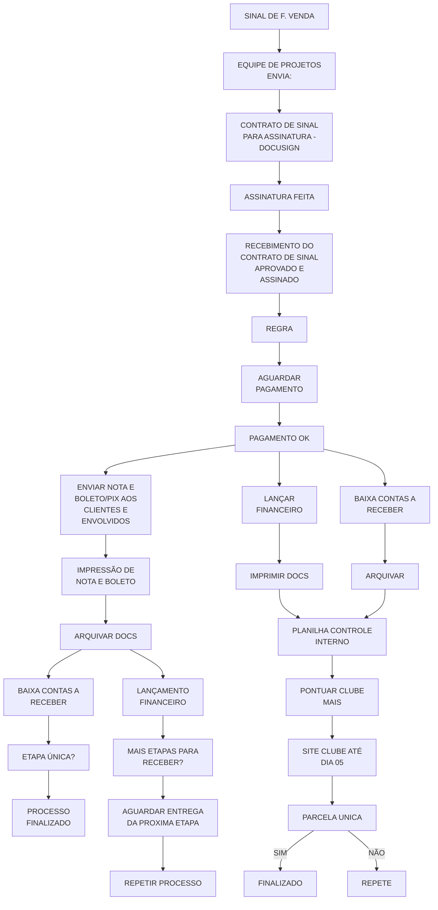

# Sinal de F. Venda

Fonte: board Miro "fluxograma Lucenera" (consolidado), widget "Sinal de F. Venda". Texto fiel ao board.

> Observações: há um nó parcialmente cortado nas capturas originais, ao lado de "AGUARDAR PAGAMENTO" (texto terminando em "...PIX/DADOS"), possivelmente um terceiro ramo de pagamento — não incluído por falta de confirmação visual completa. A ramificação exata entre "PAGAMENTO OK" e as duas colunas seguintes (envio direto de nota/boleto vs. lançamento financeiro/clube mais) pode ter um nó condicional intermediário não capturado (por analogia ao processo de Projeto Luminotécnico, que tem um nó explícito "FORMA DE PAGAMENTO:" nesse ponto).
