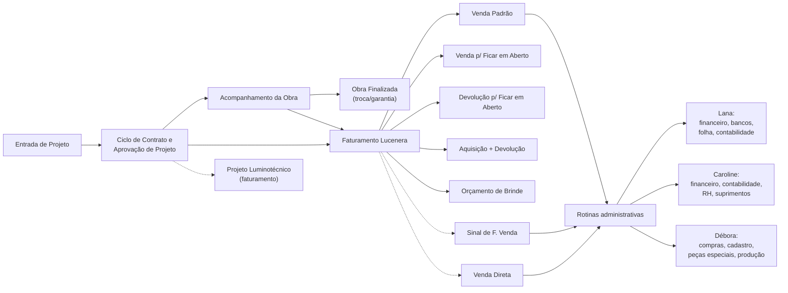

# Visão Panorâmica dos Processos do Board

Fonte: board Miro "fluxograma Lucenera" (consolidado, `https://miro.com/app/board/uXjVHEZy9vM=/`). Mapa de alto nível de como os processos detalhados (arquivos `01` a `09`) se conectam. Para o detalhe de cada caixa, ver o arquivo correspondente.

## Onde encontrar cada processo

| Arquivo | Processos |
|---|---|
| `05_projeto_luminotecnico.md` | Entrada de Projeto · Ciclo de Contrato e Aprovação de Projeto · Projeto Luminotécnico (faturamento) |
| `09_troca_garantia_luminaria.md` | Acompanhamento da Obra · Obra Finalizada |
| `04_fluxo_comercial_faturamento_estoque.md` | Venda Padrão · Venda p/ Ficar em Aberto · Devolução p/ Ficar em Aberto · Aquisição + Devolução · Orçamento de Brinde |
| `06_sinal_de_fechamento_venda.md` | Sinal de F. Venda |
| `07_venda_direta.md` | Venda Direta |
| `01_lana_financeiro_administrativo.md` | Lana |
| `02_caroline_administrativo_suprimentos.md` | Caroline |
| `03_debora_compras_cadastro_producao.md` | Débora |

> As conexões pontilhadas (`-.->`) no diagrama acima representam ligações temáticas/de nome compartilhado entre processos cuja seta exata de conexão não foi confirmada no board (ex.: "Projeto Luminotécnico" faturamento usa o mesmo nome do ciclo de contrato, mas é um widget separado).
