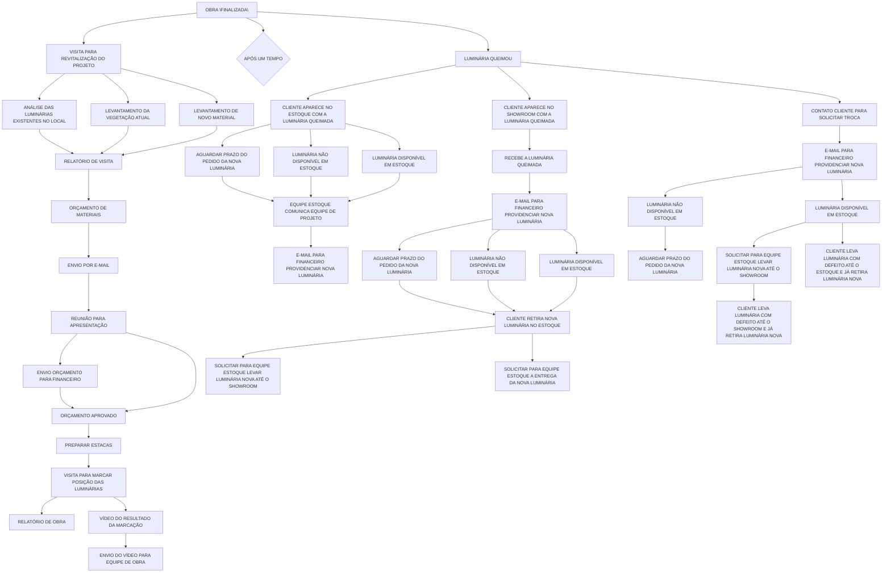

# Acompanhamento da Obra e Obra Finalizada

Fonte: board Miro "fluxograma Lucenera" (consolidado), widgets "Acompanhamento da Obra" e "Obra Finalizada" (sequenciais). Texto fiel ao board.

## 1. Acompanhamento da Obra

```mermaid
flowchart TD
    A[ACOMPANHAMENTO DA OBRA] --> VEO[VISITAS EM OBRA]
    VEO --> DLE[DESENHOS LUMINÁRIAS ESPECIAIS]
    VEO --> CME[CONFERÊNCIA DE MEDIDAS PARA PROJETO\nDE LUMINÁRIAS ESPECIAIS]
    VEO --> RDV[RELATÓRIOS DE VISITAS]
    A --> EDL[ENVIO DOS DESENHOS DE LUMINÁRIAS\nESPECIAIS PARA O COMPRAS LUCENERA]

    A --> RPA[REVISÃO PROJETO AUTOCAD]
    A --> APO[ALTERAÇÃO DE PROJETO EM OBRA]
    RPA --> RFT[REVISÃO FICHA TÉCNICA]
    APO --> ORD[ORÇAMENTO DEVOLUÇÃO]
    APO --> ORA[ORÇAMENTO AQUISIÇÃO]

    A --> RPP[RECEBIMENTO PROJETO PAISAGISMO]
    A --> RPM[RECEBIMENTO PROJETO DE MARCENARIA]

    RPP --> AEC[ANÁLISE E CROQUI]
    AEC --> PCAD[PROJETO CAD]
    PCAD --> ORP[ORÇAMENTO]
    ORP --> EPE[ENVIO POR E-MAIL]
    EPE --> RPAp[REUNIÃO PARA APRESENTAÇÃO]
    RPAp --> OAPP[ORÇAMENTO APROVADO]

    RPM --> GRR[GERAR RELATÓRIO REUNIÃO]
    RPM --> GAR[GRAVAR ÁUDIO REUNIÃO]
    RPM --> APR[APRESENTAÇÃO]
    RPM --> AGA[AGENDAR COM ARQ]
    RPM --> AGC[AGENDAR COM CLIENTES]
    RPM --> IPR[IMPRIMIR PROJETOS]
    GRR -.-> RPAp
    GAR -.-> RPAp
    APR -.-> RPAp
    AGA -.-> RPAp
    AGC -.-> RPAp
    IPR -.-> RPAp

    A --> EFV[ENVIO PARA FINANCEIRO PARA\nFORMALIZAR VENDA]

    EnvC[ENVIO PARA CLIENTE] --> MEE[MATERIAL EM ESTOQUE]
    EnvC --> MJE[MATERIAL JÁ ENTREGUE]
    MEE --> NES[NOTIFICAÇÃO PARA EQUIPE OBRA\nSEPARAR MATERIAL]
    MJE --> NES
    NES --> SEEB1[SOLICITAÇÃO PARA EQUIPE ESTOQUE BUSCAR]
    NES --> CTD[COMBINAR PARA TRAZEREM A DEVOLUÇÃO]
    SEEB1 --> EEst[ENTREGUE NO ESTOQUE]
    CTD --> EEst
    SEEB1 --> ESsr[ESTREGUE NO SHOWROOM]
    CTD --> ESsr
    EEst --> SEEB2[SOLICITAR PARA EQUIPE ESTOQUE BUSCAR]
    ESsr --> SEEB2
    EEst --> NFE[NOTIFICAR FINANCEIRO QUE O MATERIAL\nJÁ ESTÁ NO ESTOQUE PARA FINALIZAR DEVOLUÇÃO]

    ODA[ORÇAMENTO DEVOLUÇÃO APROVADO] --> EFF[ENVIO PARA FINANCEIRO PARA FORMALIZAR]
    OAA[ORÇAMENTO AQUISIÇÃO APROVADO] --> EFF
    PA[PROJETO APROVADO] --> EFF
    PA --> EPO[ENVIO PROJETO PARA OBRA]

    PA --> DPM[DETALHAMENTO PROJETO MARCENARIA]
    DPM --> EEM[ENVIO PARA EMPRESA MARCENARIA,\nOBRA E DEMAIS DISCIPLINAS]

    PA --> PEP[PRÉ EXECUTIVO PAISAGISMO]
    PEP --> PE1[PREPARAR ESTACAS]
    PE1 --> VMP1[VISITA PARA MARCAR POSIÇÃO\nDAS LUMINÁRIAS]
    VMP1 --> RO1[RELATÓRIO DE OBRA]
    VMP1 --> VRM1[VÍDEO DO RESULTADO DA MARCAÇÃO]
    VRM1 --> EVE1[ENVIO DO VÍDEO PARA EQUIPE DE OBRA]

    NMO[NECESSIDADE DE MATERIAL EM OBRA] --> CDE[CONFERIR DISPONIBILIDADE EM ESTOQUE]
    CDE --> GLS[GERAR LISTA DE SEPARAÇÃO]
    GLS --> ACE[AGENDAR COM EQUIPE ESTOQUE]
    NMO -.-> VMP1

    EOF2[ENVIO ORÇAMENTO PARA FINANCEIRO] --> OAP2[ORÇAMENTO APROVADO]
    OAP2 --> PE2[PREPARAR ESTACAS]
    PE2 --> VMP2[VISITA PARA MARCAR POSIÇÃO\nDAS LUMINÁRIAS]
    VMP2 --> RO2[RELATÓRIO DE OBRA]
    VMP2 --> VRM2[VÍDEO DO RESULTADO DA MARCAÇÃO]
    VRM2 --> EVE2[ENVIO DO VÍDEO PARA EQUIPE DE OBRA]

    RO1 -.-> REVOBRA[VISITA PARA REVITALIZAÇÃO\nDO PROJETO]
```

> O board tem dois nós "ACOMPANHAMENTO DA OBRA" ligados visualmente (provável recurso de desvio de linha do Miro, sem significado de processo). O ramo "PREPARAR ESTACAS → VISITA PARA MARCAR POSIÇÃO DAS LUMINÁRIAS → RELATÓRIO DE OBRA/VÍDEO" aparece duplicado (uma vez a partir de "PRÉ EXECUTIVO PAISAGISMO", outra a partir de "ENVIO ORÇAMENTO PARA FINANCEIRO") — mantido como dois ramos paralelos por fidelidade. `RO1` conecta à seção 2 abaixo via "VISITA PARA REVITALIZAÇÃO DO PROJETO", mas a seta exata de conexão não está visível em nenhuma captura — inferida pela proximidade espacial no board.

## 2. Obra Finalizada

Conecta-se ao final da seção 1 via "VISITA PARA REVITALIZAÇÃO DO PROJETO".

> O texto real no board é "LUMINÁRIA QUEIMOU" (não "LUMINÁRIA QUEBROU"). "APÓS UM TEMPO" e "LUMINÁRIA QUEIMOU" são ambos filhos diretos de "OBRA FINALIZADA" no mesmo nível (não um sub-nó do outro). A tríplice repetição do padrão "AGUARDAR PRAZO/LUMINÁRIA (NÃO) DISPONÍVEL" tem cobertura visual desigual entre as 3 colunas; a coluna 3 (H) tem menos certeza nas conexões finais.
