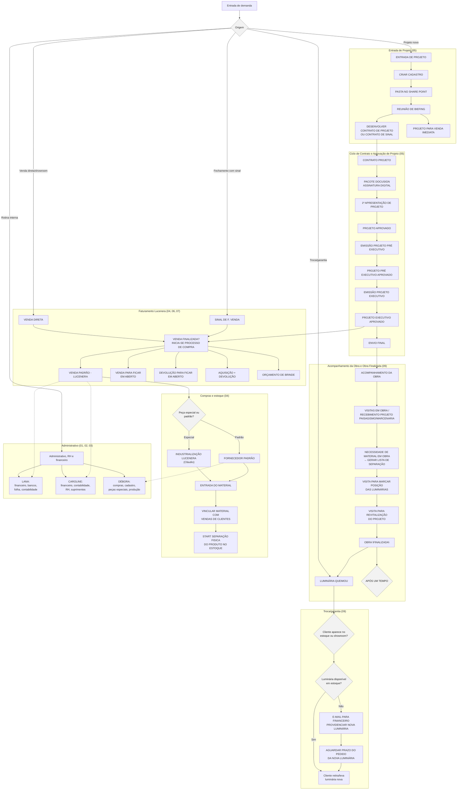

# Fluxo Total do Escritório Lucenera

Visão integrada dos processos do board Miro "fluxograma Lucenera" (consolidado). Este é um resumo de alto nível das ligações entre processos — para o detalhe completo de cada caixa (incluindo ramificações, decisões e textos exatos), ver os arquivos `01` a `09`.

> Este diagrama mostra apenas os nós de transição entre processos (não todas as ramificações internas). Para o detalhe completo e fiel de cada etapa — incluindo decisões, textos exatos e observações de ambiguidade — consulte os arquivos individuais listados em `00_indice_e_notas_de_leitura.md`.
